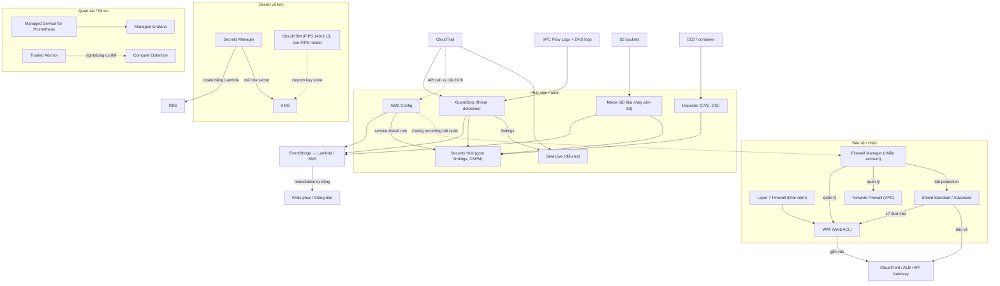

# 18 Security Deployment and Operations

Section này gom các dịch vụ bảo mật và vận hành mà đề SAA-C03 hay hỏi theo kiểu từ khóa: quản lý secret, firewall Layer 7 và chống DDoS, quản lý key bằng HSM, theo dõi compliance cấu hình, bộ ba phát hiện (Macie, Inspector, GuardDuty), quan sát hệ thống (Managed Grafana, Managed Service for Prometheus), tối ưu và best practice (Compute Optimizer, Trusted Advisor), firewall mạng và quản lý firewall tập trung (Network Firewall, Firewall Manager), cùng Security Hub và Detective để gom và điều tra findings. Nó dựa trên nền mã hóa, KMS, CloudTrail đã học ở các section trước và bổ sung lớp bảo vệ cho kiến trúc HA, serverless, CloudFront đã dựng.

← [[00 Home]] · Trước: [[_MOC 17 Hybrid and Migration]] · Sau: [[_MOC 19 CloudFormation]]

## Lộ trình học
1. [[Secrets Manager]] — lưu secret và **tự động rotate bằng Lambda**, tích hợp RDS; khác SSM Parameter Store ở rotation.
2. [[Layer 7 Firewall]] — firewall hiểu giao thức ứng dụng (HTTP header, path, nội dung), nền lý thuyết cho WAF.
3. [[WAF]] — Web ACL lọc HTTP/HTTPS (SQLi, XSS, geo, IP, rate limit), gắn CloudFront, ALB, API Gateway, AppSync.
4. [[Shield]] — chống DDoS: Standard miễn phí L3/L4; Advanced trả phí, có SRT, cost protection, L7 qua WAF.
5. [[CloudHSM]] — HSM single-tenant FIPS 140-3 Level 3 (KMS nay cũng đạt), khách hàng toàn quyền key, chạy được non-FIPS mode, API chuẩn PKCS#11/JCE/CNG/KSP/OpenSSL.
6. [[AWS Config]] — ghi lịch sử cấu hình resource và đánh giá compliance bằng Config Rules; phát hiện, không ngăn chặn.
7. [[Macie]] — khám phá và phân loại dữ liệu nhạy cảm (PII, PHI, credential) trong S3 bằng ML và pattern matching.
8. [[Amazon Managed Grafana]] — Grafana do AWS quản lý: dashboard truy vấn dữ liệu tại nguồn (CloudWatch, AMP, X-Ray, Azure Monitor…), kết nối VPC làm mọi traffic đi qua VPC.
9. [[Amazon Managed Service for Prometheus]] — lưu và truy vấn metric Prometheus (PromQL); không thu thập, collector tự dựng push vào remote write endpoint.
10. [[AWS Compute Optimizer]] — recommendation từng resource compute theo mức dùng thật (14 ngày miễn phí, 93 ngày trả phí), tự áp dụng được một số loại.
11. [[Inspector]] — quét lỗ hổng liên tục (CVE, CIS Benchmarks) và network reachability cho EC2, ECR image, Lambda.
12. [[GuardDuty]] — threat detection liên tục từ DNS logs, VPC Flow Logs, CloudTrail bằng ML + threat intelligence.
13. [[AWS Network Firewall]] — firewall managed cho traffic vào / ra VPC: firewall subnet + endpoint, stateless (5-tuple) và stateful (Suricata, domain list, IPS).
14. [[AWS Trusted Advisor]] — check best practice theo 6 nhóm; Basic/Developer chỉ có 6 core check + service limit, gói trả phí mới có mọi check và API.
15. [[AWS Security Hub]] — CSPM: gom findings (ASFF) và chấm điểm theo CIS, PCI DSS, AWS Foundational Security Best Practices.
16. [[AWS Firewall Manager]] — quản lý tập trung WAF, Network Firewall, SG, NACL, Shield Advanced cho mọi account trong Organization.
17. [[Amazon Detective]] — điều tra bảo mật trên graph sự kiện từ CloudTrail, VPC Flow Logs, GuardDuty findings.

## Bản đồ khái niệm

## Liên kết sang section khác
- [[KMS]] — dịch vụ key dùng chung, đối chiếu với CloudHSM và nền cho Secrets Manager.
- [[SSM Parameter Store]] — lưu config/SecureString, phân biệt với Secrets Manager.
- [[CloudTrail]] — ghi API call; nguồn log cho GuardDuty, phân biệt với AWS Config.
- [[VPC Flow Logs]] — nguồn log cho GuardDuty.
- [[Event-Driven Architecture]] — mẫu findings → EventBridge → Lambda/SNS lặp lại ở Config, Macie, GuardDuty.
- [[CloudFront Architecture]] — điểm gắn WAF và hấp thụ DDoS ở edge.
- [[Compare - ALB vs NLB]] — NLB không gắn được WAF.
- [[DDoS]] — kiến thức nền về các loại tấn công DDoS.
- [[Service Control Policies]] — dùng khi cần **ngăn** hành động, việc Config không làm được.
- [[Security Groups]] — firewall L4, không nhìn thấy nội dung HTTP.

## 🎯 Top mẹo thi của section
- **Secrets + rotation + RDS** → Secrets Manager (master password RDS/Aurora có managed rotation, không cần Lambda); giá trị cấu hình cần mã hóa / config phân cấp → Parameter Store SecureString ([[Secrets Manager]]).
- Lọc theo **HTTP header, URI, SQLi, XSS** → cần Layer 7, tức WAF; SG và NACL không thấy những thứ này ([[Layer 7 Firewall]]).
- WAF gắn được **CloudFront, ALB, API Gateway, AppSync**; **NLB không** → đổi sang ALB hoặc đặt CloudFront phía trước ([[WAF]]).
- Rate-based rule của WAF chỉ **BLOCK / COUNT / CAPTCHA / CHALLENGE**, không có ALLOW, đếm theo aggregation key (mặc định IP); HTTP flood (L7) → WAF rate-based rule. Web ACL 1500 WCU trong giá gốc, tối đa 5000 ([[WAF]]).
- DDoS miễn phí, tự động → **Shield Standard**; cần đội SRT 24/7, bồi hoàn chi phí scale, visibility → **Shield Advanced** ($3000/tháng/organization, phải bật thủ công) ([[Shield]]).
- **FIPS 140-3 Level 3** thì cả KMS và CloudHSM đều đạt (bản khóa cũ: CloudHSM 140-2 L3, KMS L2). Chọn **CloudHSM** khi cần HSM **single-tenant tự kiểm soát**, **thuật toán non-FIPS**, hoặc PKCS#11/JCE/CNG/KSP/OpenSSL; tích hợp dịch vụ AWS → KMS ([[CloudHSM]]).
- CloudHSM muốn HA phải dựng **cluster nhiều HSM ở nhiều AZ** ([[CloudHSM]]).
- "Cấu hình resource tuần trước thế nào", audit thay đổi cấu hình, compliance → **AWS Config**; nhưng Config **không prevent**. Recording continuous (mặc định) hoặc periodic 24 giờ; custom rule bằng Lambda hoặc Guard; remediation native bằng SSM Automation ([[AWS Config]]).
- Dữ liệu nhạy cảm **trong S3** (PII, PHI, thẻ tín dụng) → **Macie**; dữ liệu đặc thù dùng custom data identifier ([[Macie]]).
- **CVE / CIS Benchmarks / vulnerability findings** cho EC2, ECR image, Lambda → **Inspector** (quét liên tục; EC2 dùng SSM Agent hoặc agentless); network reachability **không bao giờ cần agent** ([[Inspector]]).
- Phân tích **DNS logs + VPC Flow Logs + CloudTrail** để tìm hành vi bất thường → **GuardDuty**; GuardDuty chỉ phát hiện, việc chặn do Lambda remediation làm ([[GuardDuty]]).
- Tự động phản ứng với finding → dịch vụ phát hiện → **EventBridge** → Lambda/SNS ([[GuardDuty]], [[Macie]], [[AWS Config]]).
- **Gom findings** nhiều dịch vụ, chấm điểm theo **CIS / PCI DSS** → **Security Hub** (regional, không retroactive, cần Config); **điều tra** lần theo login / API / traffic → **Detective** ([[AWS Security Hub]], [[Amazon Detective]]).
- Quản lý **WAF / SG / NACL / Network Firewall / Shield Advanced** cho **mọi account** trong Organization → **Firewall Manager** (Organizations all features + Config continuous) ([[AWS Firewall Manager]]).
- Lọc traffic vào / ra VPC theo **domain**, **IPS Suricata**, stateful có quản lý → **Network Firewall**: firewall subnet riêng, ingress route table trên IGW ([[AWS Network Firewall]]).
- **Rightsizing từng resource** theo mức dùng thật → **Compute Optimizer** (93 ngày với Enhanced Infrastructure Metrics; EC2 memory cần CloudWatch Agent) ([[AWS Compute Optimizer]]).
- **Trusted Advisor** gắn với support plan: Basic/Developer chỉ có 6 core check + service limit; **mọi check, API, event-driven** cần gói trả phí ([[AWS Trusted Advisor]]).
- Đội quen **Prometheus** → **AMP** (không thu thập, cần collector); dashboard Grafana không tự quản server → **Managed Grafana** (kết nối VPC thì mọi traffic qua VPC) ([[Amazon Managed Service for Prometheus]], [[Amazon Managed Grafana]]).
