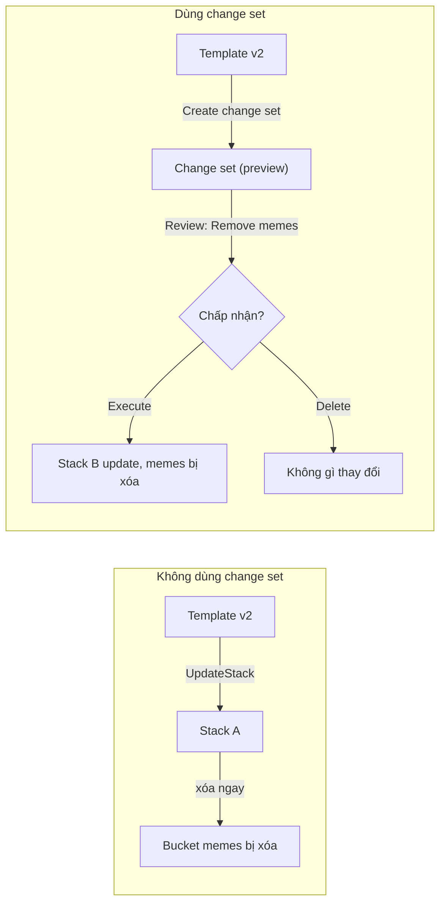

# CFN Change Sets

> **TL;DR:** Change set là bản **xem trước** những gì sẽ xảy ra với stack khi áp một template (hoặc parameter) mới: resource nào được thêm, sửa, xóa, có bị thay thế không. Không có gì thay đổi cho tới khi bạn chủ động **Execute** change set. Nhờ vậy việc update stack an toàn hơn trong môi trường IaC và CI/CD.

## 🖼️ Sơ đồ
![[CFN Change Sets.excalidraw]]
*Mở bằng plugin Excalidraw để chỉnh sửa · ảnh tĩnh: [[CFN Change Sets.svg]]*

## Khái niệm cốt lõi
- Các thao tác thường gặp với stack:
  - **CreateStack**: template → stack → tạo physical resources từ logical resources.
  - **DeleteStack**: xóa stack → xóa các physical resources nó quản lý.
  - **UpdateStack**: áp template mới (thêm resource, sửa lỗi...) vào stack hiện có → thay đổi physical resources **ngay lập tức**.
- Khi logical resource thay đổi, physical resource chịu một trong **ba kiểu tác động**:

| Kiểu update | Ý nghĩa | Ví dụ |
|---|---|---|
| **No interruption** | Đổi mà không ảnh hưởng hoạt động của resource | Đổi tag |
| **Some interruption** | Gián đoạn tạm thời, không mất dữ liệu nhưng ảnh hưởng dịch vụ | EC2 bị reboot hoặc stop/start (ví dụ đổi user data) |
| **Replacement** | Tạo bản mới của physical resource (ID mới), xóa bản cũ | Đổi thuộc tính không sửa tại chỗ được; **có thể mất dữ liệu** |

- **Change set** cho phép áp template mới vào stack nhưng **không thực thi ngay**: CloudFormation tạo một đối tượng riêng mô tả các thay đổi sẽ diễn ra.
- Một stack có thể có **nhiều change set** cùng lúc. Ví dụ tạo một change set cho mỗi phiên bản template để so sánh.
- Sau khi review: **xóa (discard)** change set, hoặc chọn **một** cái để **Execute**. Execute tạo ra thao tác UpdateStack bình thường, cập nhật logical và physical resources. Sau khi một change set được execute, các change set khác của stack đó bị CloudFormation xóa vì đã lỗi thời.
- Change set chỉ cho biết **CloudFormation sẽ làm gì**. Nó không đảm bảo update sẽ thành công (ví dụ có thể vẫn lỗi do quota, quyền IAM...).

## Cách hoạt động / Kiến trúc
Ví dụ trong bài: template v1 tạo 3 bucket `catpics`, `dogpics`, `memes`; template v2 bỏ `memes`.

- Kết quả cuối cùng khi Execute giống hệt update trực tiếp, nhưng ta có **khả năng nhìn thấy trước và kiểm soát**, đặc biệt có giá trị với template lớn và phức tạp.

## Demo / Lab
- Tạo stack `changesets` từ template 1 (3 bucket, tạo song song trong vài giây).
- Tab **Change sets** của stack (hoặc *Stack actions → Create change set for current stack*). Màn hình giống Update stack: chọn *Replace current template*, upload template 2.
- Đặt tên change set (nên theo dạng `<tên stack>-version2`), thêm mô tả "removing memes". Trạng thái chuyển `CREATE_PENDING` → `CREATE_COMPLETE`, execution status `AVAILABLE`.
- Lúc này **stack chưa đổi gì**: tab Resources vẫn đủ 3 bucket.
- Xem change set:
  - Tab **Changes**: danh sách thay đổi, ở đây là action **Remove** trên logical ID `memes` cùng physical ID của nó.
  - Tab **Template**: template trong change set (không còn `memes`).
  - Tab **JSON changes**: mỗi thay đổi là một object JSON, gồm `logicalResourceId`, `action` (Add/Modify/Remove), `physicalResourceId`, `resourceType`, `replacement` (True/False/Conditional, áp dụng với Modify)... Dùng được trong quy trình change management chặt chẽ.
- Bấm **Execute** → stack chạy update, `UPDATE_COMPLETE`, bucket `memes` bị xóa khỏi stack và tài khoản.

## 🎯 Mẹo thi SAA-C03
- Từ khóa: "**preview** thay đổi trước khi update stack", "xem resource nào sẽ bị **replace/xóa**", "change management", "review trước khi áp dụng trong pipeline CI/CD" → **Change Sets**.
- Bẫy: update stack trực tiếp thì áp **ngay**. Bỏ một resource khỏi template nghĩa là **xóa physical resource** (có thể mất dữ liệu). Muốn bảo vệ dữ liệu khi resource bị xóa hoặc replace thì dùng [[CFN Deletion Policy]] (Retain/Snapshot). Change set chỉ để **xem trước**, không bảo vệ.
- Phân biệt: Change set = xem trước thay đổi **sắp áp** từ template mới. Drift detection = phát hiện thay đổi **đã làm tay** ngoài CloudFormation. [[CFN StackSets]] = triển khai stack ra nhiều account/region.
- Kiểu update "Replacement" là kiểu nguy hiểm nhất. Change set chỉ ra trước resource nào bị replace.

## Liên kết
- Tiên quyết: [[CloudFormation Basics]], [[CFN Physical and Logical Resources]]
- Liên quan: [[CFN Deletion Policy]], [[CFN Stack Roles]], [[CFN Nested Stacks]], [[S3 Basics]]
- Phân biệt với: [[CFN StackSets]], [[cfn-hup]] (áp thay đổi metadata vào OS sau update)
- Section: [[_MOC 19 CloudFormation]]
