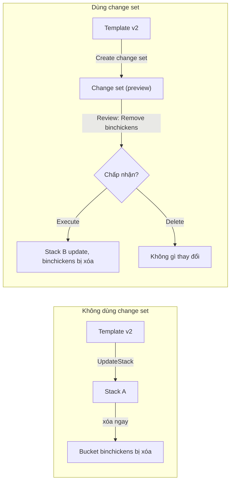

# CFN Change Sets

> **TL;DR:** Change set là bản **xem trước** những gì sẽ xảy ra với stack khi áp một template (hoặc parameter) mới: resource nào được thêm, sửa, xóa, có bị thay thế không. Không có gì thay đổi cho tới khi bạn chủ động **Execute** change set. Khi tạo change set, CloudFormation còn chạy **pre-deployment validation** (cú pháp property sai, trùng tên physical resource, chạm service quota) để bắt lỗi trước. Ngoài update còn có change set để **tạo stack mới**, **import** resource có sẵn và loại **drift-aware**. Nhờ vậy việc thay đổi stack an toàn hơn trong môi trường IaC và CI/CD.

## 🖼️ Sơ đồ
![[CFN Change Sets.excalidraw]]
*Mở bằng plugin Excalidraw để chỉnh sửa · ảnh tĩnh: [[CFN Change Sets.svg]]*

## Khái niệm cốt lõi
- Các thao tác thường gặp với stack:
  - **CreateStack**: template → stack → tạo physical resources từ logical resources.
  - **DeleteStack**: xóa stack → xóa các physical resources nó quản lý.
  - **UpdateStack**: áp template mới (thêm resource, sửa lỗi...) vào stack hiện có → thay đổi physical resources **ngay lập tức**.
- Khi logical resource thay đổi, physical resource chịu một trong **ba kiểu tác động**:

| Kiểu update | Ý nghĩa | Ví dụ |
|---|---|---|
| **No interruption** | Đổi mà không ảnh hưởng hoạt động của resource | Đổi tag |
| **Some interruption** | Gián đoạn tạm thời, không mất dữ liệu nhưng ảnh hưởng dịch vụ | EC2 bị reboot hoặc stop/start (ví dụ đổi user data) |
| **Replacement** | Tạo bản mới của physical resource (ID mới), xóa bản cũ | Đổi thuộc tính không sửa tại chỗ được; **có thể mất dữ liệu** |

- **Change set** cho phép áp template mới vào stack nhưng **không thực thi ngay**: CloudFormation tạo một đối tượng riêng mô tả các thay đổi sẽ diễn ra.
- Một stack có thể có **nhiều change set** cùng lúc. Ví dụ tạo một change set cho mỗi phiên bản template để so sánh.
- **Pre-deployment validation checks**: khi tạo change set, trước cả lúc cho xem preview, CloudFormation chạy một loạt kiểm tra và báo **ngay từ đầu** các lỗi như cú pháp property sai, nhiều resource muốn **cùng một tên physical**, hoặc sắp **chạm service quota**. Không có change set thì những lỗi này chỉ lộ ra giữa chừng khi update, làm hỏng một phần physical resource và phải dọn rollback.
- Sau khi review: **xóa (discard)** change set, hoặc chọn **một** cái để **Execute**. Execute tạo ra thao tác UpdateStack bình thường, cập nhật logical và physical resources. Sau khi một change set được execute, các change set khác của stack đó bị CloudFormation xóa vì đã lỗi thời (bản khóa cũ nêu, bài mới không nói).
- Change set chỉ cho biết **CloudFormation sẽ làm gì** và bắt trước một số lỗi qua validation. Nó vẫn không đảm bảo thao tác chắc chắn thành công.

### Các loại change set (bài mới)
| Loại | Dùng khi |
|---|---|
| **CREATE** | Stack **chưa tồn tại**: xem trước mọi resource sẽ được tạo rồi mới cho chạy, hợp với quy trình duyệt thay đổi không cho tạo stack mới khi chưa ai review |
| **UPDATE** | Áp template mới vào stack đang chạy (cách dùng truyền thống) |
| **IMPORT** | Đưa resource **không do CloudFormation tạo** vào dưới sự quản lý của một stack |
| **Drift-aware** | Xét cả **trạng thái thật** của resource: nếu ai đó đã sửa resource ngoài CloudFormation (drift), change set cho thấy tác động lên phần bị drift, và execute sẽ đưa mọi resource về đúng template mới. Nó so ba thứ: template hiện tại, template mới, trạng thái thật của môi trường |

## Cách hoạt động / Kiến trúc
Ví dụ trong bài: template v1 tạo 3 bucket `koalas`, `crocs`, `binchickens`; template v2 bỏ `binchickens` (bản khóa cũ: `catpics`, `dogpics`, `memes`).

- Kết quả cuối cùng khi Execute giống hệt update trực tiếp, nhưng ta có **khả năng nhìn thấy trước và kiểm soát**, đặc biệt có giá trị với template lớn và phức tạp.

## Demo / Lab
Video 329 (bản khóa mới; demo cũ dùng stack `changesets`, chỉ có change set cho update):
- Hai template: template 1 tạo 3 bucket `koalas`, `crocs`, `binchickens`; template 2 bỏ `binchickens`.
- **Import**: ở Create stack có lựa chọn **With existing resources**, wizard tạo stack mới từ resource đã có sẵn (luồng import). Với stack đang chạy thì dùng *Stack actions → Import resources into stack*.
- **Change set lúc tạo stack**: upload template 1, đặt tên stack, tới trang cuối thì thay vì **Submit** bấm **Create change set** (đặt tên, ví dụ `changesets-create1`, thêm mô tả). Stack xuất hiện ở trạng thái **`REVIEW_IN_PROGRESS`**, chưa tạo resource nào.
- Xem change set:
  - Tab **Resource changes**: action **Add** cho 3 bucket (với update thì có cột Replacement…).
  - Tab **Deployment validations** (mới): lỗi CloudFormation phát hiện trước khi triển khai.
  - Tab **Input**, **Template**: template đã dùng.
  - Tab **JSON changes**: mỗi thay đổi là một object JSON, gồm `logicalResourceId`, `action` (Add/Modify/Remove), `resourceType`, `physicalResourceId`, `replacement` (với Modify)... Dùng được trong quy trình change management chặt chẽ.
- **Execute**: hộp thoại cho xem **Behavior on provisioning failure** (roll back toàn bộ stack về trạng thái ổn định gần nhất, hoặc **preserve successfully provisioned resources**: giữ resource đã tạo thành công, chỉ rollback phần lỗi) và cách xử lý resource vừa tạo khi rollback (theo deletion policy hoặc xóa hết). Hành vi rollback được chốt lúc tạo change set, lúc execute không đổi được. Tùy chọn này cũng có khi tạo stack bình thường.
- **Drift-aware change set** cho update: Create change set → chọn loại *Drift-aware change set* (thay vì *Standard*) → *Replace existing template* → upload template 2. Change set báo action **Remove** cho `binchickens`; vì môi trường chưa bị sửa tay nên không có drift nào khác.
- Lúc chưa execute thì **stack chưa đổi gì**. Execute xong stack chỉ còn 2 bucket. Cuối cùng xóa stack.

## 🎯 Mẹo thi SAA-C03
- Từ khóa: "**preview** thay đổi trước khi update stack", "xem resource nào sẽ bị **replace/xóa**", "change management", "review trước khi áp dụng trong pipeline CI/CD" → **Change Sets**.
- Bẫy: update stack trực tiếp thì áp **ngay**. Bỏ một resource khỏi template nghĩa là **xóa physical resource** (có thể mất dữ liệu). Muốn bảo vệ dữ liệu khi resource bị xóa hoặc replace thì dùng [[CFN Deletion Policy]] (Retain/Snapshot). Change set chỉ để **xem trước**, không bảo vệ.
- Phân biệt: Change set = xem trước thay đổi **sắp áp** từ template mới. Drift detection = phát hiện thay đổi **đã làm tay** ngoài CloudFormation; **drift-aware change set** kết hợp cả hai: xem trước template mới có tính tới drift và đưa resource về đúng template. [[CFN StackSets]] = triển khai stack ra nhiều account/region.
- "Bắt lỗi template (cú pháp, trùng tên, quota) **trước** khi triển khai, tránh rollback giữa chừng" → tạo **change set** (pre-deployment validation).
- "Phải duyệt trước cả khi **tạo stack mới**" → change set loại CREATE; "đưa resource tạo tay vào CloudFormation quản lý" → **import**.
- Kiểu update "Replacement" là kiểu nguy hiểm nhất. Change set chỉ ra trước resource nào bị replace.

## Liên kết
- Tiên quyết: [[CloudFormation Basics]], [[CFN Physical and Logical Resources]]
- Liên quan: [[CFN Deletion Policy]], [[CFN Stack Roles]], [[CFN Nested Stacks]], [[S3 Basics]]
- Phân biệt với: [[CFN StackSets]], [[cfn-hup]] (áp thay đổi metadata vào OS sau update)
- Section: [[_MOC 19 CloudFormation]]
