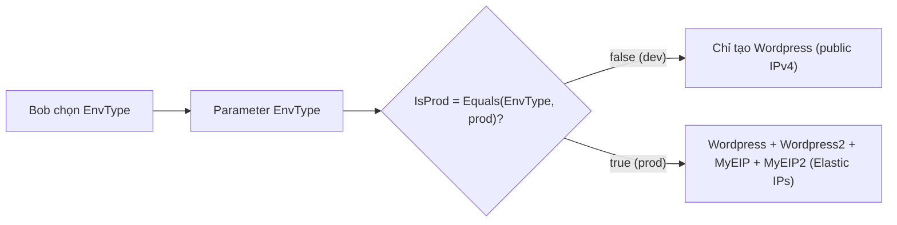

# CFN Conditions

> **TL;DR:** Section `Conditions` định nghĩa các điều kiện, mỗi điều kiện cho ra **true/false** nhờ intrinsic function (`Equals`, `If`, `Not`, `And`, `Or`). Resource gắn một condition thì **chỉ được tạo khi condition đúng**. Nhờ vậy cùng một template triển khai được hạ tầng khác nhau cho dev và prod, hoặc cho 1, 2 hay 3 AZ.

## 🖼️ Sơ đồ
![[CFN Conditions.excalidraw]]
*Mở bằng plugin Excalidraw để chỉnh sửa · ảnh tĩnh: [[CFN Conditions.svg]]*

## Khái niệm cốt lõi
- `Conditions` là section **tùy chọn**, chứa được **nhiều** condition.
- **Thứ tự xử lý**: CFN **đánh giá Conditions trước**, sau đó mới xử lý `Resources` và tạo physical resource.
- Condition dùng các hàm `Fn::Equals`, `Fn::If`, `Fn::Not`, `Fn::And`, `Fn::Or` ([[CFN Intrinsic Functions]]) để cho ra true hoặc false.
- Mọi logical resource đều gắn được `Condition: TenCondition`:
  - **Không có condition**: luôn được tạo.
  - Có condition **true**: được tạo.
  - Có condition **false**: **không** tạo physical resource.
- Ví dụ dùng:
  - Parameter số AZ (1/2/3) kèm các condition `OneAZ`/`TwoAZ`/`ThreeAZ`. Template chứa sẵn bộ resource cho từng AZ, mỗi bộ chỉ tạo khi condition tương ứng đúng.
  - Parameter `EnvType` (dev/prod) quyết định kích thước instance hoặc có tạo thêm resource HA hay không.
- **Lồng condition**: ví dụ `IsProd` và `CreateS3Bucket`, rồi condition thứ ba (dùng `Fn::And`) chỉ đúng khi bucket được tạo **và** là prod. Condition thứ ba quyết định có gắn bucket policy không.
- Ngoài việc bật/tắt resource, `!If [Cond, ValueTrue, ValueFalse]` còn chọn **giá trị property** theo điều kiện (ví dụ `InstanceType`), và có thể kết hợp với `AWS::NoValue` để bỏ hẳn property.

## Cách hoạt động / Kiến trúc
Ví dụ trên slide (template "pseudo-CFN", rút gọn):
```yaml
Parameters:
  EnvType:
    Default: 'dev'
    Type: String
    AllowedValues: ['dev', 'prod']
Conditions:
  IsProd: !Equals [ !Ref EnvType, 'prod' ]
Resources:
  Wordpress:      # không có Condition, luôn tạo
    Type: 'AWS::EC2::Instance'
  Wordpress2:
    Type: 'AWS::EC2::Instance'
    Condition: IsProd
  MyEIP:
    Type: AWS::EC2::EIP
    Condition: IsProd
    Properties: { InstanceId: !Ref Wordpress }
  MyEIP2:
    Type: AWS::EC2::EIP
    Condition: IsProd
    Properties: { InstanceId: !Ref Wordpress2 }
```



- Dev: chỉ 1 instance dùng public IPv4. Prod: 2 instance, mỗi instance có một Elastic IP.

## 🎯 Mẹo thi SAA-C03
- "Một template cho nhiều môi trường, prod có thêm resource hoặc resource lớn hơn" → **Parameter + Conditions** (+ `Fn::If` cho giá trị property).
- Nhớ quy trình 3 bước: **parameter → condition (true/false) → resource dùng `Condition:`**.
- Conditions được đánh giá **trước** Resources. Resource có condition false thì không bị tạo, không phải tạo xong rồi xóa.
- Phân biệt: [[CFN Mappings]] để **tra giá trị**, Conditions để **quyết định có tạo hay không** (hoặc chọn giá trị).

## Liên kết
- Tiên quyết: [[CFN Template and Pseudo Parameters]], [[CFN Intrinsic Functions]]
- Liên quan: [[CFN Mappings]], [[CloudFormation Basics]] (giới thiệu conditions 2 bước), [[EC2 Network Interfaces IPs and DNS]] (public IPv4 và Elastic IP)
- MOC: [[_MOC 19 CloudFormation]]
