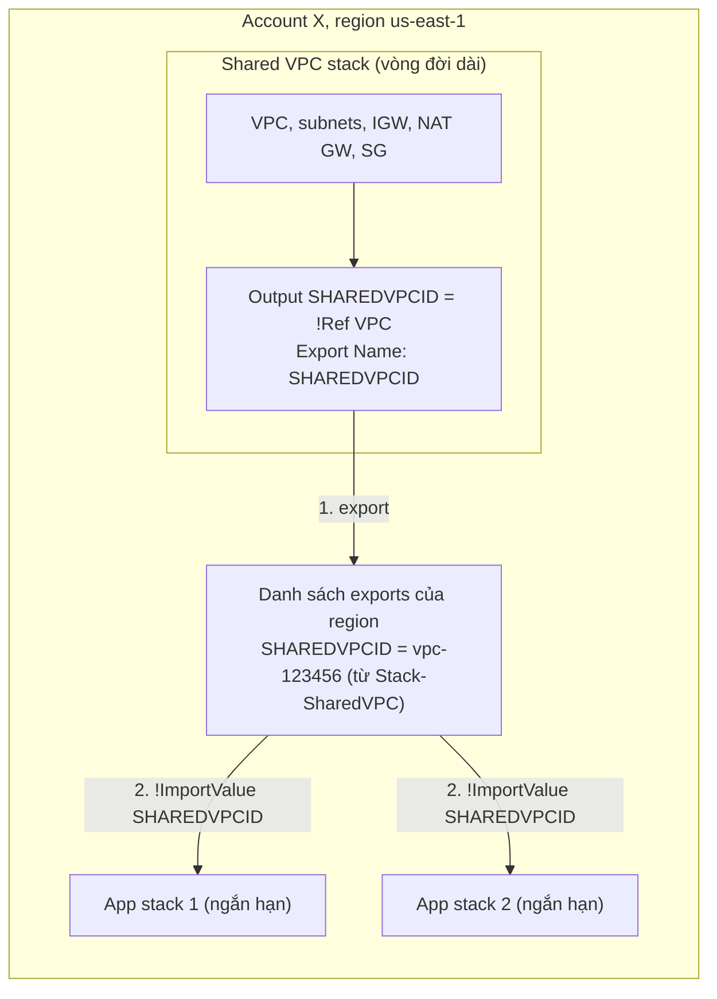

# CFN Cross-Stack References

> **TL;DR:** Cross-stack reference cho phép một stack dùng **resource thật** do stack khác tạo: stack nguồn **export** một output dưới một tên duy nhất trong region, stack khác lấy giá trị bằng `Fn::ImportValue` thay vì `Ref`. Dùng cho shared services (ví dụ **shared VPC**), kiến trúc service-oriented và các phần có **vòng đời khác nhau**. Chỉ hoạt động trong **cùng account và cùng region**.

## 🖼️ Sơ đồ
![[CFN Cross-Stack References.excalidraw]]
*Mở bằng plugin Excalidraw để chỉnh sửa · ảnh tĩnh: [[CFN Cross-Stack References.svg]]*

![[CFN Cross-Stack References - compare.excalidraw]]
*Mở bằng plugin Excalidraw để chỉnh sửa · ảnh tĩnh: [[CFN Cross-Stack References - compare.svg]]*

## Khái niệm cốt lõi
### Vấn đề: stack cô lập
- Stack được thiết kế **tự chứa và cô lập**, có ranh giới logic quanh mỗi stack. Mặc định, thứ trong stack này **không tham chiếu được** từ stack khác.
- `Ref` chỉ dùng **trong cùng stack** ([[CFN Intrinsic Functions]]).
- [[CFN Outputs|Outputs]] bình thường chỉ hiện trên **console UI và CLI**, stack khác không đọc được.
- Ngoại lệ duy nhất: root stack đọc outputs của [[CFN Nested Stacks|nested stack]]. Nhưng như vậy các stack bị **buộc chung vòng đời**.
- Giới hạn của nested stack: dùng lại template VPC chỉ là dùng lại **code**. 10 root stack giống nhau → 10 VPC riêng.
- Cách "chữa cháy": nhập tay VPC ID, subnet ID vào AppStack1, AppStack2 làm parameter. Nhưng đó là **giá trị tĩnh**, không phải tham chiếu.

### Ví dụ nhu cầu
- Một **shared VPC** được thiết kế và bảo mật kỹ, sống lâu dài; nhiều **application stack** trong cùng region và account triển khai EC2 vào subnet của nó.
- Công ty phần mềm: mỗi commit lên GitHub thì dùng CloudFormation dựng môi trường, chạy test, rồi xóa. Có thể tạo VPC riêng mỗi lần (nested stack), nhưng để **tiết kiệm chi phí** thì dùng chung VPC, chung [[NAT Gateway|NAT gateways]], chung subnet.

### Export và ImportValue
- **Export** được khai báo **bên trong một output** của stack. Nó đưa giá trị output vào **danh sách exports** dưới một **export name**.
- Danh sách exports là **riêng cho từng region của từng account**. Mỗi region trong account có danh sách riêng; account khác cũng có danh sách riêng của họ.
- **Export name phải duy nhất trong một region của account**. Ví dụ chỉ có một `SHAREDVPCID` trong us-east-1 của account đó.
- Thứ thường export từ shared VPC stack: VPC ID, subnet IDs, CIDR ranges, Security Group IDs, bất cứ thứ gì stack khác cần.
- Stack dùng gọi **`Fn::ImportValue`** với export name thay cho `Ref`, và nhận về giá trị đã export.
- **Không hỗ trợ cross-region hay cross-account.**

```yaml
# Stack nguồn: Shared VPC stack
Outputs:
  SHAREDVPCID:
    Description: Shared Services VPC
    Value: !Ref VPC
    Export:
      Name: SHAREDVPCID

# Stack dùng: App stack (cùng account, cùng region)
Resources:
  AppSubnet:
    Type: AWS::EC2::Subnet
    Properties:
      VpcId: !ImportValue SHAREDVPCID
      ...
```

## Cách hoạt động / Kiến trúc


Quy trình 3 bước:
1. Trong stack nguồn, đưa giá trị cần chia sẻ vào **Outputs** (ví dụ `Value: !Ref VPC`).
2. Thêm **`Export: Name`** để đẩy giá trị vào danh sách exports của region.
3. Ở mỗi stack cần dùng, gọi **`!ImportValue <export name>`**.

Bổ sung theo hành vi hiện tại của AWS (bài giảng không nói):
- **Không xóa được** stack nguồn, cũng **không sửa/xóa được** một export, khi export đó còn đang được stack khác import. Phải gỡ import trước. Đây là cơ chế bảo vệ resource dùng chung.
- Muốn chia sẻ giá trị qua region/account thì phải dùng cách khác, ví dụ lưu vào [[SSM Parameter Store]] hoặc dùng [[CFN Custom Resources]].

## Bảng so sánh: Nested Stacks vs Cross-Stack References

| Tiêu chí | [[CFN Nested Stacks]] | Cross-Stack References |
|---|---|---|
| Tái sử dụng gì | **Template (code)**: mỗi lần dùng tạo resource mới | **Stack (resource thật)**: nhiều stack dùng chung một resource |
| Vòng đời | **Lifecycle linked**: tạo/update/xóa cùng nhau | **Vòng đời độc lập**: shared dài hạn, app ngắn hạn |
| Cơ chế lấy giá trị | Root đọc `GetAtt <Nested>.Outputs.X` | Output + `Export`, bên dùng `Fn::ImportValue` |
| Ai tạo các stack | Root stack tự tạo stack con | Mỗi stack được tạo riêng, độc lập |
| Phạm vi | Trong cấu trúc root stack | Cùng account + cùng region |
| Ví dụ điển hình | VPC + AD + App của **một** giải pháp; vượt 500 resource | **Shared VPC**, shared services, service-oriented architecture |
| Thay đổi thường xuyên một phần | Không phù hợp | Phù hợp: chỉ update stack liên quan |

## 🎯 Mẹo thi SAA-C03
- Adrian: hiểu khác biệt nested stacks và cross-stack references là **thiết yếu** cho kỳ thi, và chọn sai ngoài thực tế cho kết quả "không lý tưởng".
- **Template không phải stack**: template dùng để tạo một hoặc nhiều stack, mỗi stack là duy nhất. Reuse **template** → nested stacks. Reuse **stack/resource** → cross-stack references.
- Từ khóa cho cross-stack: "shared services VPC", "nhiều ứng dụng ngắn hạn dùng chung hạ tầng", "service-oriented", "vòng đời khác nhau (long vs short)", "tham chiếu resource của stack khác", "export/import".
- Export name **duy nhất trong region của account**; `Fn::ImportValue` **thay cho `Ref`**; **không cross-region, không cross-account**.
- Đề cho tình huống cần nhiều account/region dùng chung template → [[CFN StackSets]], không phải cross-stack.
- Nhập tay ID vào parameter là giá trị tĩnh, không phải tham chiếu: đáp án đúng khi đề hỏi "tham chiếu động" là Export/ImportValue.

## Liên kết
- Tiên quyết: [[CloudFormation Basics]], [[CFN Outputs]], [[CFN Intrinsic Functions]], [[CFN Physical and Logical Resources]]
- Phân biệt với: [[CFN Nested Stacks]], [[CFN StackSets]]
- Liên quan: [[Custom VPC]], [[VPC Subnets]], [[NAT Gateway]], [[Security Groups]], [[SSM Parameter Store]], [[CFN Custom Resources]]
- Section: [[_MOC 19 CloudFormation]]
