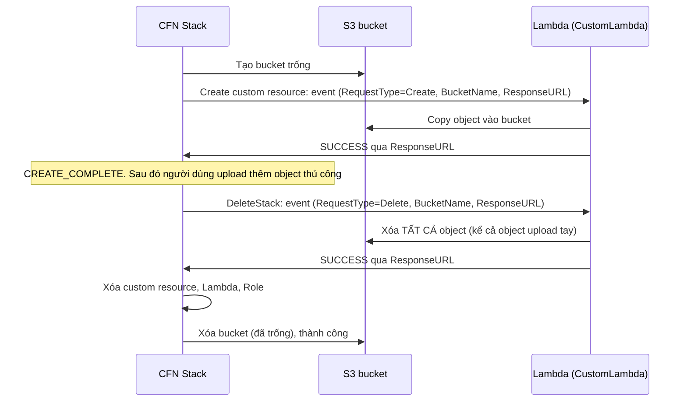

# CFN Custom Resources

> **TL;DR:** Custom resource là một loại logical resource cho phép CloudFormation làm những việc nó **chưa hỗ trợ hoặc không hỗ trợ native**, hoặc tích hợp với hệ thống bên ngoài. Mỗi khi custom resource được create, update hay delete, CloudFormation gửi event tới một **Lambda function hoặc SNS topic** do bạn chỉ định. Code xử lý rồi trả kết quả (và dữ liệu) về qua **ResponseURL**.

## 🖼️ Sơ đồ
![[CFN Custom Resources.excalidraw]]
*Mở bằng plugin Excalidraw để chỉnh sửa · ảnh tĩnh: [[CFN Custom Resources.svg]]*

## Khái niệm cốt lõi
- Logical resources trong template mô tả **cái bạn muốn**. CFN dùng chúng để **create, update, delete** physical resources (xem [[CFN Physical and Logical Resources]]).
- CloudFormation **không hỗ trợ mọi thứ**: nó thường chậm hơn so với tính năng/sản phẩm mới, và có những việc nó không bao giờ hỗ trợ.
- Custom resource giải quyết việc đó: **gửi dữ liệu tới một thứ gì đó, nhận dữ liệu về từ thứ đó**.
- Ví dụ ứng dụng:
  - **Nạp object vào S3 bucket** ngay khi bucket được tạo.
  - **Xóa sạch object trong bucket** trước khi bucket bị xóa. Bình thường xóa stack chứa bucket còn object thì sẽ **lỗi**.
  - Lấy thông tin cấu hình từ hệ thống bên ngoài khi dựng EC2.
  - Provision cả **tài nguyên ngoài AWS**.

### Khai báo trong template
- `Type: Custom::<TênTùyÝ>` (ví dụ `Custom::S3Objects`), hoặc `AWS::CloudFormation::CustomResource`.
- `Properties`:
  - **`ServiceToken`**: thuộc tính **bắt buộc duy nhất**. Là ARN của thứ đứng sau custom resource (**Lambda function** hoặc **SNS topic**), nơi CloudFormation gửi event.
  - Các property khác là tùy ý và được chuyển nguyên vào event (trong demo: `SourceBucket`, `SourcePrefix`, `Bucket`).

### Event và response
- **Event** CloudFormation gửi đi có: `RequestType` (**Create / Update / Delete**), `ResponseURL`, `StackId`, `RequestId`, `LogicalResourceId`, `ResourceProperties` (các property trong template).
- Code xử lý xong phải gửi **response** (JSON) tới **ResponseURL** (một pre-signed S3 URL, xem [[S3 Presigned URLs]]) với `Status` là `SUCCESS` hoặc `FAILED`, kèm `PhysicalResourceId` và `Data` tùy chọn.
- Nếu SUCCESS: resource được đánh dấu hoàn tất, `Data` trả về được dùng ở chỗ khác trong template (qua `Fn::GetAtt`, xem [[CFN Intrinsic Functions]]).
- Nếu code không bao giờ gửi response, stack bị treo ở trạng thái `IN_PROGRESS` cho tới khi hết timeout (mặc định 1 giờ; hiện có thể đặt ngắn hơn bằng property `ServiceTimeout`; khóa học không nhắc chi tiết này).

## Cách hoạt động / Kiến trúc
**Không có custom resource:** template → stack → bucket trống. Một người (Gabby) upload object thủ công, khiến physical resource **lệch** khỏi những gì CloudFormation biết. Xóa stack → xóa bucket **lỗi: bucket not empty**.

**Có custom resource (Lambda-backed):**

- **Thứ tự phụ thuộc là mấu chốt**: custom resource tham chiếu bucket (và Lambda), nên có **implicit dependency** (không cần [[CFN DependsOn]]). Khi tạo: bucket trước, custom resource sau. Khi xóa: CloudFormation đi **ngược thứ tự phụ thuộc**, nên custom resource bị xóa **trước** bucket. Lambda kịp dọn bucket rồi bucket mới bị xóa.

## Demo / Lab
**Phần 1: bucket thường (`S3BucketNormal`)**
- Template chỉ có `AnimalPics` kiểu `AWS::S3::Bucket`. Tạo rồi xóa stack khi bucket trống: không lỗi.
- Tạo lại, upload 2 ảnh mèo (Anna, Yuri), rồi xóa stack → **DELETE_FAILED** vì không xóa được bucket còn object.
- Xử lý: vào S3 **Empty** bucket (gõ "permanently delete"), rồi xóa stack lại. Console còn cho tùy chọn **retain** resource bị lỗi để xóa phần còn lại của stack, nhưng ở đây không cần vì bucket đã trống.

**Phần 2: bucket kèm custom resource (`S3BucketCustom`)**
- Template gồm: bucket `AnimalPics`, IAM role (cho Lambda quyền đọc bucket nguồn và ghi/xóa bucket đích), Lambda Python `CopyS3ObjectsFunction`, và custom resource `Custom::S3Objects` (`CopyAnimalPics`) với `ServiceToken` = ARN Lambda, `SourceBucket` (bucket của Adrian), `SourcePrefix` (`customresource`), `Bucket` = bucket mới.
- Lambda rẽ nhánh theo loại request: **Create → copy_objects**, **Delete → delete_objects**.
- Vì tạo IAM role nên phải tick **capabilities** (CAPABILITY_IAM) khi tạo stack.
- Thứ tự tạo nhìn như tuần tự vì phụ thuộc ngầm: bucket → role (tham chiếu bucket) → Lambda (cần role) → custom resource (tham chiếu Lambda và bucket).
- Xong: bucket đã có sẵn 3 ảnh (Nemo 1–3). [[CloudWatch Logs]] của Lambda cho thấy event JSON: StackId, **ResponseURL**, **ResourceProperties** khớp với template, và response SUCCESS gửi về CloudFormation.
- Upload thêm 2 ảnh tay (tổng 5 object) rồi xóa stack: thứ tự xóa là custom resource → Lambda → role → bucket. **Xóa thành công**. Log stream mới cho thấy event `Delete`.

## 🎯 Mẹo thi SAA-C03
- Từ khóa: "CloudFormation **không hỗ trợ** resource/tính năng X", "chạy logic tùy biến khi tạo/xóa stack", "tích hợp hệ thống bên ngoài / on-prem / bên thứ ba khi deploy" → **Custom Resource (Lambda-backed)**.
- Kịch bản kinh điển: "xóa stack thất bại vì S3 bucket còn object" → custom resource dùng Lambda **empty bucket khi nhận Delete event**. (Nếu đề chỉ muốn **giữ** bucket thì là [[CFN Deletion Policy]] `Retain`.)
- Backing của custom resource chỉ có **Lambda hoặc SNS topic**, khai báo qua **ServiceToken**.
- Lambda phải **gửi response về ResponseURL**. Quên bước này thì stack bị treo tới khi timeout.
- Adrian nhấn mạnh custom resources xuất hiện ở đề Developer, SysOps, SA Pro và DevOps Pro. Với SAA chỉ cần hiểu kiến trúc.

## Liên kết
- Tiên quyết: [[CloudFormation Basics]], [[CFN Physical and Logical Resources]], [[Lambda]]
- Dùng cùng: [[CFN Intrinsic Functions]], [[CFN DependsOn]], [[IAM Roles]], [[SNS]], [[CloudWatch Logs]]
- Liên quan: [[S3 Basics]], [[S3 Presigned URLs]], [[CFN Outputs]]
- Phân biệt với: [[CFN Deletion Policy]], [[CFN Wait Conditions and cfn-signal]]
- Section: [[_MOC 19 CloudFormation]]
