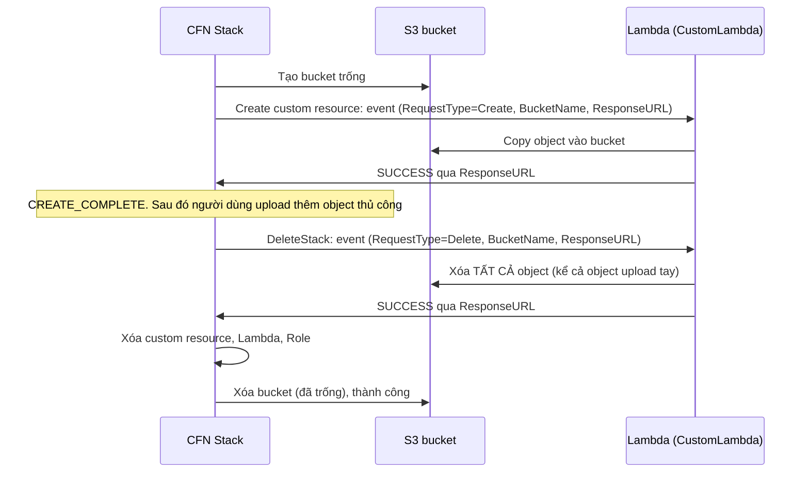

# CFN Custom Resources

> **TL;DR:** Custom resource là một loại logical resource cho phép CloudFormation làm những việc nó **chưa hỗ trợ hoặc không hỗ trợ native**, hoặc tích hợp với hệ thống bên ngoài. Mỗi khi custom resource được create, update hay delete, CloudFormation gửi event tới một **Lambda function hoặc SNS topic** do bạn chỉ định. Code xử lý rồi trả kết quả (và dữ liệu) về qua **ResponseURL**.

## 🖼️ Sơ đồ
![[CFN Custom Resources.excalidraw]]
*Mở bằng plugin Excalidraw để chỉnh sửa · ảnh tĩnh: [[CFN Custom Resources.svg]]*

## Khái niệm cốt lõi
- Logical resources trong template mô tả **cái bạn muốn**. CFN dùng chúng để **create, update, delete** physical resources (xem [[CFN Physical and Logical Resources]]).
- CloudFormation **không hỗ trợ mọi thứ**: nó thường chậm hơn so với tính năng/sản phẩm mới, và có những việc nó không bao giờ hỗ trợ.
- Custom resource giải quyết việc đó: **gửi dữ liệu tới một thứ gì đó, nhận dữ liệu về từ thứ đó**.
- Ví dụ ứng dụng:
  - **Nạp object vào S3 bucket** ngay khi bucket được tạo.
  - **Xóa sạch object trong bucket** trước khi bucket bị xóa. Bình thường xóa stack chứa bucket còn object thì sẽ **lỗi**.
  - Lấy thông tin cấu hình từ hệ thống bên ngoài khi dựng EC2.
  - Provision cả **tài nguyên ngoài AWS**.

### Khai báo trong template
- `Type: Custom::<TênTùyÝ>` (ví dụ `Custom::S3Objects`), hoặc `AWS::CloudFormation::CustomResource`.
- `Properties`:
  - **`ServiceToken`**: thuộc tính **bắt buộc duy nhất**. Là ARN của thứ đứng sau custom resource (**Lambda function** hoặc **SNS topic**), nơi CloudFormation gửi event.
  - Các property khác là tùy ý và được chuyển nguyên vào event (trong demo: `SourceBucket`, `SourcePrefix`, `Bucket`).

### Event và response
- **Event** CloudFormation gửi đi có: `RequestType` (**Create / Update / Delete**), `ResponseURL`, `StackId`, `RequestId`, `LogicalResourceId`, `ResourceProperties` (các property trong template).
- Code xử lý xong phải gửi **response** (JSON) tới **ResponseURL** (một pre-signed S3 URL, xem [[S3 Presigned URLs]]) với `Status` là `SUCCESS` hoặc `FAILED`, kèm `PhysicalResourceId` và `Data` tùy chọn.
- Nếu SUCCESS: resource được đánh dấu hoàn tất, `Data` trả về được dùng ở chỗ khác trong template (qua `Fn::GetAtt`, xem [[CFN Intrinsic Functions]]).
- Nếu code không bao giờ gửi response, stack bị treo ở trạng thái `IN_PROGRESS` cho tới khi hết timeout (mặc định 1 giờ; hiện có thể đặt ngắn hơn bằng property `ServiceTimeout`; khóa học không nhắc chi tiết này).

## Cách hoạt động / Kiến trúc
**Không có custom resource:** template → stack → bucket trống. Một người (Gabby) upload object thủ công, khiến physical resource **lệch** khỏi những gì CloudFormation biết. Xóa stack → xóa bucket **lỗi: bucket not empty**.

**Có custom resource (Lambda-backed):**

- **Thứ tự phụ thuộc là mấu chốt**: custom resource tham chiếu bucket (và Lambda), nên có **implicit dependency** (không cần [[CFN DependsOn]]). Khi tạo: bucket trước, custom resource sau. Khi xóa: CloudFormation đi **ngược thứ tự phụ thuộc**, nên custom resource bị xóa **trước** bucket. Lambda kịp dọn bucket rồi bucket mới bị xóa.

## Demo / Lab
Video 331, 332: bucket S3 làm **static website** cho cửa hàng Aus-E-Mart; file web lấy từ một bucket public do giảng viên chuẩn bị (bản khóa cũ: bucket ảnh thú cưng `AnimalPics`).

**Phần 1: bucket thường (one-click template 1)**
- Template có bucket bật static website hosting, bucket policy cho phép truy cập web, và một output là URL website. Tạo stack xong mở URL thì chưa có gì, vì bucket trống.
- Upload tay các file website (trang "product of the week"), web chạy. Nhưng stack không hề biết về các object này.
- Xóa stack → **DELETE_FAILED** vì không xóa được bucket còn object.
- Xử lý: vào S3 **Empty** bucket (gõ "permanently delete"), rồi **Retry delete**. Console cho tùy chọn **force delete**, xóa stack nhưng **giữ lại (retain)** resource không xóa được; ở đây không chọn vì bucket đã trống.

**Phần 2: bucket kèm custom resource (one-click template 2)**
- Template `s3-staticweb-custom.yaml` gồm: bucket `StaticWebsiteBucket`, bucket policy, IAM role (cho Lambda quyền đọc bucket nguồn và ghi/xóa bucket đích), Lambda Python `CopyWebsiteFilesFunction`, và custom resource `CopyWebsiteFilesCustomResource` kiểu `Custom::CopyWebsiteFiles` với `ServiceToken: !GetAtt CopyWebsiteFilesFunction.Arn`, `SourceBucket` (bucket public của giảng viên), `SourcePrefix` (thư mục chứa file web), `Bucket: !Ref StaticWebsiteBucket`.
- Code Lambda đọc các property CloudFormation truyền vào, rẽ nhánh theo loại request: **Create → chép file vào bucket**, **Delete → xóa mọi object**, rồi báo kết quả về CloudFormation.
- Vì tạo IAM role nên phải tick **capabilities** (acknowledge IAM) khi tạo stack.
- Tab Events dạng **Timeline** cho thấy thứ tự tạo nhờ phụ thuộc ngầm từ các reference (không có DependsOn nào): bucket → bucket policy → IAM role → Lambda → custom resource.
- Xong: mở output URL là có ngay website. [[CloudWatch Logs]] (Log Management → log group của Lambda) cho thấy event JSON: **ResourceProperties** (ServiceToken, SourceBucket, SourcePrefix, Bucket) khớp với template, `RequestType` Create, **ResponseURL**, và response SUCCESS gửi về đúng stack.
- Upload tay thêm `about.html` (trang About đang lỗi giờ chạy) để giả lập object không do stack tạo, rồi xóa stack: Lambda nhận event Delete, dọn sạch bucket, custom resource xóa xong thì bucket mới bị xóa. **DELETE_COMPLETE**. Log stream mới cho thấy event `Delete`.

## 🎯 Mẹo thi SAA-C03
- Từ khóa: "CloudFormation **không hỗ trợ** resource/tính năng X", "chạy logic tùy biến khi tạo/xóa stack", "tích hợp hệ thống bên ngoài / on-prem / bên thứ ba khi deploy" → **Custom Resource (Lambda-backed)**.
- Kịch bản kinh điển: "xóa stack thất bại vì S3 bucket còn object" → custom resource dùng Lambda **empty bucket khi nhận Delete event**. (Nếu đề chỉ muốn **giữ** bucket thì là [[CFN Deletion Policy]] `Retain`.)
- Backing của custom resource chỉ có **Lambda hoặc SNS topic**, khai báo qua **ServiceToken**.
- Lambda phải **gửi response về ResponseURL**. Quên bước này thì stack bị treo tới khi timeout.
- Adrian nhấn mạnh custom resources xuất hiện ở đề Developer, SysOps, SA Pro và DevOps Pro. Với SAA chỉ cần hiểu kiến trúc.

## Liên kết
- Tiên quyết: [[CloudFormation Basics]], [[CFN Physical and Logical Resources]], [[Lambda]]
- Dùng cùng: [[CFN Intrinsic Functions]], [[CFN DependsOn]], [[IAM Roles]], [[SNS]], [[CloudWatch Logs]]
- Liên quan: [[S3 Basics]], [[S3 Presigned URLs]], [[CFN Outputs]]
- Phân biệt với: [[CFN Deletion Policy]], [[CFN Wait Conditions and cfn-signal]]
- Section: [[_MOC 19 CloudFormation]]
