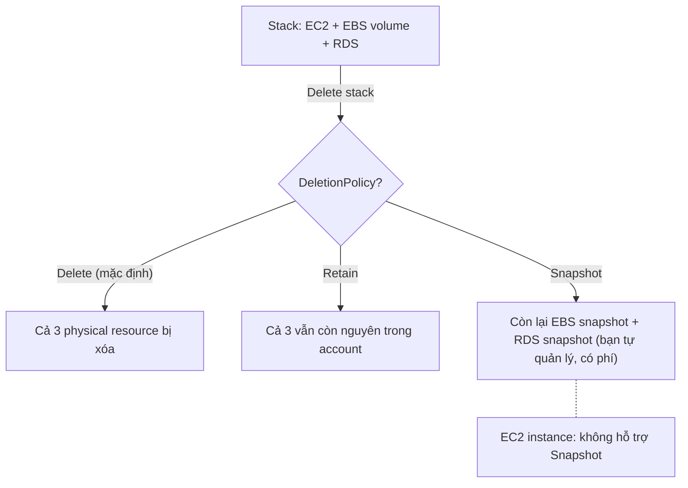

# CFN Deletion Policy

> **TL;DR:** `DeletionPolicy` là thuộc tính đặt trên **từng resource** trong template, quyết định CloudFormation làm gì với **physical resource** khi logical resource bị xóa (bỏ khỏi template hoặc xóa cả stack): **Delete** (mặc định), **Retain** (giữ lại) hoặc **Snapshot** (chụp snapshot rồi mới xóa, chỉ với một số loại resource). Mục đích chính: **tránh mất dữ liệu**.

## 🖼️ Sơ đồ
![[CFN Deletion Policy.excalidraw]]
*Mở bằng plugin Excalidraw để chỉnh sửa · ảnh tĩnh: [[CFN Deletion Policy.svg]]*

## Khái niệm cốt lõi
- Mặc định, khi bạn **xóa một logical resource** khỏi template rồi update stack, hoặc **xóa cả stack**, CloudFormation **xóa physical resource tương ứng** (xem [[CFN Physical and Logical Resources]]).
- Với resource chứa dữ liệu như RDS database hay EC2 instance có EBS volume, điều này có thể gây **mất dữ liệu**.
- `DeletionPolicy` được khai báo **riêng cho từng resource**, giá trị khả dụng tùy loại resource:

| Giá trị | Hành vi khi bị xóa | Ghi chú |
|---|---|---|
| **Delete** | Xóa physical resource | **Mặc định** với đa số resource |
| **Retain** | Không xóa, physical resource **còn nguyên** trong account | Dùng được với mọi loại resource. Nếu mọi resource đều Retain thì xóa stack không xóa gì cả |
| **Snapshot** | Chụp **snapshot** trước, rồi mới xóa resource | Chỉ resource hỗ trợ: **EBS volume, ElastiCache, Neptune, RDS, Redshift** (theo slide). **Không hỗ trợ EC2 instance** |

- **Snapshot tồn tại sau khi stack biến mất**: chúng không còn do stack quản lý, **bạn phải tự dọn**, nếu không sẽ tiếp tục **tốn phí lưu trữ** (xem [[EBS Snapshots]], [[RDS Backups and Restore]]).
- Bổ sung theo AWS hiện tại:
  - Có thêm giá trị **`RetainExceptOnCreate`**: giữ resource khi xóa, **trừ khi** resource đó vừa được tạo trong chính thao tác stack bị rollback (tránh để lại rác khi tạo thất bại).
  - Với `AWS::RDS::DBCluster` và `AWS::RDS::DBInstance` không thuộc cluster, **mặc định là Snapshot** chứ không phải Delete. (Khóa học chỉ nói mặc định chung là Delete.)
  - Danh sách hỗ trợ Snapshot hiện còn có thêm một số loại khác (ví dụ DocumentDB cluster); với kỳ thi, nhớ nhóm EBS, ElastiCache, Neptune, RDS, Redshift là đủ.

## Cách hoạt động / Kiến trúc
Ví dụ trong slide: stack tạo 1 EC2 instance, 1 EBS volume, 1 RDS instance, sau đó stack bị xóa.



Ví dụ khai báo (YAML):
```yaml
Resources:
  AppDB:
    Type: AWS::RDS::DBInstance
    DeletionPolicy: Snapshot
    UpdateReplacePolicy: Snapshot
    Properties: ...
  LogsBucket:
    Type: AWS::S3::Bucket
    DeletionPolicy: Retain
```

### Chỉ áp dụng cho DELETE, không áp dụng cho REPLACE
- Điểm Adrian nhấn mạnh: DeletionPolicy chỉ có tác dụng với thao tác **xóa** (bỏ resource khỏi template, hoặc xóa stack).
- Nếu bạn **sửa một thuộc tính** của logical resource mà thay đổi đó buộc **replacement** (tạo resource mới, xóa resource cũ, xem [[CFN Change Sets]]), DeletionPolicy **không** bảo vệ: dữ liệu trên resource cũ **mất**.
- Bổ sung theo AWS hiện tại: để bảo vệ trường hợp replace, dùng thuộc tính riêng **`UpdateReplacePolicy`** (cũng nhận Delete/Retain/Snapshot). Khóa học không đề cập thuộc tính này.

## 🎯 Mẹo thi SAA-C03
- Đề nói "xóa stack nhưng phải **giữ lại** database/bucket/volume" → `DeletionPolicy: Retain`.
- Đề nói "khi xóa stack cần **giữ bản sao dữ liệu** của RDS/EBS/Redshift/ElastiCache/Neptune nhưng không giữ resource" → `DeletionPolicy: Snapshot`.
- Bẫy: **EC2 instance không hỗ trợ Snapshot**. Muốn giữ dữ liệu của EC2 thì dùng Snapshot trên **EBS volume** (resource `AWS::EC2::Volume`) hoặc Retain cho instance.
- Bẫy: snapshot **không bị xóa** theo stack → phải tự dọn, có chi phí.
- Bẫy: DeletionPolicy **không áp dụng khi resource bị replace** do thay đổi thuộc tính. Muốn biết trước resource nào sẽ bị replace thì dùng [[CFN Change Sets]]; muốn bảo vệ khi replace thì dùng UpdateReplacePolicy.
- Phân biệt: **stack termination protection** chặn việc xóa **cả stack**; DeletionPolicy quy định số phận **từng resource** khi bị xóa.
- Với S3 bucket còn object, xóa stack sẽ lỗi; cách xử lý là Retain hoặc dùng [[CFN Custom Resources]] để dọn bucket trước.

## Liên kết
- Tiên quyết: [[CloudFormation Basics]], [[CFN Physical and Logical Resources]]
- Liên quan: [[EBS Snapshots]], [[RDS Backups and Restore]], [[ElastiCache]], [[Redshift]], [[EBS]], [[CFN Custom Resources]]
- Phân biệt với: [[CFN Change Sets]] (chỉ xem trước, không bảo vệ dữ liệu), [[CFN DependsOn]] (thứ tự tạo/xóa)
- Section: [[_MOC 19 CloudFormation]]
