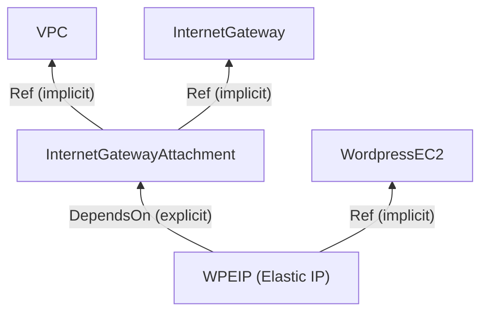

# CFN DependsOn

> **TL;DR:** CloudFormation tạo, cập nhật và xóa resource **song song** khi có thể, và tự suy ra thứ tự phụ thuộc từ `Ref`/`GetAtt` (**implicit dependency**). `DependsOn` khai báo **explicit dependency** cho những trường hợp CFN không tự suy ra được. Ca kinh điển là **Elastic IP phải chờ Internet Gateway attachment**.

## 🖼️ Sơ đồ
![[CFN DependsOn.excalidraw]]
*Mở bằng plugin Excalidraw để chỉnh sửa · ảnh tĩnh: [[CFN DependsOn.svg]]*

## Khái niệm cốt lõi
- CFN cố gắng hiệu quả nên làm song song, đồng thời dựng **cây phụ thuộc**: VPC trước, rồi subnet, rồi EC2 trong subnet.
- **Implicit dependency**: resource A dùng `!Ref B` hoặc `!GetAtt B.X` thì CFN biết phải tạo B trước. Lý do là **chỉ tham chiếu được resource đã `CREATE_COMPLETE`**. Cách này đúng trong khoảng **99%** trường hợp. Ví dụ: user data EC2 tham chiếu endpoint của Aurora cluster thì EC2 tự chờ Aurora xong.
- **`DependsOn`**: khai báo rõ "B và C phụ thuộc A". CFN **không bắt đầu tạo** B và C cho tới khi A ở `CREATE_COMPLETE`.
- Giá trị là **một resource** hoặc **một list resource**.
- Tác động lên cả 3 thao tác:
  - **Create**: tạo resource phụ thuộc **sau**.
  - **Delete**: xóa resource phụ thuộc **trước** (thứ tự ngược lại).
  - Update cũng tuân theo thứ tự này.

## Cách hoạt động / Kiến trúc
- `VPC` và `InternetGateway` độc lập nhau, tạo **song song** được.
- `InternetGatewayAttachment` (`AWS::EC2::VPCGatewayAttachment`) cần cả hai: `VpcId: !Ref VPC`, `InternetGatewayId: !Ref InternetGateway`. Đây là implicit dependency ([[VPC Routing and Internet Gateway]]).
- `WPEIP` (`AWS::EC2::EIP`) gắn vào instance trong VPC **cần IGW đã attach vào VPC** mới hoạt động. Nhưng template không có `Ref` nào nối EIP với attachment, nên **không có dependency**:
  - Tạo: nếu EIP được tạo trước attachment thì **lỗi**.
  - Xóa: nếu attachment bị xóa trước EIP thì **lỗi**.
  - Kết quả ngẫu nhiên theo thứ tự CFN chọn, lúc chạy được lúc không.
- Cách sửa:
```yaml
WPEIP:
  Type: AWS::EC2::EIP
  DependsOn: InternetGatewayAttachment
  Properties:
    InstanceId: !Ref WordpressEC2
```
  EIP được tạo **sau** khi attachment hoàn tất và bị xóa **trước** khi attachment bị xóa.



## 🎯 Mẹo thi SAA-C03
- Adrian nhắc thẳng: ca **EIP + IGW attachment** "tends to feature in exams". Stack lúc tạo hoặc xóa được, lúc lỗi, liên quan EIP/IGW → **thêm `DependsOn: <IGW attachment>`** vào EIP.
- Muốn ép thứ tự tạo giữa hai resource không tham chiếu nhau → `DependsOn`.
- `Ref`/`GetAtt` đã tạo dependency rồi, không cần `DependsOn` thừa.
- Chờ **bootstrap trong instance** xong (không phải chờ resource tạo xong) là bài toán khác → [[CFN Wait Conditions and cfn-signal]].
- `DependsOn` cũng dùng giữa các nested stack (AD stack phụ thuộc VPC stack), xem [[CFN Nested Stacks]].

## Liên kết
- Tiên quyết: [[CFN Physical and Logical Resources]], [[CFN Intrinsic Functions]]
- Liên quan: [[VPC Routing and Internet Gateway]], [[EC2 Network Interfaces IPs and DNS]] (Elastic IP), [[Custom VPC]]
- Phân biệt với: [[CFN Wait Conditions and cfn-signal]] (chờ tín hiệu từ bên trong instance)
- MOC: [[_MOC 19 CloudFormation]]
