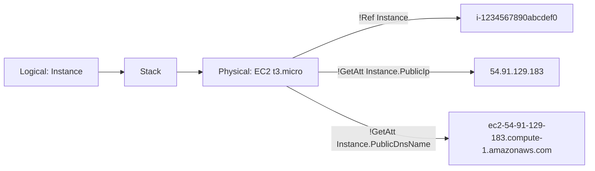

# CFN Intrinsic Functions

> **TL;DR:** Intrinsic function là các hàm có sẵn của CloudFormation. Chúng cho template **lấy dữ liệu lúc runtime**, tức lúc template đang được dùng để tạo stack: tham chiếu resource hay parameter khác, ghép chuỗi, chọn AZ, chia CIDR, mã hóa user data... Template nhờ vậy phản ứng được với môi trường và portable hơn.

## 🖼️ Sơ đồ
![[CFN Intrinsic Functions.excalidraw]]
*Mở bằng plugin Excalidraw để chỉnh sửa · ảnh tĩnh: [[CFN Intrinsic Functions.svg]]*

![[CFN Intrinsic Functions - cheatsheet.excalidraw]]
*Mở bằng plugin Excalidraw để chỉnh sửa · ảnh tĩnh: [[CFN Intrinsic Functions - cheatsheet.svg]]*

## Khái niệm cốt lõi
Danh sách hàm trong bài (cú pháp YAML rút gọn `!Hàm`, dạng đầy đủ là `Fn::Hàm`):

| Hàm | Làm gì | Ví dụ dùng |
|---|---|---|
| `Ref` | Trả **giá trị chính** của parameter hoặc logical resource | `ImageId: !Ref LatestAmiId`, `VpcId: !Ref VPC` |
| `Fn::GetAtt` | Trả **thuộc tính phụ** của logical resource | `!GetAtt Instance.PublicDnsName` |
| `Fn::Join` / `Fn::Split` | Ghép list thành chuỗi / tách chuỗi thành list | Tạo URL web cho WordPress |
| `Fn::GetAZs` / `Fn::Select` | Lấy danh sách AZ của region / chọn một phần tử theo index | Chọn AZ mà không đặt cứng tên |
| `Fn::If`, `Fn::Equals`, `Fn::Not`, `Fn::And`, `Fn::Or` | Logic điều kiện | prod thì instance to, dev thì instance nhỏ, xem [[CFN Conditions]] |
| `Fn::Base64` | Mã hóa text thường sang Base64 | **User data** EC2 |
| `Fn::Sub` | Thay biến `${...}` trong chuỗi bằng giá trị runtime | Đưa parameter hoặc ID vào user data |
| `Fn::Cidr` | Sinh danh sách dải CIDR con từ một CIDR lớn | CIDR cho subnet trong VPC |
| `Fn::ImportValue`, `Fn::FindInMap`, `Fn::Transform` | Có bài riêng | [[CFN Cross-Stack References]], [[CFN Mappings]] |

Các hàm dùng riêng hoặc **lồng vào nhau** được để tạo logic khá phức tạp.

## Cách hoạt động / Kiến trúc
### Ref và GetAtt (quan trọng nhất)
- Mỗi parameter và logical resource có một **giá trị chính** (main value):
  - Với parameter (template hoặc pseudo): giá trị của nó.
  - Với logical resource: **thường là physical ID** (EC2 thì là instance ID `i-1234567890abcdef0`).
- `Ref` lấy giá trị chính này. `GetAtt LogicalResource.Attribute` lấy **thuộc tính khác** của physical resource. Thuộc tính có gì **tùy loại resource**: EC2 có `PublicIp`, `PublicDnsName`, `AvailabilityZone`...
- Chỉ tham chiếu được khi resource đích đã `CREATE_COMPLETE`. Vì vậy `Ref`/`GetAtt` cũng tạo ra **implicit dependency** ([[CFN DependsOn]]).

### GetAZs + Select
- `!GetAZs "us-east-1"` cho region chỉ định, `!GetAZs ""` cho region hiện tại (hoặc `!GetAZs !Ref AWS::Region`). Kết quả là list AZ, ví dụ `[us-east-1a ... us-east-1f]` ([[AWS Global Infrastructure]]).
- **Lưu ý**: thực tế hàm trả các AZ mà **[[Default VPC]] có subnet**. Nếu default VPC bị xóa bớt subnet thì list thiếu AZ và kết quả không nhất quán. Không có default VPC, hoặc default VPC còn đủ subnet, thì trả đủ mọi AZ.
- `!Select [ 0, !GetAZs "" ]` lấy phần tử đầu tiên (**index bắt đầu từ 0**). Nhờ vậy không phải đặt cứng tên AZ.

### Join và Split
- `!Split [ "|", "roffle|truffles|penny|winkie" ]` cho ra `["roffle","truffles","penny","winkie"]`.
- `!Join [ delimiter, [ v1, v2, ... ] ]` làm ngược lại. Ví dụ: `!Join [ '', [ 'http://', !GetAtt Instance.DNSName ] ]` tạo URL WordPress (thường đặt trong [[CFN Outputs]]).

### Base64 và Sub
- User data EC2 phải gửi dạng **Base64**. Viết script dạng text thường rồi bọc bằng `!Base64` ([[EC2 User Data Bootstrapping]]).
- `!Sub` thay biến theo 3 dạng:
  - `${ParameterName}`: giá trị parameter.
  - `${LogicalResource}`: giá trị chính, giống `Ref`.
  - `${LogicalResource.AttributeName}`: thuộc tính, giống `GetAtt`.
- **Không tự tham chiếu được**: user data của `Instance` không thể dùng `${Instance.InstanceId}`, vì lúc đó instance chưa tồn tại. Slide cố ý đưa ví dụ sai này. Chỉ tham chiếu được tới resource *khác*.
- Thường gặp: `!Base64 !Sub | ...` để đưa `${AWS::StackName}` và `${AWS::Region}` vào lệnh `cfn-init`/`cfn-signal` ([[CFN Wait Conditions and cfn-signal]]).

### Cidr
- `!Cidr [ ipBlock, count, cidrBits ]`. Ví dụ VPC `10.16.0.0/16`:
  - `Subnet1: CidrBlock: !Select [ "0", !Cidr [ !GetAtt VPC.CidrBlock, "16", "12" ] ]`
  - `Subnet2: ... !Select [ "1", ... ]`
  - `count = 16` là số dải cần sinh. `cidrBits = 12` là **số bit host**, nên mỗi subnet là **/20** (32 − 12). Xem [[Subnetting]], [[VPC Sizing and Structure]].
- Hạn chế: chỉ dựa trên CIDR của VPC cha và **không theo dõi việc cấp phát hay thu hồi dải**. Phải tự chọn index để không trùng.

## 🎯 Mẹo thi SAA-C03
- **Ref vs GetAtt**: Ref lấy giá trị chính (ID hoặc giá trị parameter), GetAtt lấy thuộc tính phụ (IP, DNS name, ARN...). Hỏi lấy DNS name hay public IP của instance → `GetAtt`.
- `Ref` chỉ dùng **trong cùng stack**. Sang stack khác dùng `Fn::ImportValue` ([[CFN Cross-Stack References]]). Stack cha lấy output của stack con dùng `GetAtt NestedStack.Outputs.X` ([[CFN Nested Stacks]]).
- Thấy "không đặt cứng AZ" → `GetAZs` + `Select`. Thấy "tự chia CIDR cho subnet" → `Cidr`.
- User data → `Base64` (thường kèm `Sub`).

## Liên kết
- Tiên quyết: [[CFN Physical and Logical Resources]], [[CFN Template and Pseudo Parameters]]
- Dùng cùng: [[CFN Mappings]] (`FindInMap`), [[CFN Conditions]] (`If`/`Equals`...), [[CFN Outputs]], [[CFN Cross-Stack References]] (`ImportValue`)
- Liên quan: [[EC2 User Data Bootstrapping]], [[Subnetting]], [[VPC Subnets]], [[Default VPC]], [[CFN DependsOn]]
- MOC: [[_MOC 19 CloudFormation]]
