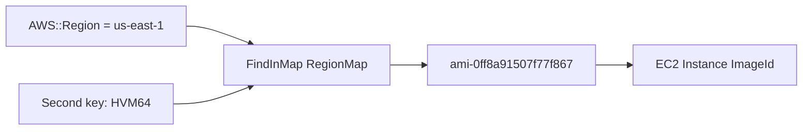

# CFN Mappings

> **TL;DR:** Section `Mappings` là **bảng tra cứu tĩnh** trong template, ánh xạ key sang value. Dữ liệu được đọc bằng hàm **`!FindInMap`**. Trường hợp kinh điển là tra **AMI ID theo region và kiến trúc**, nhằm tăng **portability** của template.

## 🖼️ Sơ đồ
![[CFN Mappings.excalidraw]]
*Mở bằng plugin Excalidraw để chỉnh sửa · ảnh tĩnh: [[CFN Mappings.svg]]*

## Khái niệm cốt lõi
- Template là tập các cặp key-value cấp cao nhất (`Resources`, `Parameters`, `Mappings`...). `Mappings` là một section tùy chọn ([[CloudFormation Basics]]).
- Section `Mappings` chứa **nhiều mapping**. Mỗi mapping ánh xạ **key → value**.
- Tra cứu được **một cấp** (chỉ top-level key) hoặc **hai cấp** (top-level key + second-level key).
- Ví dụ dùng: môi trường (prod) → cấu hình database hoặc SSH key cụ thể; region + kiến trúc → AMI ID.
- Mapping chỉ chứa **giá trị cố định** viết sẵn trong template. Không gọi API, không tự cập nhật.

## Cách hoạt động / Kiến trúc
```yaml
Mappings:
  RegionMap:
    us-east-1:
      HVM64: "ami-0ff8a91507f77f867"
      HVMG2: "ami-0a584ac55a7631c0c"
    us-west-1:
      HVM64: "ami-0bdb828fd58c52235"
      HVMG2: "ami-066ee5fd4a9ef77f1"
# Dùng trong resource:
ImageId: !FindInMap [ "RegionMap", !Ref 'AWS::Region', "HVM64" ]
```

Cú pháp: `!FindInMap [ MapName, TopLevelKey, SecondLevelKey ]`
1. **MapName** (bắt buộc): mapping cần tra, ở đây là `RegionMap`.
2. **TopLevelKey** (bắt buộc): ở đây dùng pseudo parameter `AWS::Region`, nên luôn khớp region đang tạo stack ([[CFN Template and Pseudo Parameters]]).
3. **SecondLevelKey** (tùy chọn): `HVM64` để tra cụ thể hơn. Kết quả là AMI ID cho `us-east-1` + `HVM64`.
- Theo bài giảng, nếu chỉ đưa hai thành phần đầu thì lấy được cả object dưới `us-east-1`. (Lưu ý: tài liệu AWS hiện nay quy định `Fn::FindInMap` cần đủ 3 tham số để trả một giá trị. Muốn tra một cấp thì thiết kế mapping có second-level key cố định.)



## Bảng so sánh / số liệu
| Cách lấy AMI đúng region | Ưu điểm | Nhược điểm |
|---|---|---|
| Đặt cứng AMI ID | Đơn giản | Chỉ chạy ở 1 region ([[CFN Physical and Logical Resources]]) |
| Parameter nhập tay | Linh hoạt | Người dùng phải tự tra |
| **Mappings + FindInMap** | Portable, không cần input | Bảng tĩnh, phải tự cập nhật khi có AMI mới |
| SSM public parameter | Tự động lấy AMI **mới nhất** | Phụ thuộc path SSM ([[SSM Parameter Store]]) |

## 🎯 Mẹo thi SAA-C03
- "Template chọn AMI hoặc cấu hình khác nhau theo region/môi trường mà không cần người dùng nhập" → **Mappings + `FindInMap`** (thường kèm `AWS::Region`).
- Mappings là dữ liệu **tĩnh**. Nếu đề nhấn mạnh "luôn dùng AMI mới nhất" thì SSM parameter phù hợp hơn.
- Mappings dùng cho **tra cứu**. **Bật hay tắt việc tạo resource** là việc của [[CFN Conditions]].

## Liên kết
- Tiên quyết: [[CFN Intrinsic Functions]], [[CFN Template and Pseudo Parameters]]
- Liên quan: [[AMI]], [[SSM Parameter Store]], [[CFN Conditions]]
- MOC: [[_MOC 19 CloudFormation]]
