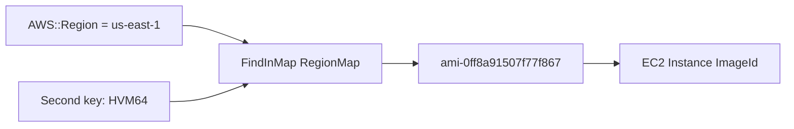

# CFN Mappings

> **TL;DR:** Section `Mappings` là **bảng tra cứu tĩnh** trong template, ánh xạ key sang value. Dữ liệu được đọc bằng hàm **`!FindInMap`**, luôn tra **hai cấp** nên cần đủ 3 tham số: tên mapping, top-level key, second-level key. Ví dụ hay gặp: kích thước instance theo môi trường và tầng ứng dụng, hoặc **AMI ID theo region và kiến trúc**, nhằm tăng **portability** của template.

## 🖼️ Sơ đồ
![[CFN Mappings.excalidraw]]
*Mở bằng plugin Excalidraw để chỉnh sửa · ảnh tĩnh: [[CFN Mappings.svg]]*

## Khái niệm cốt lõi
- Template là tập các cặp key-value cấp cao nhất (`Resources`, `Parameters`, `Mappings`...). `Mappings` là một section tùy chọn ([[CloudFormation Basics]]).
- Section `Mappings` chứa **nhiều mapping**. Mỗi mapping ánh xạ **key → value**.
- Mapping **luôn có hai cấp**: đưa top-level key và second-level key thì nhận về một giá trị. (Bản khóa cũ nói tra được cả một cấp; bài mới nói rõ luôn là hai cấp.)
- Ví dụ dùng: môi trường (prod) → cấu hình database hoặc SSH key cụ thể; môi trường + tầng (web/app) → instance size; region + môi trường; region + kiến trúc → AMI ID.
- Giảng viên khuyên: bắt đầu template đơn giản, chỉ thêm Mappings khi thật sự cần, đừng thêm vì "hay".
- Mapping chỉ chứa **giá trị cố định** viết sẵn trong template. Không gọi API, không tự cập nhật.

## Cách hoạt động / Kiến trúc
Ví dụ trên slide: một template dựng web app chạy EC2 của Aus-E-Mart cho cả **tầng web và tầng app**, ở **ba môi trường** dev, staging, prod.

```yaml
Mappings:
  AEMInstanceSizes:
    Dev:
      Web: t4g.nano
      App: t4g.small
    Staging:
      Web: t4g.small
      App: m6g.large
    Prod:
      Web: m6g.large
      App: m6g.xlarge
# Dùng trong resource (Environment, WorkloadTier là parameter của stack):
InstanceType: !FindInMap [ "AEMInstanceSizes", !Ref Environment, !Ref WorkloadTier ]
```
- Stack tạo với `Environment = Dev`, `WorkloadTier = Web` → `t4g.nano`.

Ví dụ kinh điển thứ hai (bản khóa cũ dùng): AMI theo region và kiến trúc.
```yaml
Mappings:
  RegionMap:
    us-east-1:
      HVM64: "ami-0ff8a91507f77f867"
      HVMG2: "ami-0a584ac55a7631c0c"
    us-west-1:
      HVM64: "ami-0bdb828fd58c52235"
      HVMG2: "ami-066ee5fd4a9ef77f1"
# Dùng trong resource:
ImageId: !FindInMap [ "RegionMap", !Ref 'AWS::Region', "HVM64" ]
```

Cú pháp: `!FindInMap [ MapName, TopLevelKey, SecondLevelKey ]`, **cả ba đều bắt buộc**:
1. **MapName**: mapping cần tra (`AEMInstanceSizes`, `RegionMap`). Cần vì section `Mappings` có thể chứa nhiều mapping.
2. **TopLevelKey**: thường lấy từ parameter của stack (`!Ref Environment`) hoặc pseudo parameter `AWS::Region`, để luôn khớp region đang tạo stack ([[CFN Template and Pseudo Parameters]]).
3. **SecondLevelKey**: key cấp hai (`!Ref WorkloadTier`, `HVM64`). Kết quả là một giá trị, ví dụ AMI ID cho `us-east-1` + `HVM64`.
- Bản khóa cũ nói chỉ đưa hai thành phần đầu thì lấy được cả object dưới top-level key. Bài mới và tài liệu AWS hiện nay đều nói `Fn::FindInMap` cần đủ 3 tham số. Muốn tra "một cấp" thì thiết kế mapping có second-level key cố định.



## Bảng so sánh / số liệu
| Cách lấy AMI đúng region | Ưu điểm | Nhược điểm |
|---|---|---|
| Đặt cứng AMI ID | Đơn giản | Chỉ chạy ở 1 region ([[CFN Physical and Logical Resources]]) |
| Parameter nhập tay | Linh hoạt | Người dùng phải tự tra |
| **Mappings + FindInMap** | Portable, không cần input | Bảng tĩnh, phải tự cập nhật khi có AMI mới |
| SSM public parameter | Tự động lấy AMI **mới nhất** | Phụ thuộc path SSM ([[SSM Parameter Store]]) |

## 🎯 Mẹo thi SAA-C03
- "Template chọn AMI hoặc cấu hình khác nhau theo region/môi trường mà không cần người dùng nhập" → **Mappings + `FindInMap`** (thường kèm `AWS::Region`).
- Mappings là dữ liệu **tĩnh**. Nếu đề nhấn mạnh "luôn dùng AMI mới nhất" thì SSM parameter phù hợp hơn.
- Mappings dùng cho **tra cứu**. **Bật hay tắt việc tạo resource** là việc của [[CFN Conditions]].

## Liên kết
- Tiên quyết: [[CFN Intrinsic Functions]], [[CFN Template and Pseudo Parameters]]
- Liên quan: [[AMI]], [[SSM Parameter Store]], [[CFN Conditions]]
- MOC: [[_MOC 19 CloudFormation]]
