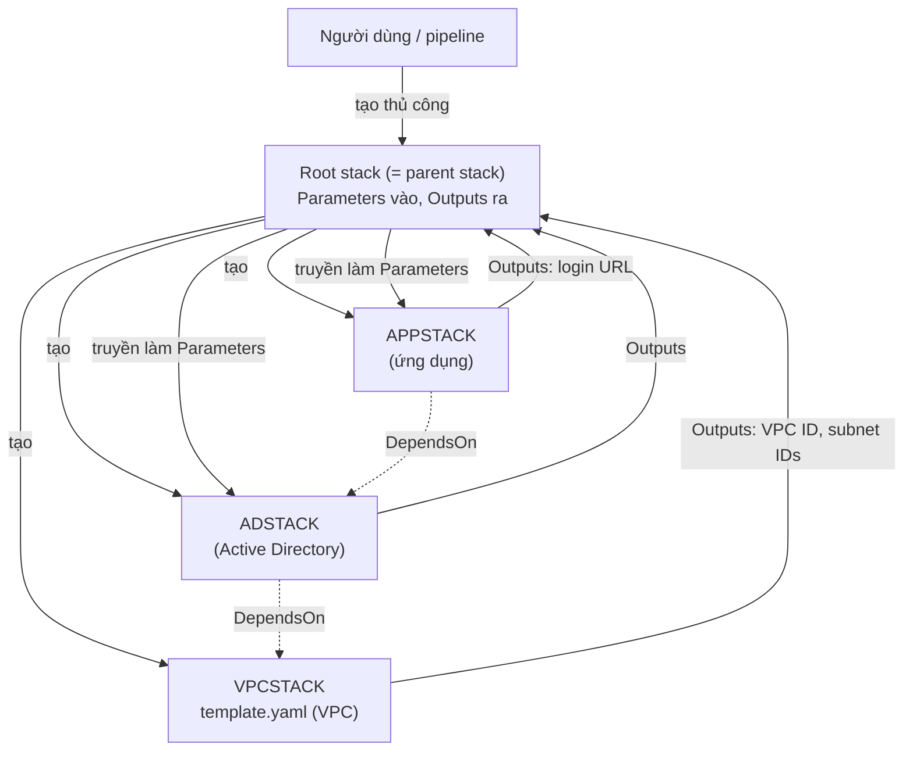

# CFN Nested Stacks

> **TL;DR:** Nested stack là kiến trúc nhiều stack trong đó một **root stack** tạo các stack con bằng logical resource `AWS::CloudFormation::Stack`, mỗi stack con dựng từ một template riêng. Dùng để vượt **giới hạn 500 resource/stack**, **tái sử dụng template** (code) dạng module và đơn giản hóa việc triển khai. Chỉ dùng khi mọi phần **cùng vòng đời (lifecycle linked)**.

## 🖼️ Sơ đồ
![[CFN Nested Stacks.excalidraw]]
*Mở bằng plugin Excalidraw để chỉnh sửa · ảnh tĩnh: [[CFN Nested Stacks.svg]]*

![[CFN Nested Stacks - reuse.excalidraw]]
*Mở bằng plugin Excalidraw để chỉnh sửa · ảnh tĩnh: [[CFN Nested Stacks - reuse.svg]]*

## Khái niệm cốt lõi
### Stack đơn lẻ và giới hạn của nó
- Dự án đơn giản thường dùng **một stack** chứa mọi thứ: VPC, DynamoDB, S3, EC2, Lambda, SNS, SQS, Directory Service...
- Mọi resource trong stack **chung vòng đời**: tạo cùng nhau, update cùng nhau, xóa cùng nhau. Ổn, miễn là không đụng các giới hạn:
  - **500 resource mỗi stack**.
  - **Không tái sử dụng resource** dễ dàng: stack được thiết kế **cô lập**. `Ref` chỉ tham chiếu resource **trong cùng stack**, không trỏ sang stack khác được ([[CFN Intrinsic Functions]]).
- Dự án lớn/phức tạp dùng **multi-stack architecture**, có hai cách: **nested stacks** (note này) và [[CFN Cross-Stack References|cross-stack references]]. Chọn đúng giữa hai cách là điều Adrian muốn bạn nắm chắc cho kỳ thi.

### Root stack và parent stack
- **Root stack**: stack được tạo **đầu tiên** và là thành phần **duy nhất được tạo thủ công** (người dùng qua console/CLI, hoặc một quy trình tự động). Mọi stack con đều do CloudFormation tạo.
- **Parent stack**: bất kỳ stack nào trực tiếp tạo ra nested stack. Cấu trúc có thể **nhiều tầng**: root tạo stack con, stack con lại tạo stack con của nó. Trong ví dụ đơn giản, root stack đồng thời là parent stack.
- Root stack **chỉ là stack bình thường**: có [[CFN Template and Pseudo Parameters|Parameters]] và [[CFN Outputs|Outputs]] như mọi stack khác. Không có gì đặc biệt về mặt kỹ thuật.

### Nested stack là một logical resource
```yaml
VPCSTACK:
  Type: AWS::CloudFormation::Stack
  Properties:
    TemplateURL: https://someurl.com/template.yaml
    Parameters:
      Param1: !Ref SomeParam1
      Param2: !Ref SomeParam2
      Param3: !Ref SomeParam3
```
- `TemplateURL`: đường dẫn tới template dùng để tạo stack con. Template đó là template bình thường, có thể chứa nested stack riêng. (Slide dùng URL ví dụ; trên thực tế AWS yêu cầu template của nested stack nằm trong **S3 bucket**.)
- `Parameters`: nếu template con có tham số thì **phải truyền đủ giá trị**, nếu không việc tạo stack con **thất bại**.
  - Ngoại lệ: tham số có **giá trị mặc định** thì không bắt buộc.
  - Best practice: vẫn truyền giá trị cho **mọi** tham số của template con.

### Outputs của nested stack
- Khi stack con tạo xong, logical resource tương ứng trong root chuyển `CREATE_COMPLETE` và **outputs của stack con được trả về root stack**.
- Tham chiếu dạng `VPCSTACK.Outputs.XXXXX` (trong YAML: `!GetAtt VPCSTACK.Outputs.XXXXX`).
- **Chỉ tham chiếu được outputs**. Không thể tham chiếu trực tiếp logical resource bên trong stack con. Muốn dùng giá trị nào thì stack con phải phơi nó ra ở [[CFN Outputs|Outputs]].

## Cách hoạt động / Kiến trúc
Ví dụ trong bài: root stack tạo 3 nested stack. AD stack chạy trong VPC nên phụ thuộc VPC stack; ứng dụng dùng Active Directory để xác thực nên phụ thuộc AD stack.



Trình tự:
1. Root stack tạo VPCSTACK, truyền 3 parameter. Xong thì outputs (VPC ID, subnet IDs) trả về root.
2. ADSTACK phụ thuộc VPCSTACK, qua dependency CFN tự suy ra hoặc khai báo `DependsOn` ([[CFN DependsOn]]). Root lấy outputs của VPCSTACK làm **parameters** cho ADSTACK. AD ở đây có thể là AD tự quản hoặc [[Directory Service]], đều cần chạy trong VPC.
3. APPSTACK phụ thuộc ADSTACK, trả output (ví dụ URL đăng nhập) về root.
4. Mỗi nested stack xong thì resource tương ứng trong root `CREATE_COMPLETE`. Khi **tất cả** xong thì root stack `CREATE_COMPLETE`.

### Tái sử dụng: template, không phải stack
- Chia giải pháp thành **template dạng module** thì template tái sử dụng được. Ví dụ upload template VPC lên một chỗ, nhiều kiến trúc nested stack khác cùng dùng.
- Nhưng đây là **tái sử dụng code (template)**, **không** tái sử dụng resource. Mỗi lần dùng lại template VPC sẽ tạo ra **một VPC mới, riêng biệt**. Triển khai 10 root stack giống nhau → 10 VPC, 10 AD, 10 app.
- Ngược lại, [[CFN Cross-Stack References]] tái sử dụng **chính resource** của một stack đang chạy (ví dụ shared VPC).

## Bảng so sánh: khi nào chọn nested stacks

| Nên dùng nested stacks khi | Không nên (cân nhắc cross-stack) khi |
|---|---|
| Cần vượt 500 resource/stack (ví dụ 5 stack lồng nhau → tới khoảng 2.500 resource) | Một phần cần sống **lâu dài** còn phần khác thì không |
| Muốn **module hóa** template, viết VPC template một lần dùng cho nhiều triển khai | Muốn dùng **cùng một VPC thật** cho nhiều triển khai |
| Muốn cài đặt dễ: áp một root stack, nó tự điều phối mọi nested stack | Muốn **thay đổi thường xuyên** một phần mà không động tới phần khác |
| Mọi phần **cùng vòng đời**: tạo, update, xóa cùng nhau | Kiến trúc service-oriented, cung cấp dịch vụ từ stack này cho stack khác |

## 🎯 Mẹo thi SAA-C03
- **Điểm quyết định duy nhất** (Adrian nhấn mạnh): chỉ dùng nested stacks khi mọi thứ **lifecycle linked**. Ứng dụng cần AD, AD cần VPC, khó có cái nào tồn tại thiếu cái kia, không có nhu cầu thay VPC/AD khác.
- Nested stacks = **reuse template (code)**. Cross-stack references = **reuse stack (resource thật)**. Template ≠ stack: một template tạo được nhiều stack, mỗi stack là duy nhất ([[CFN Physical and Logical Resources]]).
- Từ khóa "vượt giới hạn 500 resource của một stack" → nested stacks.
- Từ khóa "modular templates / building blocks / tái sử dụng template VPC chuẩn cho nhiều dự án, mỗi dự án VPC riêng" → nested stacks.
- Root stack đọc output stack con bằng `GetAtt <NestedStack>.Outputs.<Name>`, không cần Export. Export + `ImportValue` là cơ chế của cross-stack.
- Muốn triển khai cùng template ra **nhiều account/region** → đó là [[CFN StackSets]], không phải nested stacks.

## Liên kết
- Tiên quyết: [[CloudFormation Basics]], [[CFN Physical and Logical Resources]], [[CFN Template and Pseudo Parameters]], [[CFN Outputs]]
- Dùng cùng: [[CFN DependsOn]], [[CFN Intrinsic Functions]], [[S3 Basics]]
- Phân biệt với: [[CFN Cross-Stack References]], [[CFN StackSets]]
- Liên quan: [[Custom VPC]], [[Directory Service]], [[CFN Change Sets]]
- Section: [[_MOC 19 CloudFormation]]
