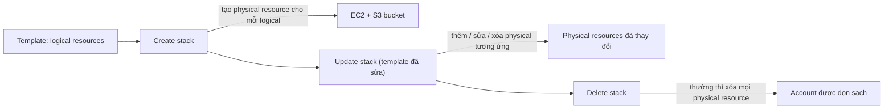

# CFN Physical and Logical Resources

> **TL;DR:** Template CloudFormation chứa **logical resource** (mô tả *cái gì* cần có). Template dùng để tạo **stack**, và stack tạo ra **physical resource** thật trong account (*làm thế nào* là việc của CFN). CFN giữ hai thứ này luôn đồng bộ qua create, update và delete. Demo cho thấy template **non-portable** (đặt cứng tên bucket, AMI ID) chỉ chạy được một lần và ở một region.

## 🖼️ Sơ đồ
![[CFN Physical and Logical Resources.excalidraw]]
*Mở bằng plugin Excalidraw để chỉnh sửa · ảnh tĩnh: [[CFN Physical and Logical Resources.svg]]*

![[CFN Physical and Logical Resources - nonportable.excalidraw]]
*Mở bằng plugin Excalidraw để chỉnh sửa · ảnh tĩnh: [[CFN Physical and Logical Resources - nonportable.svg]]*

## Khái niệm cốt lõi
- **Template**: tài liệu [[YAML]] hoặc [[JSON]]. Bên trong có logical resource cùng các section khác (Parameters, Mappings, Outputs...). Tổng quan cấu trúc ở [[CloudFormation Basics]].
- **Logical resource** = "the WHAT": bạn khai báo muốn có gì, không cần nói cách tạo. Mỗi logical resource có:
  - **Tên logic** (logical ID), ví dụ `Instance`, `Bucket`. Phải duy nhất trong template.
  - **`Type`**, ví dụ `AWS::EC2::Instance`, `AWS::S3::Bucket`.
  - **`Properties`**: cấu hình CFN dùng khi tạo physical resource (ví dụ `ImageId`, `InstanceType`, `KeyName`).
- **Stack**: tạo từ template. Một template có thể tạo **1 stack, 100 stack, hoặc 20 stack ở mỗi region**. Template viết tốt để dùng được nhiều lần, ở nhiều account và nhiều region gọi là **portable template**.
- **Physical resource**: với **mỗi logical resource** trong stack, CFN tạo một physical resource tương ứng (EC2 instance thật, bucket thật...).
- Khi logical resource chuyển sang trạng thái **`CREATE_COMPLETE`** (physical resource đã tạo xong), resource khác trong template mới tham chiếu được tới nó để lấy ID hoặc thuộc tính (ví dụ instance ID). Cách tham chiếu: [[CFN Intrinsic Functions]] (`Ref`, `GetAtt`).

## Cách hoạt động / Kiến trúc
Vòng đời stack, theo slide:

- **Create**: CFN đọc template, tạo stack chứa các logical resource, rồi tạo physical resource khớp với chúng.
- **Update**: sửa template rồi update stack. Logical resource được thêm, sửa hoặc bỏ, và CFN làm đúng việc đó với physical resource.
- **Delete**: xóa stack thì logical resource bị xóa, kéo theo **(thường là) xóa physical resource**. Chữ "thường" là vì có ngoại lệ, xem [[CFN Deletion Policy]].
- CFN tự xác định thứ tự tạo và chạy song song khi có thể. Khi cần ép thứ tự, xem [[CFN DependsOn]].

### Ứng dụng
- Tự động hóa: một template WordPress dựng được 1, 10 hay 100 site.
- **Change management**: lưu template trong source control, review và duyệt trước khi áp dụng.
- Dựng nhanh môi trường dùng một lần.

## Demo / Lab: template non-portable (0327, 0328)
Mục tiêu: tự tay thấy vì sao template không portable là bad practice.
1. Viết `nonportable.yaml` với section `Resources` (thụt lề 2 dấu cách cho mỗi cấp), gồm hai logical resource:
   - `Bucket`: `Type: 'AWS::S3::Bucket'`, `Properties: BucketName: 'accatpics1333333337'` (**tên đặt cứng**).
   - `Instance`: `Type: 'AWS::EC2::Instance'`, `InstanceType: 't2.micro'`, `ImageId: 'ami-...'` (**AMI ID của Amazon Linux 2 ở us-east-1, đặt cứng**).
   - Nguồn tham khảo cú pháp: **AWS CloudFormation User Guide, resource type reference**. Trang này liệt kê property bắt buộc/tùy chọn và **property nào khi đổi sẽ gây replacement**, kèm ví dụ JSON/YAML.
2. Lỗi 1: tên bucket đã có người dùng. Tên S3 bucket là **globally unique** trên mọi account và mọi region ([[S3 Basics]]). Cách debug chuẩn: mở tab **Events** của stack và tìm **dòng lỗi màu đỏ đầu tiên** (`CREATE_FAILED`).
3. Đổi tên bucket cho duy nhất thì stack `nonportable1` tạo thành công: Bucket thường xong trước, Instance xong sau, rồi stack chuyển `CREATE_COMPLETE`. Tab **Resources** cho thấy logical ID và physical ID tương ứng.
4. Lỗi 2: tạo stack thứ hai `nonportable2` từ **cùng template** thì fail với "bucket already exists in another stack". Vì tên đặt cứng nên **template chỉ dùng được một lần**.
5. Xóa cả hai stack: Events cho thấy CFN xóa luôn physical resource. Đây là lợi ích "lifecycle khớp nhau", account được dọn sạch.
6. Lỗi 3: sang **us-west-2** tạo stack thì fail với "image ID does not exist". **AMI ID là tài nguyên theo region** ([[AMI]]), nên AMI của us-east-1 không tồn tại ở region khác. Template bị **khóa vào một region**.

**Rút ra:** đặt cứng tên cần unique làm giới hạn **số lần** áp template. Đặt cứng giá trị theo region (AMI ID, key pair) làm giới hạn **region**. Cách sửa từng bước nằm ở [[CFN Template and Pseudo Parameters]]: bỏ tên cứng để CFN tự đặt, đưa AMI thành parameter, rồi dùng SSM public parameter.

## 🎯 Mẹo thi SAA-C03
- Phải phân biệt được **template ≠ stack**. Template là mã nguồn, có thể tạo nhiều stack. Stack là một triển khai cụ thể sở hữu physical resource. Ý này quay lại khi so sánh [[CFN Nested Stacks]] với [[CFN Cross-Stack References]].
- Mặc định: **xóa stack thì xóa physical resource**. Muốn giữ lại dữ liệu thì dùng DeletionPolicy `Retain`/`Snapshot` ([[CFN Deletion Policy]]).
- Đề hỏi template chỉ chạy được ở một region hoặc chỉ một lần → nghi ngay **giá trị đặt cứng** (AMI ID, tên bucket, tên resource). Đáp án là parameter, pseudo parameter, [[CFN Mappings]] hoặc SSM parameter.
- Stack fail thì xem tab **Events** và tìm lỗi đầu tiên. Stack tạo lỗi sẽ **rollback** (xóa những gì đã tạo).

## Liên kết
- Tiên quyết: [[CloudFormation Basics]], [[YAML]], [[JSON]]
- Tiếp theo: [[CFN Template and Pseudo Parameters]], [[CFN Intrinsic Functions]]
- Liên quan: [[CFN DependsOn]], [[CFN Deletion Policy]], [[CFN Change Sets]], [[S3 Basics]], [[AMI]]
- MOC: [[_MOC 19 CloudFormation]]
