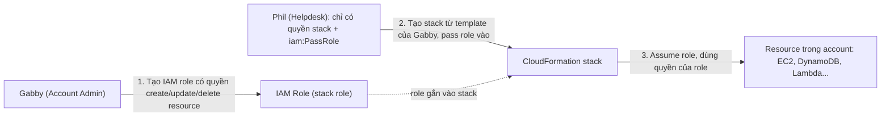

# CFN Stack Roles

> **TL;DR:** Stack role (service role của CloudFormation) là một IAM role gắn vào stack để CloudFormation **assume** và dùng quyền của role đó khi create/update/delete resource, thay vì dùng quyền của người đang thao tác. Nhờ vậy người dùng chỉ cần quyền trên **stack** cộng với **`iam:PassRole`**, không cần quyền trực tiếp trên resource: đây là cách thực hiện **role separation**.

## 🖼️ Sơ đồ
![[CFN Stack Roles.excalidraw]]
*Mở bằng plugin Excalidraw để chỉnh sửa · ảnh tĩnh: [[CFN Stack Roles.svg]]*

## Khái niệm cốt lõi
- Khi tạo stack, CloudFormation tạo **physical resource** tương ứng với mỗi logical resource ([[CFN Physical and Logical Resources]]). Mọi hành động trong AWS đều cần quyền, và mặc định là **không có quyền gì**.
- **Mặc định**, CloudFormation dùng **quyền của identity đang thao tác** (ví dụ IAM user dùng console hoặc CLI). Nghĩa là identity đó cần cả hai:
  1. Quyền thao tác với **stack** (create/update/delete stack).
  2. Quyền thao tác với **mọi resource** mà stack tạo/sửa/xóa.
- Vấn đề với nhiều tổ chức: thường có **nhóm khác nhau** phụ trách tạo resource và nhóm chỉ được cập nhật hoặc hỗ trợ. Cấp toàn quyền resource cho nhóm hỗ trợ là quá rộng.
- **Stack role**: CloudFormation **assume một role** ([[IAM Roles]]) và dùng quyền của role đó để thao tác resource.
- Identity thao tác stack khi đó chỉ cần:
  - Quyền trên **stack** (cloudformation:CreateStack/UpdateStack/DeleteStack...).
  - Quyền **`iam:PassRole`** cho đúng role đó ([[Service-linked Roles and PassRole]]).
  - **Không** cần quyền trực tiếp trên resource.
- Bổ sung theo AWS hiện tại: role phải có **trust policy** cho principal `cloudformation.amazonaws.com`. Khi stack đã gắn role, các thao tác sau trên stack (update, delete) tiếp tục dùng role đó.

## Cách hoạt động / Kiến trúc
Ví dụ trong bài: **Gabby** là account admin, **Phil** là helpdesk engineer. Muốn Phil quản lý hạ tầng **chỉ thông qua CloudFormation**, không được tự tạo resource trực tiếp.

- Phil **không** sửa được role và **không** tự assume role trực tiếp được. Anh ta chỉ có thể **pass** role vào CloudFormation.
- Khi stack chạy, nó assume stack role để tạo resource, không phụ thuộc quyền của IAM user Phil.
- Kết quả là **role separation**:
  - Gabby tạo ra thứ để người khác dùng (bản thân Gabby thậm chí có thể không được phép dùng chúng).
  - Phil **không tự tạo được quyền** cho mình, chỉ **dùng** role, và **chỉ qua CloudFormation**.
- Lợi ích thêm: CloudFormation trở thành công cụ **kiểm soát** loại resource mà identity quyền thấp được phép tạo/sửa/xóa (gói gọn trong template đã duyệt).

## 🎯 Mẹo thi SAA-C03
- Kịch bản "một identity cần dùng CloudFormation để làm những việc mà **bên ngoài CloudFormation họ không được phép làm**" → **CloudFormation stack role**.
- Công thức: admin tạo IAM role có quyền resource → user quyền thấp chỉ cần **quyền CloudFormation trên stack + `iam:PassRole`** → pass role vào stack.
- Bẫy: user **không cần** quyền trực tiếp trên EC2/S3/DynamoDB...; ngược lại, thiếu `iam:PassRole` thì không gắn được role vào stack.
- Phân biệt:
  - [[EC2 Instance Roles]]: role cho **ứng dụng trên EC2** lấy credential.
  - [[Service-linked Roles and PassRole]]: PassRole là cơ chế chung cho việc trao role cho dịch vụ; stack role là một ứng dụng cụ thể của nó.
  - [[CFN StackSets]]: dùng role để deploy **sang account/region khác**, còn stack role là về **phân tách quyền trong một account**.

## Liên kết
- Tiên quyết: [[CloudFormation Basics]], [[IAM Roles]], [[IAM Identity Policies]], [[Service-linked Roles and PassRole]]
- Liên quan: [[CFN Physical and Logical Resources]], [[IAM Users and ARNs]], [[CFN Change Sets]]
- Phân biệt với: [[EC2 Instance Roles]], [[CFN StackSets]]
- Section: [[_MOC 19 CloudFormation]]
