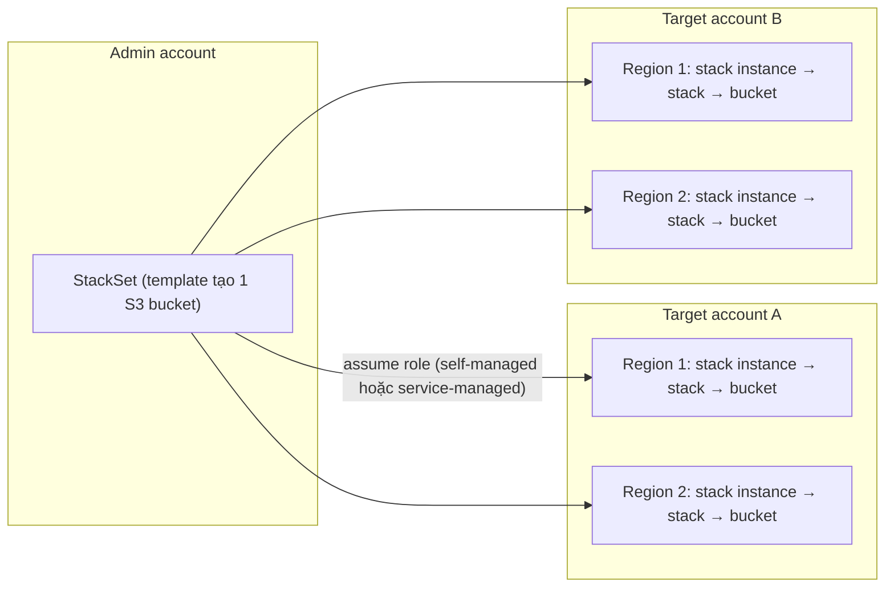

# CFN StackSets

> **TL;DR:** StackSets cho phép dùng **một template CloudFormation** để create, update, delete hạ tầng trên **nhiều region của nhiều AWS account** cùng lúc. Thay vì đăng nhập từng account và chuyển từng region để tạo stack, bạn khai báo đích một lần ở admin account, CloudFormation **assume role** vào các target account và làm hết phần còn lại.

## 🖼️ Sơ đồ
![[CFN StackSets.excalidraw]]
*Mở bằng plugin Excalidraw để chỉnh sửa · ảnh tĩnh: [[CFN StackSets.svg]]*

## Khái niệm cốt lõi
- **StackSet**: là một **container** nằm trong **admin account**. "Admin account" chỉ là cách gọi account nơi tạo StackSet, không có gì đặc biệt về mặt kỹ thuật.
- **Stack instance**: là **tham chiếu** tới **một stack** trong **một region** của **một account** cụ thể. Một StackSet chứa nhiều stack instance.
  - Stack instance khác stack: nếu stack tạo **thất bại**, stack instance **vẫn còn** để ghi lại chuyện gì đã xảy ra và lý do lỗi. Có thể coi stack instance là "vỏ chứa" cho một stack riêng lẻ.
- **Target account**: account bình thường, được gọi là "target" vì StackSet nhắm tới để deploy resource. Stack instance và stack thực tế nằm trong các target account/region.
- Mỗi stack do StackSet tạo ra là **một stack CloudFormation bình thường**, chạy trong 1 region của 1 account (xem [[CloudFormation Basics]]).
- **Template** dùng cho StackSet cũng là **template bình thường**, không có cú pháp riêng.

### Hai mô hình permission
| Mô hình | Cách hoạt động | Khi nào dùng |
|---|---|---|
| **Self-managed** | Bạn tự tạo IAM role: role quản trị ở admin account (mặc định tên `AWSCloudFormationStackSetAdministrationRole`) và role thực thi ở mỗi target account (`AWSCloudFormationStackSetExecutionRole`) có trust tới admin account | Account không nằm chung Organization, hoặc muốn tự kiểm soát role |
| **Service-managed** | Dùng CloudFormation kết hợp [[AWS Organizations]] (bật trusted access). Role được **tạo tự động** phía sau | Account cùng một Organization; có thể chọn đích theo **OU** |

- Dù mô hình nào, bản chất là CloudFormation **assume role** ([[IAM Roles]]) để tương tác với target account.
- Bổ sung theo AWS hiện tại (khóa học không đi sâu): với service-managed có **automatic deployment**, tức account mới được thêm vào OU đích sẽ tự nhận stack instance, và account bị đưa ra khỏi OU có thể tự gỡ (hoặc giữ) stack. Có thể đăng ký **delegated administrator** để một member account quản lý StackSets thay management account.

## Cách hoạt động / Kiến trúc
Ví dụ trong bài: StackSet "bucket-o-tron" ở admin account, template chỉ tạo 1 S3 bucket; 2 target account, mỗi account 2 region.

Trình tự:
1. Tạo StackSet ở admin account, chọn template.
2. Chọn đích: **account** hoặc **OU**, cùng danh sách **region**.
3. CloudFormation dùng role để vào từng target account, tạo **stack instance** trong mỗi region đã chọn.
4. Từ mỗi stack instance, **stack** thật được tạo (1 stack mỗi region mỗi account), stack tạo các resource trong template.
- 2 account × 2 region = 4 stack nếu làm tay. Với tất cả region và khoảng 50 account, lợi ích tiết kiệm công sức trở nên rất rõ.

## Các tham số cần biết
| Thuật ngữ | Ý nghĩa |
|---|---|
| **Concurrent accounts** (maximum concurrent accounts) | Số account được deploy **cùng lúc**. Ví dụ 10 account, giá trị 2 → deploy thành 5 đợt, mỗi đợt 2 account. Càng cao thì về lý thuyết càng nhanh. Có thể đặt theo số hoặc phần trăm. |
| **Failure tolerance** | Số lần deploy riêng lẻ được phép **thất bại** trước khi cả thao tác StackSet bị coi là thất bại. Cần cân nhắc kỹ với triển khai lớn. |
| **Retain stacks** | Khi **xóa stack instance** khỏi StackSet, mặc định stack ở target account **bị xóa** theo. Bật retain thì stack (và resource) **được giữ lại** trong account/region đó, chỉ bị tách khỏi StackSet. |

## Kịch bản sử dụng điển hình
- **Bật AWS Config** trên số lượng lớn account ([[AWS Config]]).
- Triển khai **AWS Config Rules** đồng loạt, ví dụ kiểm tra [[MFA]], Elastic IP không gắn, [[EBS Encryption]].
- Tạo **IAM role cho cross-account access** ở quy mô lớn: viết một template tạo role, deploy qua StackSet thay vì tạo thủ công trong từng account.
- Các baseline bảo mật/governance khác cho cả tổ chức (cũng là cách [[AWS Control Tower]] triển khai guardrail và baseline phía sau).

## 🎯 Mẹo thi SAA-C03
- Từ khóa: "deploy cùng một hạ tầng/cấu hình ra **nhiều account và nhiều region**", "từ **một chỗ** quản lý tập trung", "account mới trong Organization phải tự có cấu hình X" → **CloudFormation StackSets** (service-managed + automatic deployment).
- Nhớ cấu trúc: **StackSet (admin account) → stack instance (account + region) → stack → resource**.
- Permission: **self-managed** (tự tạo IAM role) vs **service-managed** (dùng [[AWS Organizations]], role tự tạo). Đề nhắc "đã dùng AWS Organizations" → thường là service-managed.
- Phân biệt với:
  - [[CFN Nested Stacks]]: tái sử dụng template **trong cùng một stack lớn**, cùng account/region.
  - [[CFN Cross-Stack References]]: chia sẻ output giữa các stack **cùng region**.
  - [[CFN Change Sets]]: xem trước thay đổi của **một** stack.
- Bẫy: xóa stack instance mặc định **xóa luôn stack và resource** ở target; muốn giữ thì dùng **retain stacks**.

## Liên kết
- Tiên quyết: [[CloudFormation Basics]], [[CFN Physical and Logical Resources]], [[IAM Roles]], [[AWS Organizations]]
- Liên quan: [[AWS Config]], [[AWS Control Tower]], [[Service Control Policies]], [[CFN Stack Roles]], [[AWS Accounts]]
- Phân biệt với: [[CFN Nested Stacks]], [[CFN Cross-Stack References]], [[CFN Change Sets]]
- Section: [[_MOC 19 CloudFormation]]
