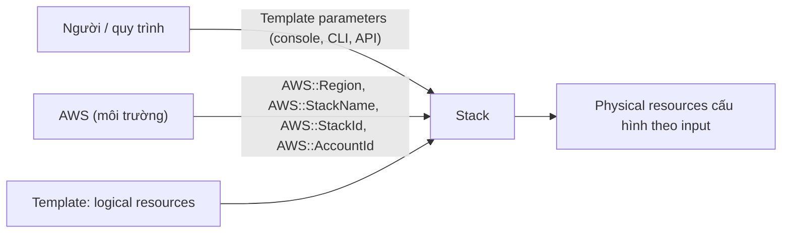

# CFN Template and Pseudo Parameters

> **TL;DR:** Parameter là cách đưa **input từ bên ngoài** vào template. **Template parameter** do người hoặc quy trình nhập lúc create/update stack. **Pseudo parameter** do **AWS tự cung cấp** theo môi trường (region, account, tên stack). Cả hai là công cụ chính để biến template non-portable thành **portable**.

## 🖼️ Sơ đồ
![[CFN Template and Pseudo Parameters.excalidraw]]
*Mở bằng plugin Excalidraw để chỉnh sửa · ảnh tĩnh: [[CFN Template and Pseudo Parameters.svg]]*

![[CFN Template and Pseudo Parameters - portable.excalidraw]]
*Mở bằng plugin Excalidraw để chỉnh sửa · ảnh tĩnh: [[CFN Template and Pseudo Parameters - portable.svg]]*

## Khái niệm cốt lõi
### Template parameters
- Khai báo trong section `Parameters`. Giá trị được nhập qua **console, CLI hoặc API** khi **tạo hoặc cập nhật** stack. Ví dụ: kích thước instance, môi trường (dev/test/prod).
- Logical resource dùng giá trị này qua `!Ref ParameterName`, nhờ đó parameter ảnh hưởng tới physical resource và cấu hình của nó.
- Mỗi parameter có thể cấu hình:
  - **`Default`**: giá trị dùng khi không nhập gì.
  - **`AllowedValues`**: danh sách hợp lệ, ví dụ 3 instance type.
  - **Ràng buộc**: `MinLength`/`MaxLength`, `MinValue`/`MaxValue`, **`AllowedPattern`** (regex).
  - **`NoEcho: true`**: ẩn giá trị khi gõ và khi hiển thị. Dùng cho **mật khẩu**.
  - **`Description`**: giúp console UI dễ dùng.
  - **`Type`**: loại đơn giản (`String`, `Number`, `List<Number>`, `CommaDelimitedList`) hoặc **loại riêng của AWS** như `AWS::EC2::VPC::Id`, `List<AWS::EC2::Subnet::Id>`, `AWS::EC2::KeyPair::KeyName`. Với loại AWS, console tự hiện danh sách lựa chọn có thật trong account và region hiện tại.
- Ví dụ trên slide: `InstanceType` (String, default `t3.micro`, 3 allowed values, có description) và `InstanceAmiId` (String tự do).

### Pseudo parameters
- Giống template parameter nhưng **AWS bơm sẵn vào** template và stack. **Không cần khai báo** trong `Parameters`, cứ `!Ref` là dùng được.

| Pseudo parameter | Giá trị |
|---|---|
| `AWS::Region` | Region đang tạo stack (ví dụ `us-east-1`) |
| `AWS::StackName` | Tên stack |
| `AWS::StackId` | ID duy nhất của stack |
| `AWS::AccountId` | Account ID nơi tạo stack |

- Ngoài bài giảng, nên biết thêm `AWS::Partition`, `AWS::URLSuffix`, và **`AWS::NoValue`** (dùng với `Fn::If` để bỏ hẳn một property).
- Hai loại parameter **dùng bổ sung cho nhau**, không phải chọn một.

### Best practice
- **Giảm tối đa số parameter bắt buộc nhập.** Nên có default hợp lý, và lấy giá trị từ AWS (pseudo parameter, SSM) thay vì bắt người dùng gõ.

## Demo / Lab: tiến hóa sang template portable (0333)
Bốn template: `nonportable`, `portable-stage1`, `portable-stage2`, `portable-stage3` (có cả bản JSON và YAML).

| Giai đoạn | Thay đổi | Kết quả |
|---|---|---|
| nonportable | Đặt cứng `BucketName` và `ImageId` | Stack thứ hai trong cùng account fail (bucket trùng tên) và fail rồi **rollback** |
| stage1 | **Bỏ `BucketName`** | Tạo nhiều lần được. Nhưng sang **us-east-2** thì fail vì AMI ID là theo region |
| stage2 | `ImageId: !Ref AMIID` (parameter String, không default) | Portable, nhưng người dùng phải tự tra AMI ID đúng region |
| stage3 | Parameter kiểu **`AWS::SSM::Parameter::Value<AWS::EC2::Image::Id>`**, default là path SSM public `/aws/service/ami-amazon-linux-latest/amzn2-ami-hvm-x86_64-gp2` | **Hoàn toàn portable**: tự lấy AMI Amazon Linux 2 **mới nhất** đúng region, không cần nhập gì |

- **Tự đặt tên physical resource**: khi không ghi `BucketName`, CFN đặt tên theo dạng `<tên stack>-<logical ID>-<chuỗi ngẫu nhiên>` (ví dụ `portablestage1-bucket-xxxx`). Tên stack là duy nhất trong region, logical ID là duy nhất trong template, thêm phần ngẫu nhiên nên tên luôn duy nhất.
- SSM Parameter Store có nhiều **public parameter** do AWS duy trì (AMI ID, thông tin region và service...). Chúng giúp tham chiếu động những giá trị phụ thuộc region hoặc được AWS cập nhật. Xem [[SSM Parameter Store]].
- (Khóa học dùng Amazon Linux 2. AL2 hết hỗ trợ vào giữa 2026, hiện nay nên dùng AL2023, ví dụ path `/aws/service/ami-amazon-linux-latest/al2023-ami-kernel-default-x86_64`.)

**Quy tắc Adrian rút ra:**
1. **Không đặt tên cứng** cho resource cần tên duy nhất. Để CFN tự đặt.
2. Tránh giá trị theo region (AMI ID, key name). Bước đầu tiên là đưa chúng thành parameter **có default hợp lý**, để ít nhất một region chạy được mà không phải nhập gì.
3. Tốt nhất là **tham chiếu động** (SSM public parameter, pseudo parameter, [[CFN Mappings]]).

## 🎯 Mẹo thi SAA-C03
- "Template phải chạy được ở mọi region, luôn dùng AMI mới nhất" → parameter kiểu SSM `AWS::SSM::Parameter::Value<AWS::EC2::Image::Id>` trỏ tới **public parameter**. Cách khác là bảng AMI theo region bằng [[CFN Mappings]] + `AWS::Region`.
- "Ẩn mật khẩu nhập vào template" → `NoEcho`. Với secret thật, nên dùng dynamic reference tới [[Secrets Manager]] hoặc [[SSM Parameter Store]].
- "Giới hạn người dùng chỉ được chọn một vài instance type" → `AllowedValues`.
- Pseudo parameter **không cần khai báo**. Nhận diện qua tiền tố `AWS::`.
- Template stage nào còn đặt cứng tên hoặc ID theo region thì chưa portable.

## Liên kết
- Tiên quyết: [[CFN Physical and Logical Resources]], [[CloudFormation Basics]]
- Dùng cùng: [[CFN Intrinsic Functions]] (`Ref`, `Sub`), [[CFN Mappings]], [[CFN Conditions]]
- Liên quan: [[SSM Parameter Store]], [[AMI]], [[Secrets Manager]], [[CFN Nested Stacks]] (truyền parameter cho stack con)
- MOC: [[_MOC 19 CloudFormation]]
