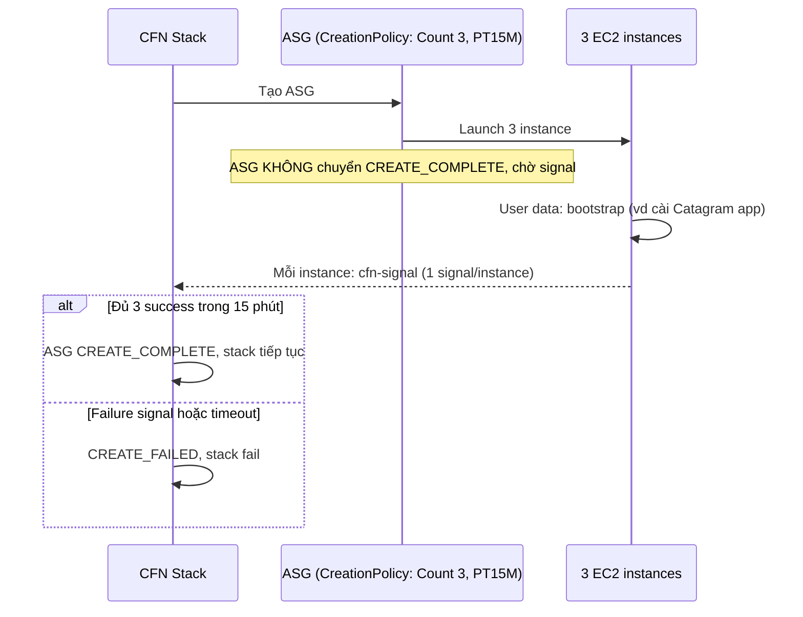
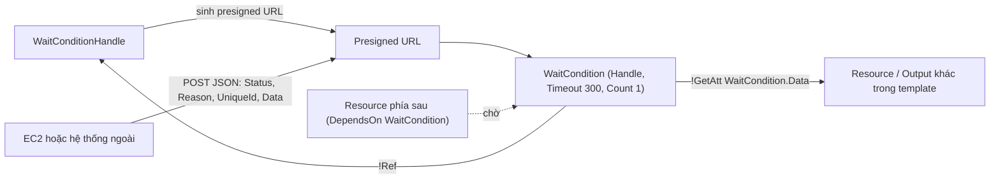

# CFN Wait Conditions and cfn-signal

> **TL;DR:** Mặc định CloudFormation coi một EC2 instance là `CREATE_COMPLETE` ngay khi EC2 báo launch xong, dù bootstrapping bên trong còn chạy hoặc đã lỗi. **CreationPolicy**, **WaitCondition** và công cụ **cfn-signal** cho phép stack *chờ* một số tín hiệu thành công trong một khoảng timeout trước khi đánh dấu resource hoàn tất. Hết hạn hoặc nhận tín hiệu lỗi thì resource và stack fail.

## 🖼️ Sơ đồ
![[CFN Wait Conditions and cfn-signal.excalidraw]]
*Mở bằng plugin Excalidraw để chỉnh sửa · ảnh tĩnh: [[CFN Wait Conditions and cfn-signal.svg]]*

![[CFN Wait Conditions and cfn-signal - waitcondition.excalidraw]]
*Mở bằng plugin Excalidraw để chỉnh sửa · ảnh tĩnh: [[CFN Wait Conditions and cfn-signal - waitcondition.svg]]*

## Khái niệm cốt lõi
### Vấn đề của provisioning thông thường
- Luồng bình thường: logical resource trong template → stack yêu cầu EC2 tạo physical resource → EC2 báo xong → logical resource chuyển `CREATE_COMPLETE` ([[CFN Physical and Logical Resources]]).
- CloudFormation chỉ biết những gì **EC2 service** nói. Nó không biết gì về [[EC2 User Data Bootstrapping|bootstrapping]] chạy *trong* OS sau khi instance đã "running".
- Hệ quả: instance `CREATE_COMPLETE` từ lâu trước khi bootstrap xong. Nếu bootstrap **lỗi**, resource vẫn hiện `CREATE_COMPLETE`. Không có kênh nào báo ngược kết quả về CloudFormation.

### Cơ chế chung: chờ N tín hiệu trong thời hạn T
- Cấu hình cho resource phải nhận **một số lượng success signal** (Count) trong một **timeout**.
- **Timeout tối đa 12 giờ** (giờ, phút, giây).
- Khi có cấu hình này, resource **không** tự chuyển sang `CREATE_COMPLETE` khi EC2 báo sẵn sàng mà **đứng chờ**.
- Ba kết cục:

| Tình huống | Kết quả |
|---|---|
| Nhận đủ số success signal trong timeout | Resource `CREATE_COMPLETE`, stack tiếp tục; giờ ta *biết chắc* instance đã cấu hình xong |
| cfn-signal gửi **failure signal** | Fail **tường minh**: resource tạo lỗi, stack fail (mặc định rollback) |
| Hết timeout mà chưa đủ success signal | Fail **ngầm định** (implicit failure): resource lỗi, stack fail |

### cfn-signal
- Là một helper nằm trong gói **aws-cfn-bootstrap** (cùng họ với [[cfn-init]] và [[cfn-hup]]), chạy **trên chính instance** và gửi tín hiệu về CloudFormation service.
- Gửi được cả **success** lẫn **failure**. Mẫu phổ biến ở cuối user data:
  `cfn-signal -e $? --stack ${AWS::StackName} --resource <LogicalID> --region ${AWS::Region}`
  - `-e $?` = exit code của lệnh liền trước (thường là `cfn-init` hoặc script bootstrap). 0 → success, khác 0 → failure.
  - `!Sub` thay pseudo parameter bằng giá trị thật để cfn-signal biết báo về **đúng stack, đúng resource, đúng region** ([[CFN Template and Pseudo Parameters]], [[CFN Intrinsic Functions]]).
- Thứ được "signal" là một **logical resource**: hoặc resource có **CreationPolicy** (EC2, ASG), hoặc một resource **WaitCondition** riêng.

### CreationPolicy
- Là thuộc tính gắn **ngay trên resource** cần chờ, thường là `AWS::EC2::Instance` hoặc `AWS::AutoScaling::AutoScalingGroup`.
- AWS **khuyến nghị** dùng CreationPolicy cho EC2 và [[Auto Scaling Groups]] vì nó gắn trực tiếp với resource đang tạo, đơn giản hơn.

```yaml
EC2Instance:
  Type: AWS::EC2::Instance
  CreationPolicy:
    ResourceSignal:
      Count: 1
      Timeout: PT15M      # ISO 8601: 15 phút
```

### WaitCondition + WaitConditionHandle
- **WaitCondition** (`AWS::CloudFormation::WaitCondition`) là một **logical resource riêng**, không phải thuộc tính của resource khác.
- Nó có thể `DependsOn` resource khác, và resource khác có thể `DependsOn` nó ([[CFN DependsOn]]). Vì vậy nó đóng vai **cổng tiến trình (progress gate)** tổng quát trong template: điểm không vượt qua được cho tới khi nhận đủ signal hoặc hết timeout.
- Thuộc tính chính: `Handle` (trỏ tới WaitConditionHandle), `Timeout` (giây, ví dụ `300`), `Count` (số signal cần).
- **WaitConditionHandle** (`AWS::CloudFormation::WaitConditionHandle`) là một logical resource khác, nhiệm vụ duy nhất: **sinh ra một presigned URL** để gửi signal tới. Vì là presigned nên bên gửi **không cần AWS credentials** (credentials đã nằm trong URL, cùng ý tưởng với [[S3 Presigned URLs]]).
- Bên gửi có thể là **EC2 hoặc hệ thống bên ngoài** (external server, hệ thống IT on-prem, hệ thống cấp license...).
- Signal là một **JSON document** gồm `Status` (ví dụ `SUCCESS`), `Reason`, `UniqueId`, `Data`.
- Điểm mạnh riêng: phần `Data` truy cập được ở chỗ khác trong template bằng `!GetAtt WaitCondition.Data`, trả về JSON dạng `{"<UniqueId>": "<Data>"}`. Đây là một kênh **trao đổi dữ liệu nhỏ** từ bên ngoài vào stack (ví dụ thông tin license, trạng thái chi tiết từ hệ thống ngoài).

```yaml
WaitHandle:
  Type: AWS::CloudFormation::WaitConditionHandle
WaitCondition:
  Type: AWS::CloudFormation::WaitCondition
  DependsOn: SomeResource
  Properties:
    Handle: !Ref WaitHandle
    Timeout: "300"
    Count: 1
```

## Cách hoạt động / Kiến trúc
### CreationPolicy với Auto Scaling Group
Ví dụ trong bài: ASG (dùng launch configuration/[[Launch Templates|launch template]]) tạo 3 instance, CreationPolicy yêu cầu **3 signal trong 15 phút**.



### WaitCondition với hệ thống ngoài


## Bảng so sánh: CreationPolicy vs WaitCondition

| Tiêu chí | CreationPolicy | WaitCondition |
|---|---|---|
| Bản chất | Thuộc tính gắn trên resource | Logical resource riêng (+ WaitConditionHandle) |
| Dùng cho | EC2 instance, Auto Scaling Group | Cổng chờ tổng quát; tích hợp hệ thống ngoài |
| Cách gửi signal | `cfn-signal` trên instance | `cfn-signal` hoặc HTTP tới presigned URL của handle |
| Cần credentials? | Không (helper dùng API signal của CFN) | Không (presigned URL) |
| Truyền dữ liệu về stack | Không | Có: `!GetAtt <WaitCondition>.Data` |
| Quan hệ phụ thuộc | Gắn với một resource | `DependsOn` hai chiều, đặt ở bất kỳ điểm nào |
| Khuyến nghị AWS | **Ưu tiên** cho hầu hết trường hợp | Khi cần luồng phức tạp/hệ thống ngoài |
| Timeout | Tối đa 12 giờ (ISO 8601, vd `PT15M`) | Tối đa 12 giờ (giây, vd `300`; max 43200) |

## Demo / Lab
- **0167 (WordPress với cfn-init + CreationPolicy)**: CreationPolicy timeout 15 phút trên EC2Instance. User data chỉ còn update hệ thống, chạy [[cfn-init]], rồi `cfn-signal` gửi kết quả. Stack mất thêm vài phút vì phải chờ instance launch, pass status checks, chạy xong cfn-init. Trong tab Events xuất hiện dòng **"Received SUCCESS signal with UniqueId <instance-id>"**: đó là tín hiệu stack chờ. Lúc đó mới chắc instance đã sẵn sàng, không chỉ dựa vào "2/2 status checks" của EC2.
- **0344 (so sánh user data trần và user data + signal)**:
  - Template 1 chỉ có user data với `sleep 300` giả lập bootstrap dài: stack `CREATE_COMPLETE` sau khoảng 60 s nhưng web chưa lên tới 5 phút sau. CloudFormation hoàn toàn không biết về bootstrap.
  - Template 2 chỉ thêm **2 thay đổi**: một `CreationPolicy` và **một dòng `cfn-signal` cuối user data**. Stack lâu hơn (khoảng 6–7 phút) nhưng khi `CREATE_COMPLETE` thì web dùng được ngay. Toàn bộ stack chỉ `CREATE_COMPLETE` khi mọi resource, kể cả instance đang chờ signal, đều xong.
  - Cả hai template vẫn chung một hạn chế: update stack không cập nhật cấu hình OS. Cách sửa nằm ở [[cfn-init]] + [[cfn-hup]] (0345), bảng 4 bước tiến hóa xem trong note [[cfn-hup]].

## 🎯 Mẹo thi SAA-C03
- Adrian nhấn mạnh: **phải hiểu cả CreationPolicy và WaitCondition** cho kỳ thi.
- "Stack báo `CREATE_COMPLETE` nhưng ứng dụng trên EC2/ASG chưa cài xong hoặc cài lỗi", "stack chỉ được hoàn tất khi bootstrapping thành công" → **CreationPolicy + cfn-signal**.
- "ASG cần N instance báo khỏe trước khi stack tiếp tục" → CreationPolicy trên ASG với `Count = N`.
- "Chờ một hệ thống bên ngoài/on-prem xác nhận rồi mới tạo phần còn lại", "cần đưa dữ liệu từ bên ngoài vào stack" → **WaitCondition + WaitConditionHandle** (presigned URL, `GetAtt .Data`).
- Hết timeout **= thất bại**, không phải bỏ qua. Timeout tối đa **12 giờ**.
- Phân biệt các công cụ:
  - Chờ *resource khác tạo xong* → [[CFN DependsOn]] (không cần signal).
  - Chờ *bootstrapping trong OS* xong → CreationPolicy/WaitCondition + cfn-signal.
  - *Áp cấu hình* desired state → [[cfn-init]]; *cập nhật lại khi update stack* → [[cfn-hup]].
  - Logic tùy biến khi tạo/xóa resource (gọi Lambda) → [[CFN Custom Resources]].

## Liên kết
- Tiên quyết: [[CloudFormation Basics]], [[CFN Physical and Logical Resources]], [[EC2 User Data Bootstrapping]]
- Dùng cùng: [[cfn-init]], [[cfn-hup]], [[CFN Template and Pseudo Parameters]], [[CFN Intrinsic Functions]], [[Auto Scaling Groups]], [[Launch Templates]]
- Liên quan: [[S3 Presigned URLs]], [[EC2 Status Checks and Auto Recovery]], [[ASG Lifecycle Hooks]]
- Phân biệt với: [[CFN DependsOn]], [[CFN Custom Resources]]
- Section: [[_MOC 19 CloudFormation]]
