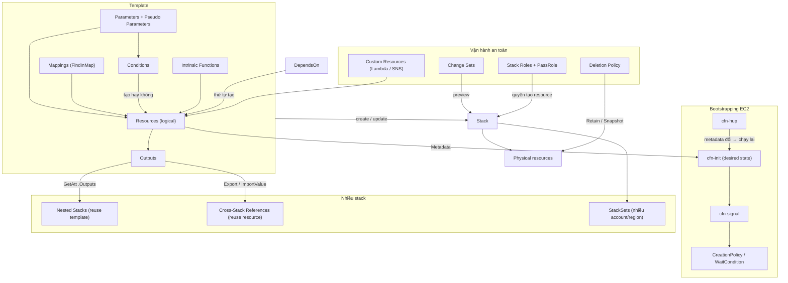

# 19 CloudFormation

Section đi sâu vào CloudFormation sau phần nhập môn ở [[CloudFormation Basics]]: cấu trúc template (parameters, mappings, conditions, outputs), intrinsic functions, kiểm soát thứ tự và bootstrapping EC2 (DependsOn, cfn-init, cfn-signal, cfn-hup), kiến trúc nhiều stack (nested, cross-stack, StackSets) và các tính năng vận hành an toàn (DeletionPolicy, stack roles, change sets, custom resources). Ở SAA-C03, trọng tâm là chọn đúng cơ chế cho từng tình huống kiến trúc, không phải cú pháp.

← [[00 Home]] · Trước: [[_MOC 18 Security Deployment and Operations]] · Sau: [[_MOC 20 NoSQL and Analytics]]

## Lộ trình học
1. [[CFN Physical and Logical Resources]] — template chứa logical resource, stack tạo physical resource; template ≠ stack; template đặt cứng giá trị là non-portable.
2. [[CFN Template and Pseudo Parameters]] — template parameter do người nhập, pseudo parameter `AWS::` do AWS cấp; công cụ chính để template portable.
3. [[CFN Intrinsic Functions]] — Ref, GetAtt, GetAZs, Select, Join, Sub, Base64, Cidr... lấy dữ liệu lúc runtime.
4. [[CFN Mappings]] — bảng tra tĩnh đọc bằng `FindInMap`, ca kinh điển là AMI theo region.
5. [[CFN Outputs]] — trả giá trị sau khi tạo stack, được stack cha đọc hoặc export cho stack khác.
6. [[CFN Conditions]] — điều kiện true/false quyết định resource có được tạo không; một template cho dev và prod.
7. [[CFN DependsOn]] — explicit dependency khi CFN không tự suy ra, ca kinh điển EIP chờ IGW attachment.
8. [[CFN Wait Conditions and cfn-signal]] — CreationPolicy/WaitCondition + cfn-signal để stack chờ bootstrapping thành công trong timeout.
9. [[CFN Nested Stacks]] — root stack tạo stack con từ template riêng; reuse template, vượt 500 resource, chỉ khi cùng lifecycle.
10. [[CFN Cross-Stack References]] — Export + `Fn::ImportValue` dùng resource thật của stack khác, cùng account và region.
11. [[CFN StackSets]] — một template triển khai ra nhiều account và region, self-managed hoặc service-managed qua Organizations.
12. [[CFN Deletion Policy]] — Delete / Retain / Snapshot quyết định số phận physical resource khi bị xóa.
13. [[CFN Stack Roles]] — CFN assume role để thao tác resource; user chỉ cần quyền stack + `iam:PassRole`.
14. [[cfn-init]] — helper đọc `AWS::CloudFormation::Init` để đưa EC2 về desired state.
15. [[cfn-hup]] — daemon phát hiện metadata đổi sau update stack và chạy lại cfn-init.
16. [[CFN Change Sets]] — xem trước thay đổi (thêm, sửa, xóa, replace) trước khi execute update stack.
17. [[CFN Custom Resources]] — gửi event create/update/delete tới Lambda hoặc SNS để làm việc CFN không hỗ trợ native.

## Bản đồ khái niệm

## Liên kết sang section khác
- [[CloudFormation Basics]] — nhập môn template, stack, logical/physical resource.
- [[EC2 User Data Bootstrapping]] — user data là nền cho cfn-init và cfn-signal.
- [[Auto Scaling Groups]] — CreationPolicy chờ N instance của ASG báo thành công.
- [[Service-linked Roles and PassRole]] — cơ chế PassRole mà stack role dựa vào.
- [[AWS Organizations]] — StackSets service-managed và automatic deployment.
- [[SSM Parameter Store]] — public parameter cho AMI mới nhất, dynamic reference.
- [[Secrets Manager]] — dynamic reference cho secret thay vì NoEcho.
- [[Lambda]] — backing cho custom resources.
- [[VPC Routing and Internet Gateway]] — ca EIP/IGW attachment cần DependsOn.

## 🎯 Top mẹo thi của section
- **Template ≠ stack**: reuse **template** → Nested Stacks; reuse **resource thật của stack khác** → Cross-Stack References ([[CFN Nested Stacks]], [[CFN Cross-Stack References]]).
- Nested stacks chỉ khi mọi phần **lifecycle linked**; từ khóa "vượt 500 resource", "modular template" ([[CFN Nested Stacks]]).
- Cross-stack: export name duy nhất trong region, `Fn::ImportValue` thay `Ref`, **không cross-region, không cross-account** ([[CFN Cross-Stack References]]).
- Cùng hạ tầng cho **nhiều account và nhiều region** từ một chỗ → **StackSets** (service-managed khi đã dùng Organizations) ([[CFN StackSets]]).
- Template chỉ chạy được ở một region hoặc một lần → nghi giá trị đặt cứng; dùng parameter, pseudo parameter, Mappings, SSM parameter ([[CFN Physical and Logical Resources]], [[CFN Template and Pseudo Parameters]]).
- AMI theo region → **Mappings + `AWS::Region`**; luôn AMI mới nhất → **SSM public parameter** ([[CFN Mappings]]).
- Một template cho dev/prod, prod có thêm resource → **Parameter + Conditions** ([[CFN Conditions]]).
- Stack lỗi khi tạo/xóa liên quan **EIP + IGW** → thêm **DependsOn** IGW attachment ([[CFN DependsOn]]).
- Stack báo CREATE_COMPLETE nhưng app trên EC2/ASG chưa cài xong → **CreationPolicy + cfn-signal**; chờ hệ thống ngoài → **WaitCondition**; timeout tối đa 12 giờ và hết hạn = fail ([[CFN Wait Conditions and cfn-signal]]).
- Update stack phải cập nhật cấu hình OS trên EC2 đang chạy → **cfn-hup + cfn-init**; user data chỉ chạy lần launch đầu ([[cfn-hup]], [[cfn-init]]).
- Xóa stack nhưng giữ DB/bucket → **Retain**; giữ bản sao dữ liệu RDS/EBS/Redshift → **Snapshot**; EC2 instance không hỗ trợ Snapshot ([[CFN Deletion Policy]]).
- User quyền thấp cần CFN tạo resource họ không tự tạo được → **stack role**, user chỉ cần quyền stack + `iam:PassRole` ([[CFN Stack Roles]]).
- "Preview thay đổi, xem resource nào bị replace/xóa trước khi update" → **Change Sets**; change set không bảo vệ dữ liệu ([[CFN Change Sets]]).
- CFN không hỗ trợ native, tích hợp hệ thống ngoài, empty S3 bucket khi xóa stack → **Lambda-backed Custom Resource**, nhớ gửi response về ResponseURL ([[CFN Custom Resources]]).
