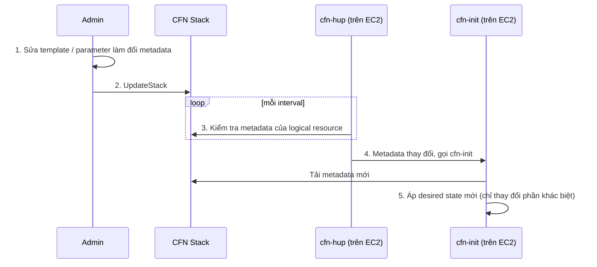

# cfn-hup

> **TL;DR:** `cfn-hup` là helper daemon chạy trên EC2, định kỳ kiểm tra metadata của một logical resource trong stack. Khi metadata đổi (sau một lần update stack), nó chạy action đã cấu hình, thường là chạy lại [[cfn-init]]. Nhờ vậy update stack có thể cập nhật cả cấu hình bên trong OS của instance, điều mà user data hay cfn-init đơn thuần không làm được.

## 🖼️ Sơ đồ
![[cfn-hup.excalidraw]]
*Mở bằng plugin Excalidraw để chỉnh sửa · ảnh tĩnh: [[cfn-hup.svg]]*

![[cfn-hup - evolution.excalidraw]]
*Mở bằng plugin Excalidraw để chỉnh sửa · ảnh tĩnh: [[cfn-hup - evolution.svg]]*

## Khái niệm cốt lõi
- [[cfn-init]] chỉ **chạy một lần** lúc bootstrapping. Sửa template rồi update stack thì cfn-init **không** tự chạy lại, nên cấu hình mới không được áp vào OS.
- User data cũng vậy: chỉ chạy lần launch đầu tiên. Đổi user data qua update stack thì instance bị stop/start nhưng script **không** chạy lại.
- **cfn-hup** lấp khoảng trống này:
  - Là công cụ **bạn phải tự cài và cấu hình** trên instance. Thường làm ngay trong quá trình bootstrap (ví dụ một config key `install_cfn` trong `AWS::CloudFormation::Init`).
  - Được trỏ vào một logical resource trong stack và **theo dõi metadata** của resource đó.
  - Khi phát hiện thay đổi, chạy **action tùy cấu hình**. Phổ biến nhất là chạy lại `cfn-init` để áp lại desired state.
- Kết quả: cfn-init + cfn-hup biến mỗi lần **UpdateStack có đổi metadata** thành một lần cập nhật cấu hình OS của EC2.

### Cấu hình (hai file trên instance)
| File | Nội dung chính |
|---|---|
| `/etc/cfn/cfn-hup.conf` | `stack` (stack ID), `region`, `interval` (bao lâu kiểm tra một lần, đơn vị phút; mặc định 15, demo đặt 1) |
| `/etc/cfn/hooks.d/cfn-auto-reloader.conf` | `triggers=post.update`, `path=Resources.<LogicalID>.Metadata.AWS::CloudFormation::Init` (vùng metadata cần theo dõi), `action=` lệnh chạy lại `cfn-init ...`, `runas=root` |

- Service `cfn-hup` cần được `enabled` và `ensureRunning` (khai báo trong section `services` của cfn-init) để nó luôn theo dõi.
- Log: `/var/log/cfn-hup.log`.

## Cách hoạt động / Kiến trúc

- Lưu ý: chỉ đổi **metadata** mới kích hoạt cfn-hup. Trong demo, parameter `Message` được tham chiếu trong section `files` của metadata, nên đổi parameter làm metadata đổi theo.
- Vì cfn-init là desired state, lần chạy lại chỉ sửa những gì khác biệt (ví dụ file `index.html` đã tồn tại thì được backup và ghi nội dung mới).

## Bảng so sánh: 4 bước tiến hóa template trong demo

| Template | Stack biết khi nào bootstrap xong? | Update stack có cập nhật cấu hình OS? | Ghi chú |
|---|---|---|---|
| 1. User data | Không: `CREATE_COMPLETE` sau khoảng 60 s dù bootstrap còn chạy 5 phút | Không: đổi user data → instance stop/start (đổi public IP), nhưng script không chạy lại | Hai vấn đề cần sửa |
| 2. User data + `cfn-signal` + CreationPolicy | **Có**: stack chờ "Received SUCCESS signal", mất khoảng 6–7 phút | Không | Sửa vấn đề 1 |
| 3. cfn-init + `cfn-signal` | Có | Không | Bootstrapping dạng desired state |
| 4. cfn-init + `cfn-signal` + **cfn-hup** | Có | **Có** | Sửa cả hai vấn đề |

## Demo / Lab
- Mô phỏng bootstrapping dài bằng `sleep 300` (5 phút); trang web hiển thị một CFN parameter (`Message`, "Cats are the best").
- **Template 1 (user data)**: stack xong trong khoảng 60 s nhưng web chưa lên vì còn đang sleep. CloudFormation không biết gì về bootstrapping bên trong. Update parameter thì đó là **update with some interruption**: instance bị stop rồi start, mất public IPv4 cũ, nhưng trang web **không đổi** vì user data chỉ chạy một lần.
- **Template 2 (+ signal)**: thêm CreationPolicy và một dòng `cfn-signal -e $?` cuối user data. Stack chỉ `CREATE_COMPLETE` khi bootstrap xong, nên vừa xong là web dùng được ngay. Update vẫn không cập nhật trang.
- **Template 3 (cfn-init)**: `packages` cài web server, `files` tạo HTML, `commands` chạy sleep 300, `services` bật/chạy httpd. Xem log `cloud-init-output.log`, `cfn-init-cmd.log`, `cfn-init.log` để chẩn đoán (đọc bằng `sudo`).
- **Template 4 (+ cfn-hup)**: `sudo tail -f /var/log/cfn-hup.log` thấy nó trỏ tới endpoint đúng region và báo "no change in path Resources.Instance.Metadata.AWS::CloudFormation::Init". Update stack với Message mới. Khi stack ở `UPDATE_COMPLETE`, lần kiểm tra kế tiếp (interval 1 phút) báo "data has changed from previous state", chạy lại cfn-init. `cfn-init.log` cho thấy `index.html` được backup và ghi lại. Trang web cập nhật **mà không thay instance**.

## 🎯 Mẹo thi SAA-C03
- Update stack **không tự chạy lại** bootstrapping trên EC2: user data chỉ chạy lần launch đầu, cfn-init chỉ chạy một lần.
- Đề hỏi "khi update CloudFormation stack, cấu hình phần mềm trên các EC2 hiện có phải tự cập nhật theo" → **cfn-hup + cfn-init**.
- Đề hỏi "stack phải chờ cho tới khi ứng dụng trên EC2 cấu hình xong" → **CreationPolicy + cfn-signal** (không phải cfn-hup).
- Nhớ vai trò từng helper: `cfn-init` áp cấu hình, `cfn-signal` báo kết quả, `cfn-hup` theo dõi thay đổi và kích hoạt chạy lại.

## Liên kết
- Tiên quyết: [[cfn-init]], [[EC2 User Data Bootstrapping]], [[CloudFormation Basics]]
- Dùng cùng: [[CFN Wait Conditions and cfn-signal]], [[CFN Template and Pseudo Parameters]]
- Liên quan: [[CFN Change Sets]] (xem trước tác động của update stack), [[CFN Physical and Logical Resources]], [[EC2 Instance Connect and SSH]]
- Section: [[_MOC 19 CloudFormation]]
