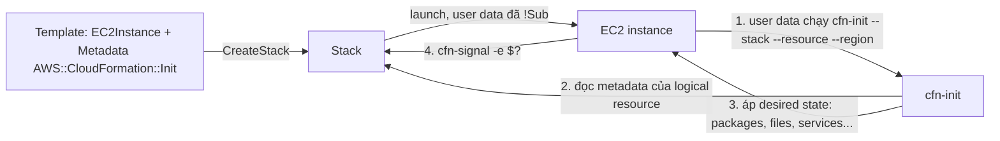

# cfn-init

> **TL;DR:** `cfn-init` là một helper script cài sẵn trong OS của EC2 (Amazon Linux), đọc khối cấu hình `AWS::CloudFormation::Init` nằm trong `Metadata` của logical resource rồi đưa instance về đúng **trạng thái mong muốn (desired state)**. Nó là cách bootstrapping mạnh hơn user data thuần: khai báo "muốn gì" thay vì viết script "làm thế nào", và có thể chạy lại khi stack được update (kết hợp [[cfn-hup]]).

## 🖼️ Sơ đồ
![[cfn-init.excalidraw]]
*Mở bằng plugin Excalidraw để chỉnh sửa · ảnh tĩnh: [[cfn-init.svg]]*

## Khái niệm cốt lõi
- **User data là procedural**: một script, OS chạy từng dòng một. Ta nói cho instance biết *cách* tự cấu hình. Đây là tính năng của EC2, không phải của CloudFormation: CFN chỉ base64 rồi đẩy nguyên khối vào, không hiểu nội dung (xem [[EC2 User Data Bootstrapping]]).
- **CloudFormation Init là desired state**: ta mô tả *kết quả* muốn có (gói nào phải cài, file nào phải tồn tại, service nào phải chạy), còn hệ thống tự lo cách đạt được. Đây là **tính năng native của CloudFormation**: chỉ thị được lưu ngay trong template, cạnh logical resource mà nó áp vào.
- Adrian gọi nó là một **hệ thống quản lý cấu hình (configuration management) đơn giản**, chứ không chỉ là "helper script".
- **Idempotent**: nếu thứ gì đó đã đúng trạng thái thì chạy lại `cfn-init` không làm gì cả. Ví dụ muốn Apache phiên bản X: chưa có thì cài, có bản cũ thì nâng, có đúng bản rồi thì bỏ qua. Không phải tự viết logic `if đã cài thì...` trong script.
- **Cross-platform hơn**: vì chỉ khai báo trạng thái nên cùng một cấu hình dùng được trên nhiều bản Linux khác nhau, có trường hợp cả Linux và Windows.
- Vị trí trong template: `Resources → <EC2Instance> → Metadata → AWS::CloudFormation::Init`.
- `cfn-init` vẫn phải được **gọi từ user data**. User data lúc này rất ngắn: cập nhật hệ thống, chạy `cfn-init`, rồi chạy `cfn-signal` để báo kết quả.

### Các section trong một config key
Mỗi **config key** là một "thùng chứa" chỉ thị, có cùng bộ section sau (cfn-init xử lý theo đúng thứ tự này):

| Section | Tác dụng |
|---|---|
| `packages` | Cài gói (yum, apt, rpm, python...), có thể chỉ định version; để trống thì lấy bản mặc định của trình quản lý gói |
| `groups` | Quản lý group local trên OS |
| `users` | Quản lý user local trên OS |
| `sources` | Tải archive (tar, zip...) và giải nén vào thư mục chỉ định, hỗ trợ cả xác thực |
| `files` | Tạo file với nội dung, quyền (mode), owner/group cụ thể |
| `commands` | Chạy lệnh tùy ý (phần procedural), có thể kèm điều kiện test |
| `services` | Đảm bảo service được `enabled` (khởi động cùng OS) và `ensureRunning` (đang chạy ngay) |

### configSets
- Thường chỉ cần một config key duy nhất (tên mặc định `config`).
- Khi cấu hình phức tạp, có thể định nghĩa nhiều config key rồi gom chúng vào **configSet**: một configSet chọn **những config key nào** sẽ dùng và **theo thứ tự nào**.
- Ví dụ WordPress trong bài: configSet `wordpress_install` gồm 5 key theo thứ tự `install_cfn → software_install → configure_instance → install_wordpress → configure_wordpress`. Có thể thêm configSet khác (nâng cấp WordPress, cài ứng dụng khác) trong cùng resource.
- Lệnh `cfn-init` chọn configSet bằng tham số `--configsets`.

## Cách hoạt động / Kiến trúc
Lệnh trong user data (dạng chuẩn của bài):

```bash
#!/bin/bash -xe
yum -y update
/opt/aws/bin/cfn-init -v --stack ${AWS::StackId} --resource EC2Instance --configsets wordpress_install --region ${AWS::Region}
/opt/aws/bin/cfn-signal -e $? --stack ${AWS::StackId} --resource EC2Instance --region ${AWS::Region}
```

- User data được bọc trong `Fn::Base64` và `!Sub`. `!Sub` thay `${AWS::StackId}` và `${AWS::Region}` (pseudo parameters, xem [[CFN Template and Pseudo Parameters]] và [[CFN Intrinsic Functions]]) bằng **giá trị thật** trước khi user data vào instance. Nhờ vậy `cfn-init` biết phải hỏi **đúng stack, đúng region, đúng logical resource**.
- `cfn-init` liên lạc với CloudFormation service, lấy metadata `AWS::CloudFormation::Init` của resource đó, rồi áp desired state.



### Creation Policy và cfn-signal (đi kèm cfn-init)
- **Vấn đề**: không có signal thì CloudFormation đánh dấu EC2 instance là `CREATE_COMPLETE` ngay khi EC2 báo đã launch xong, bất kể bootstrapping bên trong thành hay bại. Với S3 bucket hay instance trống thì ổn, nhưng với instance cần cấu hình sau launch thì CFN "mù".
- **CreationPolicy** gắn vào logical resource, kèm **timeout** (ví dụ 15 phút, `PT15M`). CloudFormation tạo một "điểm chờ": resource **không** chuyển sang `CREATE_COMPLETE` cho tới khi nhận được signal từ chính resource đó.
- `cfn-signal -e $?` gửi **exit code của lệnh trước** (tức `cfn-init`) về stack:
  - Thành công → resource `CREATE_COMPLETE`.
  - Lỗi → resource báo lỗi, stack không tạo thành công (mặc định rollback).
  - Hết timeout mà không có signal → CloudFormation coi là lỗi.
- Creation Policy dùng cho EC2 instance và cho [[Auto Scaling Groups]]. Chi tiết và so sánh với Wait Condition: [[CFN Wait Conditions and cfn-signal]].

## Bảng so sánh: User data vs cfn-init

| Tiêu chí | User data thuần | cfn-init (CloudFormation Init) |
|---|---|---|
| Kiểu | Procedural (script) | Desired state (+ commands procedural) |
| Thuộc về | EC2 | CloudFormation (native) |
| Nơi chứa cấu hình | Thuộc tính `UserData` | `Metadata → AWS::CloudFormation::Init` |
| Idempotent | Phải tự viết logic | Có sẵn |
| Chạy lại khi update stack | Không (chỉ chạy lần launch đầu) | Có, nếu cài [[cfn-hup]] |
| Log trong OS | `/var/log/cloud-init-output.log` | `/var/log/cfn-init.log`, `/var/log/cfn-init-cmd.log` |

## Demo / Lab
**0167 (WordPress với cfn-init + CreationPolicy)**
- Tạo stack VPC (A4L) trước, sau đó stack EC2 dùng template WordPress đã được viết lại sang cfn-init.
- `software_install`: `packages` cài `httpd`, `mariadb-server`, `wget`, `cowsay` qua yum (không ghi version, lấy bản mặc định); một `command` chạy `amazon-linux-extras` (procedural); `services` bật và chạy các service.
- `configure_instance`: `files` tạo banner cowsay (`/etc/update-motd.d/40-cow`), `commands` đặt mật khẩu root của DB.
- `install_wordpress`: `sources` tự tải và giải nén (un-gzip, untar) bản WordPress vào thư mục web; `files` tạo file cấu hình WordPress và script tạo DB.
- `configure_wordpress`: sửa quyền và tạo database.
- `install_cfn`: cấu hình [[cfn-hup]] để theo dõi metadata và chạy lại cfn-init khi có thay đổi.
- Stack mất vài phút: phải chờ instance launch, pass status checks, chạy xong cfn-init, rồi mới có event **"Received SUCCESS signal"**. Lúc đó mới chắc chắn instance đã cấu hình xong, không chỉ dựa vào "2/2 checks passed" của EC2.
- Trong instance (kết nối bằng [[EC2 Instance Connect and SSH|EC2 Instance Connect]]): `curl` user data từ [[EC2 Instance Metadata|metadata]] thấy chỉ còn vài dòng, các biến đã được thay bằng stack ID và region thật.

**0345 (chẩn đoán lỗi)**
- `/var/log/cloud-init-output.log`: output của user data. Khi dùng cfn-init thì chỉ thấy lệnh cfn-init và cfn-signal; khi dùng user data thuần thì đây là nơi xem lỗi bootstrapping.
- `/var/log/cfn-init-cmd.log`: output của từng config key và lệnh mà cfn-init chạy.
- `/var/log/cfn-init.log`: chi tiết từng hành động desired state (đã cài gói gì, không có groups/users/sources, đã tạo file nào...).
- Các file log này cần `sudo` để đọc.

## 🎯 Mẹo thi SAA-C03
- Adrian nói rõ: chi tiết kỹ thuật của cfn-init **vượt mức Associate**, nhưng hiểu kiến trúc giúp trả lời các câu hỏi về **automation/bootstrapping**.
- Từ khóa: "desired state", "configuration management trong CloudFormation", "cài packages/files/services khai báo trong template", "metadata" → **cfn-init / AWS::CloudFormation::Init**.
- "Stack báo CREATE_COMPLETE nhưng ứng dụng trên EC2 chưa cài xong / cài lỗi" → thêm **CreationPolicy + cfn-signal**.
- "Muốn cấu hình trong OS được cập nhật khi update stack" → cfn-init **kết hợp [[cfn-hup]]**. User data và cfn-init đơn thuần chỉ chạy một lần lúc launch.
- Phân biệt: user data = procedural, EC2 feature; cfn-init = desired state, CloudFormation feature, vẫn được gọi *từ* user data.

## Liên kết
- Tiên quyết: [[CloudFormation Basics]], [[EC2 User Data Bootstrapping]], [[CFN Physical and Logical Resources]]
- Dùng cùng: [[cfn-hup]], [[CFN Wait Conditions and cfn-signal]], [[CFN Template and Pseudo Parameters]], [[CFN Intrinsic Functions]]
- Liên quan: [[Auto Scaling Groups]], [[Launch Templates]], [[AMI]], [[EC2 Instance Metadata]]
- Section: [[_MOC 19 CloudFormation]]
