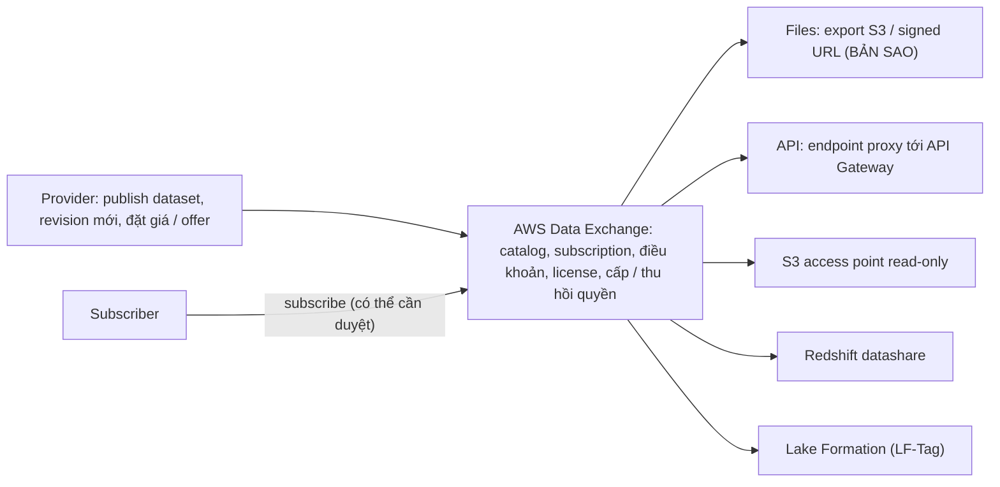

# AWS Data Exchange

> **TL;DR:** AWS Data Exchange giúp **tìm, subscribe và dùng dataset của bên thứ ba** (ví dụ dữ liệu thời tiết để dự báo nhu cầu, dữ liệu địa lý: cửa hàng đối thủ, mã bưu chính, dân số), qua **data grant** hoặc **AWS Marketplace data product**, **miễn phí hoặc trả phí**. Dịch vụ phục vụ cả **provider** (publish dataset, giá, offer, license, quản khách hàng, cấp / thu hồi quyền mà không phải tự dựng) lẫn **subscriber**. Năm cách giao dữ liệu: **Files** (export vào S3 hoặc signed URL: subscriber nhận **bản sao**), **API** (endpoint do Data Exchange quản lý proxy tới API Gateway của provider), **S3** (access point read-only), **Redshift datashare** và **Lake Formation** (LF-Tag): bốn cách sau là **truy cập tại chỗ**, thu hồi được, luôn mới nhất. Có thêm **Open Data on AWS**: dữ liệu miễn phí hoàn toàn.

## 🖼️ Sơ đồ
![[AWS Data Exchange.excalidraw]]
*Mở bằng plugin Excalidraw để chỉnh sửa · ảnh tĩnh: [[AWS Data Exchange.svg]]*

## Khái niệm cốt lõi

### Data Exchange làm gì
- Cho phép **truy cập dataset bên thứ ba**: tìm trong catalog, **subscribe** rồi **dùng**. Ví dụ: cần **dữ liệu thời tiết** để dự báo nhu cầu ở mọi vùng công ty hoạt động, hoặc **dữ liệu địa lý** như vị trí cửa hàng đối thủ, mã bưu chính, dân số.
- Dữ liệu cung cấp qua **data grant** hoặc **AWS Marketplace data product**: có dataset **miễn phí** lẫn **trả phí**.
- Không chỉ cho người dùng dữ liệu: **provider** cũng dùng Data Exchange để **publish / bán dataset**. Những thứ cần có để bán dữ liệu (search, marketplace, điều khoản, giá, quản lý offer, license, quản lý khách hàng, **cấp và thu hồi quyền**) không phải tự dựng.
- **Open Data on AWS**: dữ liệu từ nhiều publisher, **hoàn toàn miễn phí**.

### Năm cách giao dữ liệu
| Cách | Cơ chế | Subscriber nhận gì |
|---|---|---|
| **Files** | Subscriber **export vào S3 bucket của mình** hoặc tải qua **signed URL** | **Bản sao** dữ liệu |
| **API** | Provider dựng **REST API trên [[API Gateway]]**; subscriber gọi **endpoint do Data Exchange quản lý**, endpoint này proxy tới API của provider | Truy cập tại chỗ |
| **S3** | Provider share bucket trực tiếp; Data Exchange tạo **access point** với quyền **read-only** tới các object ([[S3 Access Points]]) | Truy cập tại chỗ |
| **Redshift** | Share dữ liệu từ Redshift qua **datashare**: dữ liệu đã nằm trong warehouse, cho subscriber query bằng **SQL read-only** ([[Redshift]]) | Truy cập tại chỗ |
| **Lake Formation** | Share resource gắn **LF-Tag**, subscriber query từ **account của họ** ([[AWS Lake Formation]]) | Truy cập tại chỗ |

## Cách hoạt động / Kiến trúc

Demo của bài (trong console, không cần làm theo):
1. Mở Data Exchange, **explore available data products**, lọc catalog theo **kiểu giao dữ liệu** (S3, Redshift, data lake...) và theo **kiểu hợp đồng** (ví dụ dữ liệu miễn phí); tìm "open data" để thấy các dataset Open Data.
2. Chọn dataset thử "worldwide event" (miễn phí, 12 tháng), **subscribe**, chọn offer. Tùy provider: thời hạn, có **tự gia hạn** không; request có thể phải **được duyệt**, có email thông báo.
3. Dataset này giao qua **Redshift**: mở Redshift cluster sẵn có, vào **datashares** là thấy dữ liệu, gần như không phải làm gì thêm. Tắt **auto renewal** để không tự gia hạn.
4. Dataset "heartbeat" giao dạng **file**: cấu hình **export** sang S3 bucket của mình, chọn tự động nhận **revision mới** khi provider publish.
5. Muốn bán dữ liệu: vào **Publish to AWS Marketplace**, tạo **public profile**, được duyệt rồi publish dataset; chỉ cần một AWS account.

## Bảng so sánh / số liệu

### Bản sao vs truy cập tại chỗ
| | **Files (bản sao)** | **API, S3, Redshift, Lake Formation (tại chỗ)** |
|---|---|---|
| Kiểm soát | Subscriber **giữ dữ liệu cả sau khi grant hết hạn** | Provider **thu hồi được**, thu hồi là mất truy cập |
| Độ mới | Chỉ mới khi provider publish **revision mới** và subscriber export lại | **Luôn là dữ liệu hiện tại** |
| Ai trả tiền | Provider trả phí **lưu trữ** cho Data Exchange; subscriber trả **bản sao S3** của mình | S3: provider bật **Requester Pays** thì subscriber trả **request và transfer**; Redshift: subscriber trả **compute** trên cluster của mình |

## 🎯 Mẹo thi SAA-C03
- "Lấy / mua / subscribe **dataset bên thứ ba**" hoặc "**bán / cung cấp dataset** cho người khác" qua nhiều dạng (file, S3, API, Redshift, Lake Formation) → **AWS Data Exchange**. Dịch vụ không xuất hiện nhiều trong đề.
- Cần **thu hồi được quyền** và dữ liệu **luôn mới** → giao **tại chỗ** (S3, API, Redshift datashare, Lake Formation), không giao file.
- Giao **Files** = subscriber có **bản sao** riêng.
- Dữ liệu công khai miễn phí → **Open Data on AWS**.
- Chia sẻ S3 mà muốn người nhận trả phí request / transfer → **Requester Pays** ([[S3 Requester Pays]]).

## Liên kết
- Cách giao: [[S3 Access Points]], [[S3 Requester Pays]], [[API Gateway]], [[Redshift]], [[AWS Lake Formation]]
- Liên quan: [[S3 Presigned URLs]] (signed URL)
- Section: [[_MOC 20 NoSQL and Analytics]]
