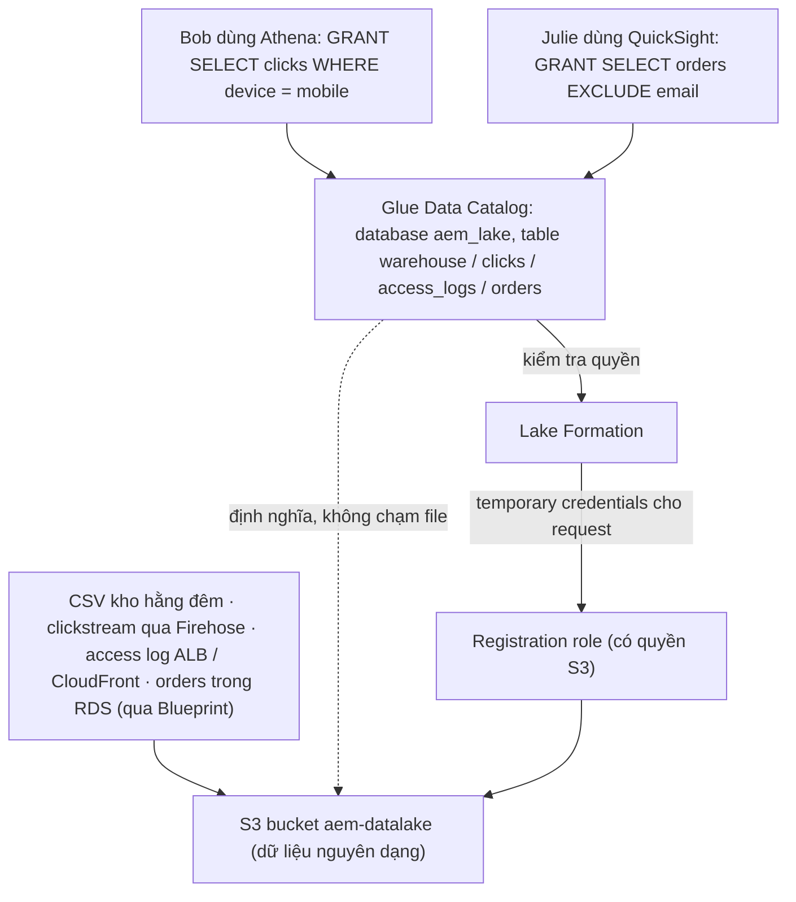

# AWS Lake Formation

> **TL;DR:** AWS Lake Formation cấp **quyền chi tiết (fine-grained access control)** cho **S3 khi dùng làm data lake**, tức S3 + **Glue Data Catalog** (schema-on-read: database, table, cột). Bucket policy và IAM chỉ thấy **bucket / prefix / object**, không thấy table hay cột; Lake Formation cấp quyền theo **database, table, cột** (theo **tên** hoặc theo **LF-Tag**) và **data filter** (biểu thức **hàng** + danh sách **cột** include / exclude → giới hạn tới từng ô). Lake Formation **đọc S3 thay user** qua **registration role** và đưa **temporary credentials** cho từng request; user **không có quyền S3 trực tiếp**. Quyền được **thực thi bởi query engine** đi qua catalog (Athena, Redshift Spectrum, EMR, Glue ETL, QuickSight); share **cross-account** qua **RAM** (AWS Resource Access Manager). Đề thi: **S3 data lake + cần hạn chế theo cột / hàng** → Lake Formation.

## 🖼️ Sơ đồ
![[AWS Lake Formation.excalidraw]]
*Mở bằng plugin Excalidraw để chỉnh sửa · ảnh tĩnh: [[AWS Lake Formation.svg]]*

## Khái niệm cốt lõi

### S3 data lake là gì
- Bình thường S3 **không có cấu trúc**: kho object phẳng (xem [[S3 Basics]]).
- Thêm **[[Glue|Glue Data Catalog]]** để **gắn cấu trúc** lên dữ liệu S3: dữ liệu hiện ra như **database gồm table và cột**. Catalog cho **schema-on-read** (như [[Athena]]): chỉ chứa định nghĩa table (tên, cột, kiểu, prefix S3 nơi file nằm), **không chạm vào file**.
- **S3 + Glue Data Catalog = S3 data lake.** Không có nút "bật data lake" trên S3: bucket vẫn là bucket bình thường, cấu trúc đến từ catalog.
- Vì catalog dùng chung, **Athena, Redshift Spectrum, EMR, Amazon QuickSight** đều thấy cùng cấu trúc đó.

### Vì sao cần Lake Formation
- Bucket policy và IAM permission trên bucket chỉ kiểm soát ở mức **bucket, prefix, object**. Chúng **không nhìn thấy** table, cột hay hàng mà Glue tạo ra.
- Lake Formation cho phép định nghĩa quyền **trên chính schema đó**, ví dụ cho user chạy `SELECT` trên một table cụ thể. Nó **thay thế** bucket policy / IAM trên bucket cho mục đích này.

### Cấp quyền thế nào
- Quyền gắn với **object của Glue Data Catalog**: **database, table, cột**.
- Hai cách chọn object:
  - **Theo tên**: ví dụ `SELECT` trên table này, cho các cột này. Cách cơ bản nhất.
  - **Theo LF-Tag**: gắn tag lên table / cột trong catalog (ví dụ mọi table production, mọi cột liên quan finance) rồi **cấp quyền trên tag**. Linh hoạt.
- **Data filter**: chi tiết hơn nữa, gắn vào một **grant theo tên table**, gồm hai phần:
  - **Row expression** (biểu thức hàng), ví dụ `country = 'AU'`.
  - **Danh sách cột include / exclude**, ví dụ bỏ cột `email`.
  - Chỉ dùng row expression → bảo mật **mức hàng**; dùng **cả hàng và cột** → giới hạn tới **từng ô (cell)**. Ví dụ: user chỉ thấy đơn hàng của Úc và **không bao giờ** thấy email.

### Cross-account
- Vì quyền định nghĩa trên **catalog** chứ không trên bucket, có thể **share cho account khác** theo tên hoặc theo tag, kèm cả filter.
- **Dữ liệu không di chuyển**, vẫn nằm trong bucket của bạn. Bên dưới dùng **resource sharing của [[AWS Resource Access Manager|RAM]]**: account kia nhận một **resource link** trong catalog của họ và query qua link đó.

### Thực thi ở đâu
- Quyền được **query engine thực thi**: Athena, Redshift Spectrum, EMR, Glue ETL, Amazon QuickSight đều đi qua catalog, và catalog **hỏi Lake Formation**.
- Hệ quả: thứ gì **đọc S3 trực tiếp** thì Lake Formation **không kiểm soát được** → phải **gỡ mọi quyền truy cập S3 trực tiếp** của user.

## Cách hoạt động / Kiến trúc

Ví dụ của bài: Aus-E-Mart dựng data lake `aem-datalake` cho business intelligence.

1. **Nguồn**: hệ thống kho xuất **CSV mỗi đêm**, **clickstream** đi qua Firehose, **access log** của ALB hoặc CloudFront giao thẳng vào S3, **orders** nằm trong một table RDS. Mỗi nguồn vào S3 ở **định dạng gốc** (CSV, JSON, gzip, text, database dump); S3 không quan tâm.
2. **Glue Data Catalog** biến bucket thành data lake: database `aem_lake` với bốn table, mỗi nguồn một table.
3. **Blueprint** (riêng cho RDS): template của Lake Formation tự sinh **Glue job, crawler**, kích hoạt copy database RDS vào S3 và catalog hóa giúp bạn.
4. **Đăng ký S3 location** với Lake Formation, kèm một **role** (registration role / Lake Formation role). Role này **phải có quyền S3**; đây là thứ **duy nhất** đọc bucket.
5. **Grant**:
   - Bob phân tích clickstream bằng Athena: `GRANT SELECT ON aem_lake.clicks TO Bob WHERE device = mobile` → Bob chỉ thấy **hàng** mobile (data filter mức hàng). Bucket policy không làm được việc này.
   - Julie ở finance dựng dashboard đơn hàng bằng QuickSight: `GRANT SELECT ON aem_lake.orders TO Julie EXCLUDE email` → Julie thấy table orders nhưng **không có cột email**.
6. **Lúc query**: Athena / QuickSight hỏi catalog → catalog hỏi Lake Formation → Lake Formation đưa **temporary credentials cho đúng request đó** → đọc S3 qua role.
7. **Bob và Julie không có quyền S3 nào** (không bucket policy, không IAM policy trên bucket). Nếu họ đọc thẳng được bucket thì đã **vượt qua mọi grant**, Lake Formation không hề thấy request.

## Bảng so sánh / số liệu

| | **Bucket policy / IAM trên bucket** | **Lake Formation** |
|---|---|---|
| Thấy được gì | Bucket, prefix, object | Database, table, cột, hàng (qua Glue Data Catalog) |
| Mức chi tiết | Object | Table → cột → hàng → ô |
| Ai đọc S3 | Chính user / role | **Registration role** của Lake Formation, credential tạm theo request |
| Cross-account | Bucket policy cho account khác | Grant theo tên / tag, share qua **RAM** (resource link), dữ liệu không di chuyển |
| Thực thi | S3 | Query engine đi qua catalog (Athena, Redshift Spectrum, EMR, Glue ETL, QuickSight) |

| Khái niệm | Ghi nhớ |
|---|---|
| **LF-Tag** | Gắn tag cho table / cột, cấp quyền trên tag |
| **Data filter** | Row expression + cột include / exclude, gắn vào grant theo tên table |
| **Blueprint** | Template tạo Glue job + crawler để copy RDS vào data lake và catalog hóa |
| **Registration role** | Role có quyền S3 khi đăng ký location; Lake Formation đọc dữ liệu thay user |

## 🎯 Mẹo thi SAA-C03
- "**S3 data lake**" + analytics (Athena, Redshift Spectrum, EMR, QuickSight) + cần hạn chế **theo cột, theo hàng, theo table** → **AWS Lake Formation**.
- Chỉ cần quyền theo **bucket / prefix / object** → bucket policy, IAM ([[S3 Security]]), không cần Lake Formation.
- Cấp quyền cho nhiều table theo phân loại (production, finance) → **LF-Tag**. Giới hạn hàng (ví dụ chỉ dữ liệu một quốc gia) và ẩn cột nhạy cảm → **data filter**.
- Phải **gỡ quyền S3 trực tiếp** của user: Lake Formation chỉ kiểm soát truy cập đi qua catalog.
- Chia sẻ data lake cho account khác **không copy dữ liệu** → grant Lake Formation cross-account (dựa trên RAM).
- Đưa dữ liệu RDS vào data lake dễ dàng → **Lake Formation Blueprint**.

## Liên kết
- Tiên quyết: [[S3 Basics]], [[Glue]], [[Athena]]
- Dùng cùng: [[Redshift]] (Spectrum), [[Amazon EMR]], [[Amazon QuickSight]], [[Kinesis Data Firehose]], [[RDS Architecture]]
- Phân biệt với: [[S3 Security]] (bucket policy, IAM), [[S3 Access Points]]
- Liên quan: [[AWS Resource Access Manager]], [[AWS Data Exchange]] (share dữ liệu qua LF-Tag)
- Section: [[_MOC 20 NoSQL and Analytics]]
