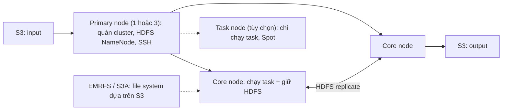

# Amazon EMR

> **TL;DR:** Amazon EMR là **nền tảng cluster managed** để chạy framework **big data** như **Apache Hadoop** (MapReduce) và **Apache Spark**, kèm hệ sinh thái **Spark, HBase, Presto, Flink, Hive, Pig**. Ngoài cluster dài hạn, EMR cho dựng **cluster transient / ad-hoc**: dựng, chạy một workload, rồi tắt. Bốn cách chạy: **EC2** (cluster thật, có **HDFS**, full control), **Serverless** (Spark / Hive, không cluster), **EKS** (job thành pod trên EKS bạn tự quản), **Outposts** (như EC2 nhưng dữ liệu không rời on-prem, chỉ On-Demand). Với EMR trên EC2: cluster nằm trong **một AZ**, có **primary node** (1 hoặc 3), **core node** (chạy task + giữ **HDFS**), **task node** (chỉ chạy task, hợp **Spot**). Input / output nằm ở **S3**, đọc ghi qua **EMRFS / S3A**.

## 🖼️ Sơ đồ
![[Amazon EMR.excalidraw]]
*Mở bằng plugin Excalidraw để chỉnh sửa · ảnh tĩnh: [[Amazon EMR.svg]]*

## Khái niệm cốt lõi

### EMR là gì
- **Managed cluster platform** chạy big data framework như **Apache Hadoop** và **Apache Spark** trên AWS. Về bản chất là **Hadoop managed**: framework xử lý big data theo mô hình **MapReduce**.
- Kèm các thành phần khác của hệ sinh thái Hadoop: **Spark, HBase, Presto, Flink, Hive, Pig**. Không cần hiểu từng cái; nhớ chúng như **từ khóa**: đề nhắc tới là gợi ý mạnh nên dùng EMR.
- Cẩn thận: nếu đề chỉ nói **Spark** thì **[[Glue|AWS Glue]] cũng chạy Spark** (và [[Athena]] có engine Apache Spark).
- Dùng cho **xử lý big data**: thao tác dữ liệu, analytics, indexing, biến đổi dữ liệu... Đề thi không cần hiểu vận hành EMR; cần biết **cách triển khai, kiến trúc, thành phần chính** và **khi nào chọn**.

### Vì sao không tự chạy Hadoop
- Nhiều tổ chức lớn có (hoặc từng có) **Hadoop cluster on-premises**: bảo trì rất phức tạp, tốn thời gian; một cluster chung lớn khiến các team **phải xếp hàng** chờ workload của nhau.
- EMR vẫn chạy được cluster dài hạn, nhưng điểm khác quan trọng là **cluster transient / ad-hoc**: mỗi workload một cluster, **provision → chạy → terminate**. Đây là điểm cần nhớ cho đề thi.

### Bốn cách triển khai
| Cách | Mô tả | Chọn khi |
|---|---|---|
| **EC2** (kiểu gốc) | Cluster EC2 thật, có **HDFS** bên trong, truy cập được instance | Cần **full control**, cần **HDFS**, cần **full Hadoop ecosystem** (HBase, Presto là service chạy dài, cần cluster để sống), muốn chọn purchase option cho từng loại node |
| **Serverless** | **Không có cluster**: tạo **application** (Spark hoặc Hive) rồi submit job; EMR dựng worker cho job, tự scale tới **maximum** bạn đặt, dọn sạch compute và storage khi xong | Chỉ là **job Spark / Hive**, không có lý do để quản cluster |
| **EKS** | Không có EMR cluster: job Spark chạy thành **pod** trên **EKS cluster bạn đã có và tự quản** ([[EKS]]); EMR chỉ đăng ký vào cluster đó và submit pod | **Đã chạy EKS** và muốn chạy data job trong cùng cluster |
| **Outposts** | Chính là kiểu EC2 nhưng chạy trong **Outpost subnet**, cluster nằm **tại cơ sở của bạn**; **chỉ On-Demand** (không Spot), Outpost phải đủ capacity | Yêu cầu bảo mật / governance: **dữ liệu không được rời on-premises**, hoặc phải tích hợp hệ thống on-prem |

Điểm chung của mọi cách:
- **S3 là kho dữ liệu**: input đọc từ S3, output ghi về S3.
- Cùng **EMR release** (cùng phiên bản Spark, Hive...).
- Mỗi job mang **runtime role** riêng: IAM role chỉ cho job đó, **không chia chung cho cả cluster** → hai job trên cùng cluster có quyền khác nhau.

## Cách hoạt động / Kiến trúc

### EMR trên EC2 (cũng là kiến trúc của Outposts)

- **Một AZ**: cluster chạy trong **một AZ** của một VPC → compute và storage native của cluster đều ở AZ đó, **không chịu được lỗi AZ**.
- **Primary node** (bắt buộc, ít nhất 1): quản cluster và sức khỏe cluster, **nhận và phân phối workload**, chạy **HDFS NameNode**, là node bạn **SSH** vào. Cluster nhỏ / test có thể chỉ có primary (khi đó nó tự chạy map, reduce), không dùng cho production. Chỉ 1 primary mà hỏng → **cả cluster dừng**; chạy **1 hoặc 3** primary, 3 cho HA dịch vụ của primary (nhưng cả ba **vẫn trong một AZ**).
- **Core node** (có thể nhiều):
  1. Chạy **task** (map, reduce). Có nhiều core node thì một task bị gián đoạn cũng không sao, task chạy lại được.
  2. Chạy **HDFS** (Hadoop distributed file system) trên storage gắn vào từng core node, replicate giữa các core node. HDFS **khởi tạo khi cluster bắt đầu, bị xóa khi cluster terminate**: rất nhanh, scale tốt, nhưng **tạm thời** và chỉ ở **một AZ** → thứ gì làm gián đoạn core node có thể làm mất HDFS → **không đặt core node trên compute có thể bị gián đoạn**.
- **Task node** (tùy chọn): **chỉ chạy task**, không dính HDFS → hỏng hay bị terminate thì HDFS không ảnh hưởng, task chạy lại trên node khác → **hợp Spot**.
- **EMRFS / S3A**: file system **dựa trên S3**, để cluster đọc ghi S3 như một file system. Hai connector: **EMRFS** và **S3A** (S3A mặc định ở các release hiện tại). Vì dựa trên S3 nên **tồn tại sau khi cluster tắt** và **chịu được lỗi AZ**.

### Lưu dữ liệu ở đâu
| Loại dữ liệu | Nơi lưu |
|---|---|
| Input | Thường từ **S3** |
| Dữ liệu trung gian | **HDFS** (cần hiệu năng storage cực cao, local volume) hoặc **EMRFS** |
| Output, dữ liệu cần giữ | **S3** |

### Serverless và EKS khác gì
- Chỉ khác **phần compute và storage bên trong**; phần còn lại (S3, connector, runtime role theo job) giống hệt.
- **Serverless**: không cluster; tạo application, submit job, worker tự lên, tự scale tới max, tự dọn. Không thấy instance, **không SSH**. **Regional**: không chọn AZ.
- **EKS**: không EMR cluster; job thành pod trên EKS của bạn (On-Demand, Spot hay Fargate tùy cấu hình EKS), pod nằm ở nơi EKS của bạn đặt.
- Cả hai: **không có node role** (primary / core / task) để quản, **không có HDFS**: worker / pod chỉ có scratch disk tạm cho job, mất khi job xong → dữ liệu cần giữ để ở S3.
- Node type, chọn Spot theo node, ràng buộc một AZ: **chỉ áp dụng cho cluster EC2** (và Outposts).

## Bảng so sánh / số liệu

### Purchase option theo loại node (EC2)
| Node | Mức quan trọng | On-Demand / Spot |
|---|---|---|
| **Primary** | **Rất quan trọng**: hỏng là cả cluster dừng | On-Demand (dùng RI / Savings Plans nếu chạy dài). Đã cho primary chạy Spot thì cũng như cho cả cluster Spot → chỉ cho workload **không quan trọng** |
| **Core** | Khá quan trọng: chạy job **và giữ HDFS** | On-Demand; Spot chỉ hợp cluster tạm, chấp nhận **rủi ro mất dữ liệu HDFS** |
| **Task** | Ít quan trọng: chỉ chạy task | **Spot** là hợp nhất: bị terminate thì task chạy lại, không mất dữ liệu |

- Workload ngắn hạn: On-Demand cho primary + core, Spot cho task.
- Cluster dài hạn: **reserve** (Reserved Instances) hoặc **Savings Plans** cho phần ổn định (primary, có thể cả core), thêm **task node Spot** khi job cần. Xem [[EC2 Purchase Options]], [[Reserved Instances and Savings Plans]].

## 🎯 Mẹo thi SAA-C03
- Từ khóa → **EMR**: **Hadoop**, **MapReduce**, **Spark ở quy mô lớn**, **Hive**, **HBase**, **Presto**, **Pig**, **Flink**, big data processing, migrate Hadoop on-prem.
- **Transient cluster**: dựng cho từng workload rồi terminate → tiết kiệm, không phải duy trì cluster dài hạn.
- Chọn cách triển khai: cần **control cluster, HDFS, service chạy dài, chọn purchase option** → **EC2**; **dữ liệu không được rời on-prem** → **Outposts** (chỉ On-Demand); **chỉ job Spark / Hive**, không muốn quản compute → **Serverless**; **đã có EKS** → **EKS**.
- **Spot cho task node**; primary và core nên On-Demand (primary hỏng là cả cluster dừng, core giữ HDFS).
- EMR trên EC2 chạy trong **một AZ**; HDFS **tạm thời**, mất khi cluster tắt. Dữ liệu cần **bền** → **S3** (qua EMRFS / S3A). Cần **hiệu năng storage cao nhất** cho dữ liệu trung gian → **HDFS**.
- Chỉ nói "Spark" → cân nhắc cả **Glue** và **Athena for Apache Spark** (serverless); EMR khi cần cluster, hệ sinh thái Hadoop đầy đủ.

## Liên kết
- Liên quan: [[Athena]] (Athena for Apache Spark), [[Glue]] (Spark ETL serverless), [[AWS Lake Formation]] (EMR là query engine chịu quyền Lake Formation), [[S3 Basics]]
- Hạ tầng: [[EC2 Purchase Options]], [[Reserved Instances and Savings Plans]], [[EKS]], [[AWS Global Infrastructure]] (Outposts)
- Phân biệt với: [[Redshift]] (data warehouse SQL), [[Kinesis Data Streams]] (streaming)
- Section: [[_MOC 20 NoSQL and Analytics]]
