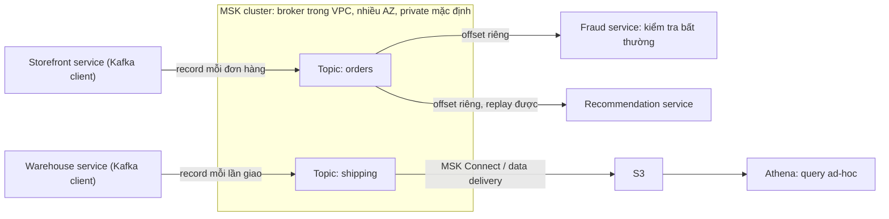

# Amazon MSK

> **TL;DR:** **Amazon MSK** (Amazon Managed Streaming for Apache Kafka) là **Apache Kafka managed**: đúng Kafka mã nguồn mở, khác ở chỗ **AWS sở hữu control plane** (tạo cluster, patch, thay broker hỏng, scale), còn bạn giữ **data plane** (topic, producer, consumer). Chọn MSK khi **đã dùng Kafka** (client, API) mà không muốn quản hạ tầng. Record ghi vào **topic**, giữ **theo thứ tự trong partition**, **không xóa khi đọc**, giữ theo **retention** (ngược với SQS); **nhiều consumer group** đọc cùng topic độc lập bằng **offset** riêng và **replay** được. Hai mode: **provisioned** (chọn broker; Standard hoặc Express) và **Serverless** (trả theo throughput + storage). Broker nằm **trong VPC, nhiều AZ, private mặc định**; public chỉ với provisioned, bật sau khi tạo, bắt buộc auth **IAM / SCRAM / mutual TLS**. Xây mới, chỉ dùng dịch vụ native → **Kinesis Data Streams**.

## 🖼️ Sơ đồ
![[Amazon MSK.excalidraw]]
*Mở bằng plugin Excalidraw để chỉnh sửa · ảnh tĩnh: [[Amazon MSK.svg]]*

## Khái niệm cốt lõi

### MSK là gì, khi nào dùng
- **Apache Kafka** là dịch vụ **event streaming** chuẩn công nghiệp. Kiến trúc **event-driven**, các thành phần ứng dụng **decoupled**, và **đã tích hợp với nhau bằng Kafka** → cân nhắc MSK (xem [[Event-Driven Architecture]]).
- AWS quản hạ tầng bên dưới: các **Kafka broker**. Vẫn là **đúng Kafka mã nguồn mở**; khác duy nhất:
  - **AWS sở hữu control plane**: tạo cluster, patch, thay broker hỏng, scale.
  - **Bạn sở hữu data plane**: topic, producer, consumer...
- Chọn MSK khi **đã dùng Kafka** nhưng **không muốn quản hạ tầng**, hoặc đang **migrate / mở rộng sang AWS**.

### Topic, partition, offset
- **Producer** gửi **record** (key + value), ví dụ event "đơn đã đặt", "hàng đã giao", vào một **topic** có tên.
- Trong một **partition**, topic giữ record **theo thứ tự nhận**, và **giữ lại** record: **không xóa khi đọc**, giữ trong **retention window** bạn cấu hình. **Ngược với SQS**, nơi message đã xử lý bị xóa (xem [[SQS]]).
- **Nhiều consumer trên một topic**, mỗi consumer có **góc nhìn độc lập**: nhiều **consumer group** đọc cùng topic mà không ảnh hưởng nhau.
- **Offset**: "bookmark" của một consumer group trong topic. Nhờ offset, consumer **replay** được event (khác SQS queue). Không cần tạo nhiều bản sao topic: Kafka tự hỗ trợ góc nhìn và replay độc lập.

### Provisioned vs Serverless
| | **Provisioned** | **Serverless** |
|---|---|---|
| Quản gì | Chọn **số broker**, **size**, **storage** | Không quan tâm broker: không chọn size, không scale |
| Tính tiền | Trả cho toàn bộ capacity, **bận hay rảnh** | Trả theo **throughput** và **storage** |
| Loại broker | **Standard**: bạn quản storage · **Express**: MSK quản storage | Không có |
| Hợp với | Workload **dự đoán được** hoặc **tinh chỉnh kỹ** | Workload **biến động, chưa biết trước** |

### Mạng và bảo mật
- Dù mode nào, broker được đặt **trong VPC** của bạn, trải **nhiều AZ**, cluster **private mặc định** (MSK **inject ENI** vào VPC).
- **Public access**: **chỉ provisioned** hỗ trợ, và **bật sau khi tạo cluster**. Như các dịch vụ inject vào VPC khác, phải tự cấu hình public: **public subnet**, Internet Gateway, NAT Gateway, security... (xem [[VPC Routing and Internet Gateway]]).
- Bật public thì **bắt buộc authentication**. MSK hỗ trợ ba kiểu: **IAM**, **SCRAM**, hoặc **mutual TLS** (khi cần mã hóa).

### Đưa dữ liệu ra S3 mà không cần Kafka client
- Producer và consumer bình thường dùng **Kafka client** (không cần AWS API / SDK).
- Vẫn gửi dữ liệu sang **S3** được mà không cần Kafka client: **MSK Connect**, **[[Kinesis Data Firehose|Amazon Data Firehose]]**, hoặc **data delivery native** (chỉ có ở **Express broker**).

## Cách hoạt động / Kiến trúc

Ví dụ của bài: web store Aus-E-Mart là ứng dụng event-driven hiện đại, decoupled, nhiều service, **đã hỗ trợ Apache Kafka**.

1. Thay vì tự dựng Kafka cluster, Aus-E-Mart **tạo MSK cluster**: chứa các **broker** (compute và storage cho event streaming), được **inject vào VPC** qua nhiều AZ, private mặc định. Muốn public: cấu hình sau khi cluster chạy, subnet public, bật authentication.
2. **Producer**: **storefront service** gửi một record vào topic **orders** mỗi khi có đơn; **warehouse service** gửi record vào topic **shipping** mỗi lần giao hàng. Mọi producer phải dùng **Kafka client**, không cần AWS API hay SDK.
3. Topic giữ record **theo thứ tự trong từng partition**, **giữ theo retention**, không xóa khi đọc.
4. **Consumer**: **fraud service** (tự viết, dùng Kafka client) đọc **mọi record** của topic orders để tìm bất thường bảo mật, dùng **offset** riêng để đi qua topic độc lập. **Recommendation service** cũng đọc topic orders để gợi ý theo lịch sử mua, với **offset riêng**, có thể **quay lại đọc từ đầu** (replay). Đây là các **consumer group** hoạt động hoàn toàn độc lập.
5. Athena **không đọc Kafka native** (đọc được qua connector). Muốn query ad-hoc topic shipping: dùng **MSK Connect** hoặc **S3 delivery native** để đổ dữ liệu ra S3 rồi [[Athena]] query trên S3.

## Bảng so sánh / số liệu

| | **Amazon MSK** | [[Kinesis Data Streams]] | [[SQS]] |
|---|---|---|---|
| Khi nào | **Đã dùng Kafka** (client, API), migrate / mở rộng sang AWS | Xây mới event streaming, **chỉ dùng dịch vụ AWS native** | Decouple bằng queue |
| Client | Kafka client (không cần AWS SDK) | AWS SDK / API | AWS SDK / API |
| Đọc rồi có xóa không | **Không**, giữ theo retention | Không, giữ theo retention | **Có**, xóa sau khi xử lý |
| Nhiều consumer độc lập, replay | **Có** (consumer group, offset) | Có | Không |

## 🎯 Mẹo thi SAA-C03
- "**Đã dùng Apache Kafka**", "Kafka client / Kafka API", "migrate Kafka on-prem lên AWS", "không muốn quản Kafka cluster" → **Amazon MSK**.
- Event-driven **xây mới từ đầu**, chỉ muốn dùng **dịch vụ AWS native** → **Kinesis Data Streams** thay vì MSK.
- Cần **nhiều consumer đọc độc lập cùng một luồng** và **replay** → Kafka / MSK (offset, consumer group), không phải SQS.
- MSK **private mặc định**; **public chỉ provisioned**, bật **sau khi tạo**, cần public subnet / IGW và **bắt buộc auth** (IAM, SCRAM, mutual TLS).
- Workload biến động → **MSK Serverless** (trả theo throughput + storage); dự đoán được → **provisioned** (Standard hoặc Express broker).
- Đổ dữ liệu Kafka ra S3 không viết consumer → **MSK Connect**, **Amazon Data Firehose**, hoặc data delivery của **Express broker**.

## Liên kết
- Liên quan: [[Event-Driven Architecture]], [[Kinesis Data Firehose]], [[Athena]], [[Lambda]] (Lambda đọc được MSK qua event source mapping; bổ sung, bài không nói)
- Phân biệt với: [[Kinesis Data Streams]], [[SQS]], [[Compare - SQS vs SNS vs Kinesis]], [[Amazon MQ]] (broker JMS / AMQP / MQTT)
- Section: [[_MOC 20 NoSQL and Analytics]]
