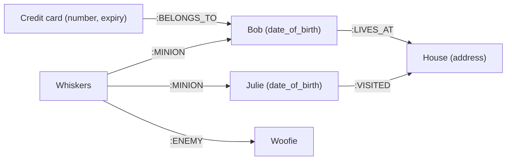

# Amazon Neptune

> **TL;DR:** Amazon Neptune là **graph database managed** của AWS: loại database mà **quan hệ quan trọng ngang với dữ liệu**. Về vận hành, Neptune **giống RDS / Aurora**: chạy **trong VPC, private mặc định**, **Multi-AZ**, scale đọc bằng **read replica**, **continuous backup** vào S3 và **point-in-time recovery**; có thêm **Neptune Serverless** (NCU), **Neptune Global Database** (1 region ghi, tối đa 5 region phụ chỉ đọc) và **Neptune Analytics**. Đề thi chỉ hỏi ở mức chọn đúng database: thấy **graph, quan hệ thay đổi liên tục** (mạng xã hội, gian lận, recommendation, knowledge graph) → Neptune.

## 🖼️ Sơ đồ
![[Amazon Neptune.excalidraw]]
*Mở bằng plugin Excalidraw để chỉnh sửa · ảnh tĩnh: [[Amazon Neptune.svg]]*

## Khái niệm cốt lõi

### Graph database là gì
- **Graph database**: quan hệ giữa dữ liệu **quan trọng ngang chính dữ liệu**. Hợp với bài toán mà quan hệ **linh hoạt, hay thay đổi**, và câu hỏi chủ yếu là "giữa các dữ liệu có quan hệ gì". Xem mô hình graph ở [[Database Models]].
- **Node**: những "thứ" lưu trong database (người, nhà, thú cưng, thẻ tín dụng). Node có **label** và **property** (cặp key/value), ví dụ ngày sinh của người, địa chỉ của nhà, thông tin thẻ.
- **Relationship**: có **hướng**, có **tên** (ví dụ `:LIVES_AT`, `:MINION`, `:ENEMY`, `:BELONGS_TO`, `:VISITED`), đi theo được cả hai chiều, và **truy vấn được như node**.
- Relational database cũng lưu được quan hệ nhưng quan hệ là **"công dân hạng hai"**: thường phải định nghĩa trước, khó đổi, và truy vấn theo quan hệ phức tạp **rất nặng** về tính toán khi dữ liệu lớn. Graph database được thiết kế riêng cho kiểu truy cập này.

### Neptune giống RDS / Aurora ở đâu
- Chạy **trong VPC**, **private mặc định**. Muốn **public endpoint** thì phải **opt-in từng instance** và **bắt buộc cấu hình IAM database authentication**.
- **Resilient**: triển khai **Multi-AZ**, **scale đọc bằng read replica**.
- **Continuous backup** vào S3 và **point-in-time recovery**.
- Nói gọn: "như RDS hay Aurora, nhưng cho dữ liệu kiểu graph".

### Ba khả năng thêm
| Tính năng | Ý nghĩa |
|---|---|
| **Neptune Serverless** | Compute **tự scale** theo đơn vị **NCU** (Neptune capacity unit) |
| **Neptune Global Database** | **Một region ghi** + **tối đa 5 region phụ chỉ đọc** |
| **Neptune Analytics** | **Engine in-memory riêng** để chạy **thuật toán graph** trên cả graph, không phải database giao dịch |

## Cách hoạt động / Kiến trúc

Ví dụ graph của bài:

- Mọi thứ trong database đều có thể có quan hệ với nhau, và quan hệ có thể thêm, bỏ, đổi bất cứ lúc nào.
- Truy vấn theo quan hệ rất tự nhiên, ví dụ tìm **thẻ tín dụng thuộc về hai người nhưng hai người ở hai địa chỉ khác nhau**: kiểu khám phá dữ liệu dựa trên quan hệ mà graph database làm dễ dàng.
- Về hạ tầng: cluster trong VPC của bạn, instance ghi + read replica ở nhiều AZ, giống mô hình RDS / Aurora (xem [[RDS Architecture]], [[Aurora]]).

## Bảng so sánh / số liệu

### Use case điển hình
| Use case | Vì sao hợp graph |
|---|---|
| **Mạng xã hội** (Facebook, X/Twitter: follow, unfollow, kết bạn, hủy kết bạn) | Quan hệ **động, thay đổi liên tục** |
| **Phát hiện gian lận** | Nhìn quan hệ: ai ở địa chỉ nào, ai dùng số an sinh xã hội / thẻ tín dụng nào → phát hiện mẫu bất thường |
| **Recommendation engine** | Node là bạn của một nhóm người và mua ở một nơi → gợi ý theo hành vi của thực thể / quan hệ tương tự |
| **Network / IT operations** | Mô hình hóa **phụ thuộc** giữa các thành phần |
| **Life sciences** | Thuốc nào tương tác với thuốc nào, thuốc nào chữa được bệnh nào |
| **Knowledge graph** | Liên kết thực thể và khái niệm trong dữ liệu tổ chức; cách graph database **đưa ngữ cảnh cho ứng dụng generative AI** |

### Chọn database theo mô hình dữ liệu
| Dữ liệu | Chọn |
|---|---|
| Relational, SQL, JOIN | [[RDS Architecture\|RDS]], [[Aurora]] |
| Key-value, NoSQL, serverless | [[DynamoDB Architecture\|DynamoDB]] |
| **Graph**, quan hệ là trọng tâm | **Neptune** |
| Data warehouse, OLAP | [[Redshift]] |

## 🎯 Mẹo thi SAA-C03
- Đề nhắc **graph**, **relationships**, dữ liệu **social media**, **fraud detection** theo quan hệ, **recommendation**, **knowledge graph** → **Amazon Neptune**. AWS muốn bạn chọn dịch vụ managed của họ cho đúng kiểu dữ liệu.
- Đề thi chỉ hỏi ở mức **chọn đúng database**, không đi sâu vào ngôn ngữ truy vấn hay tính năng chi tiết.
- Neptune **private mặc định trong VPC**; public endpoint phải **opt-in theo instance** và **bắt buộc IAM database authentication**.
- Nhớ các con số / tên: **NCU** (Serverless), Global Database **1 region ghi + tối đa 5 region đọc**, **Neptune Analytics** = engine in-memory chạy thuật toán graph.

## Liên kết
- Tiên quyết: [[Database Models]], [[RDS Architecture]], [[Aurora]]
- Phân biệt với: [[DynamoDB Architecture]] (key-value), [[Redshift]] (OLAP), [[Amazon OpenSearch Service]] (search)
- Liên quan: [[Aurora Global Database]] (cùng mô hình 1 region ghi, region phụ chỉ đọc), [[CFN Deletion Policy]] (Neptune hỗ trợ Snapshot)
- Section: [[_MOC 20 NoSQL and Analytics]]
