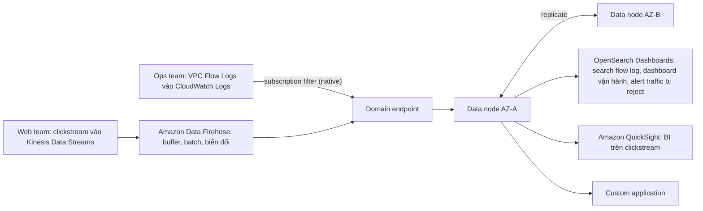

# Amazon OpenSearch Service

> **TL;DR:** Amazon OpenSearch Service là dịch vụ **search và analytics managed**, chạy **OpenSearch** và **OpenSearch Dashboards** mã nguồn mở, là bản **fork của Elasticsearch và Kibana** (đề cũ có thể còn gọi tên cũ). Hai việc chính: **full-text search** và **log analytics**, đều **near real-time**: dữ liệu vào dạng **JSON document**, được **index ngay khi tới** (không cần schema trước) và **tìm được trong khoảng một giây**. Chạy **trong VPC hoặc public endpoint**, trải **2 hoặc 3 AZ**; hai mode: **domain** (chọn instance type + số node, trả instance-giờ) hoặc **Serverless** (min / max **OCU**, tự scale, về 0 được). Dữ liệu vào qua **CloudWatch Logs subscription**, **Amazon Data Firehose** (native), **OpenSearch Ingestion** hoặc **Lambda**; xem bằng **OpenSearch Dashboards**, **QuickSight** hoặc app tự viết.

## 🖼️ Sơ đồ
![[Amazon OpenSearch Service.excalidraw]]
*Mở bằng plugin Excalidraw để chỉnh sửa · ảnh tĩnh: [[Amazon OpenSearch Service.svg]]*

## Khái niệm cốt lõi

### OpenSearch là gì
- Dịch vụ **search & analytics managed**: AWS host và quản lý **OpenSearch** và **OpenSearch Dashboards**, hai dự án mã nguồn mở **fork từ Elasticsearch và Kibana**. Đề thi hoặc tài liệu cũ có thể vẫn dùng tên **Elasticsearch / Kibana**.
- Hai năng lực chính: **full-text search** và **log analytics**, cả hai **near real-time**.
- Dữ liệu vào dưới dạng **JSON document**, được **index trên đường vào**: **mọi field** trong JSON được index ngay khi tới, **không cần cấu hình schema trước**, và **searchable trong khoảng 1 giây**. Đó là điểm bán hàng lớn: tìm trên hàng tỷ dòng log trong vài millisecond, gần real-time.

### Kết nối và resilience
- Chọn **trong VPC** hoặc **public endpoint**.
- Dù chọn gì, compute bên dưới trải được trên **2 hoặc 3 AZ**; dữ liệu được copy giữa các node ở các AZ → mất một node hoặc cả một AZ vẫn chạy tiếp.

### Hai cách chạy
| | **Domain** (kiểu cổ điển) | **Serverless** |
|---|---|---|
| Hạ tầng | Một **cluster**: bạn chọn **instance type** và **số node** (data node giữ dữ liệu và chạy query) | Không có node, không chọn instance type |
| Scale | **Không auto scaling**: cần thêm thì tự thêm node hoặc đổi type | Đặt **minimum** và **maximum** **OCU** (OpenSearch compute unit), tự scale trong khoảng đó |
| Tính tiền | Theo **instance-giờ** khi domain còn tồn tại, có query hay không | Chỉ trả cho **OCU được cấp**; **scale về 0 được** khi rảnh, hoặc đặt min = 1 để luôn có compute và tránh **cold start** |
| AZ | Tự chọn 2 hoặc 3 AZ | AWS tự replicate dữ liệu qua các AZ, không phải chọn |

### Đưa dữ liệu vào
- **Native**: **[[Kinesis Data Firehose|Amazon Data Firehose]]** và **[[CloudWatch Logs]]** (subscription filter) giao thẳng vào OpenSearch.
- **Nguồn không native** (ví dụ [[Kinesis Data Streams]], S3, DynamoDB): đặt một **[[Lambda]] function** ở giữa để ghi dữ liệu vào.
- **OpenSearch Ingestion**: **pipeline managed**, thu dữ liệu từ nhiều nguồn, **lọc hoặc đổi hình dạng** trên đường vào rồi giao cho OpenSearch, không cần Lambda hay server tự quản. Không bắt buộc dùng: đường native và Lambda vẫn chạy được mà không cần nó.

### Xem và dùng dữ liệu
- **OpenSearch Dashboards**: UI có sẵn để search, dựng visualization, đặt alert.
- Không bắt buộc dùng Dashboards: **ứng dụng của bạn query thẳng OpenSearch**, tự làm analytics / dashboard, hoặc dùng [[Amazon QuickSight]] cho lớp BI.

## Cách hoạt động / Kiến trúc

Ví dụ của bài là Aus-E-Mart, dùng một **domain** hai AZ:

1. Tạo **domain**: về bản chất là một **cluster**, mọi thứ kết nối tới **một domain endpoint**. Bên trong là các **data node** (instance có storage) giữ dữ liệu và chạy query. Với Serverless thì không có data node để quản, chỉ đặt OCU.
2. **Đội vận hành** đã có [[VPC Flow Logs]] gửi vào CloudWatch Logs: thêm **subscription filter** trên log group để đẩy event stream thẳng vào OpenSearch (CloudWatch Logs làm được việc này native).
3. **Đội web** đã gửi clickstream vào Kinesis Data Streams: gắn **Firehose** vào stream, trỏ tới OpenSearch. Firehose **buffer, batch** clickstream và **biến đổi** được nếu cần. Đội vận hành cũng có thể cho subscription CloudWatch Logs đi qua Firehose; cả hai cách đều đúng, đề thi dùng cả hai.
4. Dữ liệu đến endpoint dạng JSON document, được **replicate qua các AZ** để không mất dữ liệu, được **index ngay khi tới**.
5. Đội vận hành dùng **OpenSearch Dashboards** search flow log, dựng dashboard vận hành, đặt alert cho traffic bị reject; đội web dùng **QuickSight** làm dashboard BI về hành vi khách trên web store; ứng dụng riêng cũng query được. Tất cả đều **near real-time**.

> Lưu ý: Dashboards, QuickSight hay app **không nhận** dữ liệu; chúng **query index** JSON nằm trong OpenSearch. Mẫu "Kinesis → OpenSearch ở giữa → QuickSight cho BI" gặp cả ngoài thực tế lẫn trong đề.

## Bảng so sánh / số liệu

### Use case
| Use case | Ví dụ |
|---|---|
| **Log analytics** | Log ứng dụng, log hạ tầng, VPC Flow Logs, CloudTrail, phân tích near real-time |
| **Application monitoring** | Log, metric, cả trace của ứng dụng ở một chỗ |
| **Full-text search** | Danh mục sản phẩm, tài liệu: thứ mà RDS và DynamoDB không làm tốt ở quy mô lớn |
| **Clickstream** | Kinesis gửi vào, QuickSight làm BI ở cuối |
| **Security analytics (kiểu SIEM)** | Điều tra trên log xác thực, log [[WAF]], log [[GuardDuty]] |
| **Vector search** | Lưu **embedding** (dãy số biểu diễn ý nghĩa của text / ảnh), tìm bản gần nhất → **semantic search** ("tìm thứ giống thế này" thay vì đúng từ khóa). Đây là cách **RAG** hoạt động: app lấy tài liệu liên quan từ OpenSearch đưa cho model để câu trả lời dựa trên dữ liệu của bạn |

### OpenSearch vs Athena
| | **OpenSearch** | [[Athena]] |
|---|---|---|
| Kiểu truy cập | Search / analytics **near real-time**, liên tục | Query **ad-hoc, thỉnh thoảng** |
| Dữ liệu | Index JSON ngay khi vào | Nằm nguyên trên S3, schema-on-read |
| Chi phí | Trả cho cluster / OCU | Lưu S3 rẻ, trả theo query |

## 🎯 Mẹo thi SAA-C03
- Từ khóa → **OpenSearch**: "**search**", "**full-text search**", "**log analytics**", "**near real-time**", "**Elasticsearch / Kibana**" (đề cũ), SIEM, **vector search / semantic search / RAG**, kèm yêu cầu dịch vụ **AWS managed**.
- Cần **lưu rất rẻ** và **chỉ query thỉnh thoảng** → lưu S3 và query bằng **Athena**, không phải OpenSearch.
- Đường vào native: **Amazon Data Firehose** và **CloudWatch Logs subscription filter**. Nguồn không native → **Lambda** ở giữa, hoặc **OpenSearch Ingestion** (pipeline managed, lọc / reshape được).
- Mẫu kiến trúc hay gặp: **Kinesis → (Firehose) → OpenSearch → OpenSearch Dashboards / QuickSight**.
- **Domain**: chọn instance type + số node, trả theo giờ, không auto scaling. **Serverless**: min / max **OCU**, tự scale, về 0 được.
- Giao diện có sẵn là **OpenSearch Dashboards** (tên cũ Kibana).

## Liên kết
- Nguồn dữ liệu: [[Kinesis Data Firehose]], [[CloudWatch Logs]], [[Kinesis Data Streams]], [[Lambda]], [[VPC Flow Logs]]
- Hiển thị: [[Amazon QuickSight]]
- Phân biệt với: [[Athena]] (query ad-hoc trên S3), [[Amazon Neptune]] (graph), [[DynamoDB Architecture]] (key-value, không full-text search)
- Liên quan: [[Compare - SQS vs SNS vs Kinesis]], [[CloudTrail]]
- Section: [[_MOC 20 NoSQL and Analytics]]
