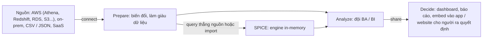

# Amazon QuickSight

> **TL;DR:** Amazon QuickSight là dịch vụ **business analytics / business intelligence (BA / BI)** trong bộ sản phẩm **Amazon Quick**: dùng cho **visualization**, **dashboard** và **ad-hoc analysis**. **Tính tiền theo user** (có **reader** giá thấp cho người chỉ xem dashboard; đông reader khó đoán thì dùng **capacity pricing** theo **session 30 phút**). Kết nối sẵn **nguồn AWS** (Athena, RDS, Aurora, Redshift kể cả Spectrum, OpenSearch, S3) và **nguồn ngoài** (Jira, GitHub, ServiceNow, Salesforce, SQL Server, MySQL, PostgreSQL, Spark, Snowflake, Presto, Teradata). Luồng: **connect → prepare → analyze → share**; query thẳng nguồn hoặc import vào **SPICE** (engine in-memory). Dashboard **private mặc định**. Đề thi: thấy **dashboard / visualization** → QuickSight.

## 🖼️ Sơ đồ
![[Amazon QuickSight.excalidraw]]
*Mở bằng plugin Excalidraw để chỉnh sửa · ảnh tĩnh: [[Amazon QuickSight.svg]]*

## Khái niệm cốt lõi

### QuickSight là gì
- Một trong các sản phẩm **Amazon Quick** (cùng Quick Flows, Quick Automate, Quick Index, Quick Research). QuickSight là phần **business intelligence** của bộ Quick Suite.
- Dùng cho **visualization** và **ad-hoc analysis** dữ liệu.
- Cung cấp chức năng **BA / BI** (business analytics, business intelligence): **tự phát hiện và tích hợp nguồn dữ liệu AWS** sẵn, và kết nối được rất nhiều nguồn bên ngoài.
- Với đề thi chỉ cần biết **nó là gì, làm gì, tích hợp với gì**.

### Tính tiền
- Dịch vụ kiểu này trước đây **đắt** để mua, cài và bảo trì. QuickSight **tính tiền theo user**: rẻ, on-demand so với sản phẩm bên thứ ba hay BI tự dựng.
- Có **reader user giá thấp** cho người **chỉ xem dashboard**.
- Khán giả **lớn hoặc khó đoán**: reader dùng **capacity pricing**, mua **session theo khối**, mỗi session là **30 phút**.

### Nguồn dữ liệu
| Nhóm | Ví dụ |
|---|---|
| **AWS** | [[Athena]], RDS, Aurora, [[Redshift]] (kể cả **Redshift Spectrum**), [[Amazon OpenSearch Service\|OpenSearch]], S3 |
| **Ứng dụng SaaS / bên ngoài** | Jira, GitHub, ServiceNow, Salesforce |
| **Database ngoài** | Microsoft SQL Server, MySQL, PostgreSQL |
| **Sản phẩm ngoài khác** | Apache Spark, Snowflake, Presto, Teradata |

Không cần thuộc hết; nhìn **từ khóa và khả năng** trong câu hỏi.

## Cách hoạt động / Kiến trúc

1. **Connect**: kết nối nguồn dữ liệu (nguồn AWS, on-prem, file CSV / JSON, SaaS).
2. **Prepare**: biến đổi hoặc làm giàu dữ liệu để lộ ra đúng thông tin cần.
3. **Query thẳng nguồn** hoặc **import vào SPICE**: engine **in-memory** của QuickSight, cho dashboard nhanh ở quy mô lớn mà không phải load lại nguồn mỗi lần.
4. **Analyze**: đội BA / BI rút ra **business intelligence** mà người ra quyết định cần.
5. **Share**: đưa thông tin và báo cáo cho người ra quyết định qua **dashboard**, visualization và các dạng khác; **embed dashboard** vào ứng dụng và website của bạn.
- **Dashboard private mặc định**: phải **share cho user hoặc group cụ thể**, với vai trò **viewer** hoặc **co-owner**.

## Bảng so sánh / số liệu

| Nhu cầu | Dịch vụ |
|---|---|
| **Dashboard, visualization, BI** cho người dùng doanh nghiệp | **QuickSight** |
| Query SQL ad-hoc trên S3 (nguồn cho dashboard) | [[Athena]] |
| Data warehouse cho phân tích nặng | [[Redshift]] |
| Search / log analytics near real-time, dashboard vận hành | [[Amazon OpenSearch Service]] (OpenSearch Dashboards) |
| Dashboard metric / alarm hạ tầng AWS | [[CloudWatch Basics\|CloudWatch]] dashboards (bổ sung, bài không nói) |

## 🎯 Mẹo thi SAA-C03
- Từ khóa **dashboard**, **visualization**, **business intelligence / BI**, **ad-hoc analysis** → **Amazon QuickSight**, trừ khi đề có lý do mạnh để chọn khác.
- Đề kết hợp "visualization / dashboard" với các nguồn như **Athena, Redshift, RDS, Aurora, S3, OpenSearch, Salesforce** → QuickSight.
- Tính tiền **theo user**, có **reader** rẻ; khán giả lớn / khó đoán → **capacity pricing** (session 30 phút). Rẻ hơn BI bên thứ ba hay tự dựng.
- **SPICE** = engine in-memory của QuickSight (import dữ liệu để dashboard nhanh).
- Dashboard **private mặc định**, share cho user / group (viewer, co-owner); **embed** được vào app / website.

## Liên kết
- Nguồn dữ liệu: [[Athena]], [[Redshift]], [[Amazon OpenSearch Service]], [[RDS Architecture]], [[Aurora]], [[S3 Basics]]
- Liên quan: [[AWS Lake Formation]] (QuickSight là engine chịu quyền Lake Formation), [[AWS Cost Management]] (CUR cho Athena / QuickSight)
- Section: [[_MOC 20 NoSQL and Analytics]]
