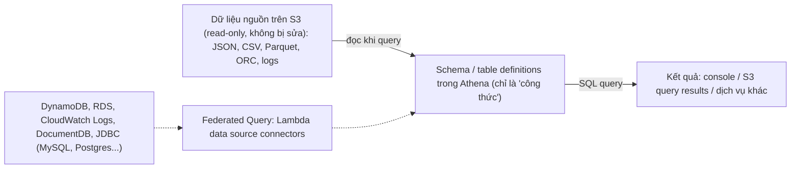

# Athena

> **TL;DR:** Athena là dịch vụ **truy vấn tương tác, serverless**: chạy câu lệnh SQL ad-hoc trực tiếp trên dữ liệu nằm trong S3 mà **không load, không ETL, không hạ tầng**. Dựa trên cơ chế **schema-on-read** — dữ liệu gốc trong S3 không bao giờ bị thay đổi. Chỉ trả tiền theo **lượng dữ liệu mà query quét**.

## 🖼️ Sơ đồ
![[Athena.excalidraw]]
*Mở bằng plugin Excalidraw để chỉnh sửa · ảnh tĩnh: [[Athena.svg]]*

## Khái niệm cốt lõi

### Serverless, trả theo dữ liệu quét
- Không có chi phí base hàng tháng, không tính theo phút/giờ. Trả cho **dữ liệu được query đọc** + phí lưu trữ S3 của dữ liệu gốc (theo giá công bố hiện nay khoảng **5 USD / TB quét**).
- Không có cluster/server nào cần dựng trước.

### Schema-on-read
- Hình dung schema như **lăng kính/cửa sổ** nhìn vào dữ liệu: dữ liệu gốc trên S3 **giữ nguyên, read-only**, chỉ được "dịch" sang dạng bảng **trong lúc đọc** (in-flight).
- Database truyền thống: tạo table → **load** dữ liệu vào table (dữ liệu phải khớp format, hoặc phải ETL — extract, transform, load). Athena **không cần** bước này.
- **Table trong Athena không chứa dữ liệu**: nó chỉ là "công thức" (recipe) mô tả cách chuyển dữ liệu nguồn thành cấu trúc bảng để query. Định nghĩa table chỉ trỏ tới **location trên S3** và khai báo cột/kiểu dữ liệu.
- Query bằng **SQL chuẩn** (kiểu relational); kết quả hiển thị trên console, lưu vào S3, hoặc đưa sang dịch vụ AWS khác.

### Định dạng dữ liệu hỗ trợ
XML, **JSON**, **CSV/TSV**, **Avro**, **Parquet**, **ORC**, log ứng dụng (ví dụ Apache), log dịch vụ AWS (**CloudTrail**, **VPC Flow Logs**, ELB logs, cost reports...). Danh sách liên tục mở rộng. Có thể dùng **[[Glue|AWS Glue Data Catalog]]** làm metadata store cho table.

### Tối ưu chi phí (kiến thức bổ sung)
- Vì tính tiền theo dữ liệu quét, nên tối ưu dữ liệu gốc: **nén**, **định dạng cột** (Parquet/ORC), **partition** theo ngày/khóa thường lọc → query quét ít dữ liệu hơn, rẻ hơn và nhanh hơn.

### Athena Federated Query
- Tính năng mới hơn: query **nguồn không phải S3**.
- Dùng **data source connector chạy trên [[Lambda]]** — đoạn code dịch giữa nguồn dữ liệu và Athena, như một phần mở rộng của query engine.
- Có connector dựng sẵn cho **CloudWatch Logs, DynamoDB, DocumentDB, Amazon RDS**, và các nguồn relational tương thích **JDBC** (MySQL, PostgreSQL...).

## Demo / Lab
Kịch bản Animals4life ([[Animals4life Scenario]]): đội lưu động cần **tra cứu ad-hoc** danh sách phòng khám thú y theo khu vực địa lý; không chấp nhận thời gian setup dài, không chi phí hạ tầng nền, không tự vận hành database.

- Dữ liệu: **OpenStreetMap Planet (Planet OSM)** trong một **S3 bucket public do bên ngoài quản lý** — gồm *nodes* (địa điểm, doanh nghiệp + tọa độ + metadata), *ways* (ranh giới/khu vực), *relations*. File planet ~**100 GB nén**, ~**1.2–1.3 TB** giải nén.
- Các bước chính:
  1. **Thiết lập một lần**: tạo S3 bucket làm **query result location** và khai báo trong settings của Athena (bắt buộc trước khi chạy query).
  2. `CREATE DATABASE a4l;` — chỉ tạo định nghĩa.
  3. `CREATE EXTERNAL TABLE planet (...) LOCATION 's3://...'` — khai báo cột (id, type, tags, lat, lon, nds, members, changeset, timestamp, uid, user, version) và trỏ tới bucket nguồn. **Không load dữ liệu**, chưa phát sinh chi phí.
  4. Test: `SELECT * FROM planet LIMIT 100;`.
  5. Query thật: lọc `type = 'node'`, tag `amenity = 'veterinary'`, và **lat/lon trong một hình chữ nhật** (Brisbane: lat −27.8 → −27.3, lon 152.2 → 153.5). Kết quả là danh sách phòng khám thú y trong khu vực.
  6. Dọn dẹp: `DROP TABLE planet;` và `DROP DATABASE a4l;`.
- Ghi nhớ tọa độ: latitude Bắc dương / Nam âm; longitude Đông dương / Tây âm.
- Bài học: query được bộ dữ liệu hàng TB mà **không hạ tầng, không ETL**, chỉ trả cho dữ liệu đã quét.

## 🎯 Mẹo thi SAA-C03
- Từ khóa → **Athena**: "**ad-hoc / occasional** query dữ liệu trong S3", "**không muốn load/transform**", "**serverless**, không hạ tầng", "**cost-conscious**, trả theo query".
- Query **log dịch vụ AWS** (VPC Flow Logs, CloudTrail, ELB logs, cost & usage reports), web server logs → Athena là đáp án ưu tiên. Xem [[VPC Flow Logs]], [[CloudTrail]], [[S3 Access Logs]].
- Có nhắc **Glue Data Catalog** → thường đi cùng Athena (xem [[Glue]]).
- Cẩn thận: nếu đề nói về một **database cụ thể / SQL vs NoSQL DB** thì thường **không phải** Athena — trừ khi đề nói rõ query nhiều nguồn khác nhau từ Athena → **Athena Federated Query** (connector chạy trên Lambda).
- Athena vs [[Redshift]]: Athena cho query **ad-hoc, không thường xuyên**, không cần load; Redshift là **data warehouse** chạy liên tục cho phân tích/BI quy mô lớn, dữ liệu được load vào (hoặc dùng Redshift Spectrum).
- Athena vs [[S3 Select and Glacier Select]]: S3 Select lọc trong **một object**; Athena query cả **dataset** nhiều object bằng SQL đầy đủ.

## Liên kết
- Tiên quyết: [[S3 Basics]], [[Database Models]]
- Liên quan: [[Glue]], [[Lambda]], [[VPC Flow Logs]], [[CloudTrail]], [[Kinesis Data Firehose]] (đổ dữ liệu vào S3 để Athena query)
- Phân biệt với: [[Redshift]], [[S3 Select and Glacier Select]], [[RDS Architecture]]
- Section: [[_MOC 20 NoSQL and Analytics]]
