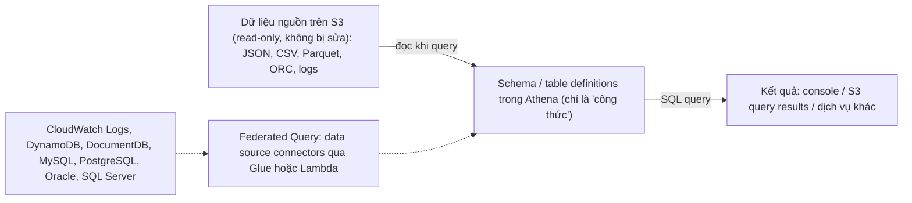

# Athena

> **TL;DR:** Athena là dịch vụ **phân tích tương tác, serverless** với **hai analytics engine**, chọn theo **workgroup** lúc tạo (không đổi được). **SQL engine**: chạy câu lệnh SQL ad-hoc trực tiếp trên dữ liệu nằm trong S3 mà **không load, không ETL, không hạ tầng**, dựa trên **schema-on-read**; trả tiền theo **lượng dữ liệu mà query quét** hoặc **capacity reservation** (DPU theo giờ). **Apache Spark engine**: viết **PySpark trong notebook** để làm data pipeline/ETL nhiều bước, chạy trên **DPU serverless**, trả theo **DPU-giờ**. Với cả hai, dữ liệu gốc trong S3 không bao giờ bị thay đổi.

## 🖼️ Sơ đồ
![[Athena.excalidraw]]
*Mở bằng plugin Excalidraw để chỉnh sửa · ảnh tĩnh: [[Athena.svg]]*

![[Athena - spark.excalidraw]]
*Mở bằng plugin Excalidraw để chỉnh sửa · ảnh tĩnh: [[Athena - spark.svg]]*

## Khái niệm cốt lõi

### Hai analytics engine
- **SQL**: hỏi đáp trên dữ liệu có sẵn bằng SQL (các mục dưới đây, tới hết phần Federated Query, nói về engine này).
- **Apache Spark**: phân tích nâng cao, làm data pipeline bằng code (xem mục **Athena for Apache Spark** bên dưới).
- Dù dùng engine nào, **dữ liệu nằm trong S3** và Athena **không sửa** dữ liệu gốc.

### Serverless, trả theo dữ liệu quét (SQL)
- Không có chi phí base hàng tháng, không tính theo phút/giờ. Trả cho **dữ liệu được query đọc** + phí lưu trữ S3 của dữ liệu gốc (theo giá công bố hiện nay khoảng **5 USD / TB quét**; bổ sung, bài không nói con số).
- **Hoặc capacity reservation**: trả **giá cố định theo giờ cho DPU** (data processing unit) → hợp khi muốn **chi phí dễ đoán** hoặc **compute được bảo đảm** cho SQL query.
- Không có cluster/server nào cần dựng trước.

### Schema-on-read
- Hình dung schema như **lăng kính/cửa sổ** nhìn vào dữ liệu: dữ liệu gốc trên S3 **giữ nguyên, read-only**, chỉ được "dịch" sang dạng bảng **trong lúc đọc** (in-flight). Làm việc được với dữ liệu **structured, semi-structured và unstructured**.
- Database truyền thống: tạo table → **load** dữ liệu vào table (dữ liệu phải khớp format, hoặc phải ETL — extract, transform, load). Athena **không cần** bước này.
- **Table trong Athena không chứa dữ liệu**: nó chỉ là "công thức" (recipe) mô tả cách chuyển dữ liệu nguồn thành cấu trúc bảng để query. Định nghĩa table chỉ trỏ tới **location trên S3** và khai báo cột/kiểu dữ liệu.
- Table được định nghĩa trước trong **AWS Glue Data Catalog**; dữ liệu được "chiếu" qua table khi đọc.
- Query bằng **SQL chuẩn** (kiểu relational); kết quả lưu vào **S3 hoặc managed storage**, hiển thị trên console, hoặc đưa sang dịch vụ AWS khác / công cụ bên thứ ba.

### Định dạng dữ liệu hỗ trợ
**Amazon Ion**, XML (bản khóa cũ nêu), **JSON**, **CSV/TSV**, **Avro**, **Parquet**, **ORC**, log ứng dụng (ví dụ Apache web server), log dịch vụ AWS (**CloudTrail**, **VPC Flow Logs**, ELB logs, cost reports...). Danh sách liên tục mở rộng. Table nằm trong **[[Glue|AWS Glue Data Catalog]]**.

### Tối ưu chi phí (kiến thức bổ sung)
- Vì tính tiền theo dữ liệu quét, nên tối ưu dữ liệu gốc: **nén**, **định dạng cột** (Parquet/ORC), **partition** theo ngày/khóa thường lọc → query quét ít dữ liệu hơn, rẻ hơn và nhanh hơn.

### Workgroup
- **Đơn vị quản lý** của Athena: lúc nào chạy query bạn cũng đang ở trong một workgroup. Có sẵn workgroup mặc định **`primary`**, cấu hình cho SQL engine.
- Khi tạo workgroup, **chọn analytics engine (SQL hoặc Apache Spark)**; lựa chọn này **cố định, không đổi được** về sau.
- Dùng workgroup để **cô lập user/team** (như một ranh giới bảo mật), đặt **cost control** như giới hạn lượng dữ liệu quét mỗi query, và cấu hình **capacity reservation** nếu cần.

### Athena Federated Query
- Dễ nhầm: Athena làm việc với S3 là chính, nhưng **query được cả nguồn không phải S3** (database SQL lẫn NoSQL).
- Dùng **data source connector**, một phần mở rộng của query engine, đi qua **AWS Glue hoặc [[Lambda]]** để làm cầu nối giữa Athena và nguồn dữ liệu.
- Có connector dựng sẵn cho **CloudWatch Logs, DynamoDB, DocumentDB**, và các engine quan hệ như **MySQL, PostgreSQL, Oracle, SQL Server**.

## Athena for Apache Spark

- Athena ban đầu chỉ là SQL serverless trên S3; engine **Apache Spark** mở rộng sang **phân tích nâng cao**: viết **code Spark** để làm **data pipeline** (đọc dữ liệu, biến đổi, ghi ra). Đây là cả một nền tảng Apache Spark **serverless**, không phải tự quản hạ tầng Spark.
- **Nguồn**: vẫn là dữ liệu trong **S3, read-only**. Định dạng: Parquet, ORC, JSON, CSV và các **open table format** như **Apache Iceberg**, **Delta Lake**. Có thể đọc table qua **Glue Data Catalog** nhưng không bắt buộc; đọc thẳng S3 là cách đơn giản nhất.
- **Notebook**: thay cho query editor, bạn làm việc trong notebook, về cơ bản là **trình soạn Python chia cell**: viết **PySpark** trong cell, chạy, xem output, viết tiếp. Tương tác, lặp lại, giống viết chương trình hơn là chạy một câu SQL.
- **Spark session**: chạy code thì Athena mở một Spark session ở hậu trường, chạy trên **DPU (data processing unit)**, compute **serverless tự scale**: không chọn instance type, không provision DPU.
- **DataFrame**: biểu diễn dữ liệu **trong bộ nhớ** (giống bảng) bên trong Spark session. Code đọc dữ liệu vào DataFrame, lọc, biến đổi, join, tạo DataFrame mới. DataFrame **tạm thời**: session kết thúc là mất → muốn giữ kết quả phải ghi ra đâu đó.
- **Output**: kết quả tính toán **lưu vào S3 mặc định** (results location cấu hình ở **workgroup**, bền vững) và **hiển thị inline trong notebook cell**.
- **Tính tiền**: theo **DPU-giờ** khi session chạy; **không** có kiểu trả theo dữ liệu quét, **không** có capacity reservation như SQL.

| | **Athena SQL** | **Athena for Apache Spark** |
|---|---|---|
| Làm gì | **Hỏi** dữ liệu có sẵn: lọc, join, tổng hợp, group (set-based) | **Làm việc** với dữ liệu bằng code: ETL, làm sạch, đổi hình dạng, pipeline nhiều bước |
| Giao diện | Query editor, SQL | Notebook, PySpark |
| Thực thi | Schema-on-read qua table | Spark session trên DPU, DataFrame trong bộ nhớ |
| Tính tiền | Theo dữ liệu quét, hoặc capacity reservation (DPU/giờ) | Theo DPU-giờ |
| Dữ liệu S3 gốc | Không bị sửa | Không bị sửa |

- So với tự chạy Spark hoặc [[Amazon EMR]] (phải quản cluster, hạ tầng), Athena for Apache Spark là cách **serverless** để chạy workflow Spark.

## Demo / Lab
Kịch bản Animals4life ([[Animals4life Scenario]]): đội lưu động cần **tra cứu ad-hoc** danh sách phòng khám thú y theo khu vực địa lý; không chấp nhận thời gian setup dài, không chi phí hạ tầng nền, không tự vận hành database.

- Dữ liệu: **OpenStreetMap Planet (Planet OSM)** trong một **S3 bucket public do bên ngoài quản lý** — gồm *nodes* (địa điểm, doanh nghiệp + tọa độ + metadata), *ways* (ranh giới/khu vực), *relations*. File planet ~**100 GB nén**, ~**1.2–1.3 TB** giải nén.
- Các bước chính:
  1. **Thiết lập một lần**: tạo S3 bucket làm **query result location** và khai báo trong settings của Athena (bắt buộc trước khi chạy query).
  2. `CREATE DATABASE a4l;` — chỉ tạo định nghĩa.
  3. `CREATE EXTERNAL TABLE planet (...) LOCATION 's3://...'` — khai báo cột (id, type, tags, lat, lon, nds, members, changeset, timestamp, uid, user, version) và trỏ tới bucket nguồn. **Không load dữ liệu**, chưa phát sinh chi phí.
  4. Test: `SELECT * FROM planet LIMIT 100;`.
  5. Query thật: lọc `type = 'node'`, tag `amenity = 'veterinary'`, và **lat/lon trong một hình chữ nhật** (Brisbane: lat −27.8 → −27.3, lon 152.2 → 153.5). Kết quả là danh sách phòng khám thú y trong khu vực.
  6. Dọn dẹp: `DROP TABLE planet;` và `DROP DATABASE a4l;`.
- Ghi nhớ tọa độ: latitude Bắc dương / Nam âm; longitude Đông dương / Tây âm.
- Bài học: query được bộ dữ liệu hàng TB mà **không hạ tầng, không ETL**, chỉ trả cho dữ liệu đã quét.

## 🎯 Mẹo thi SAA-C03
- Từ khóa → **Athena**: "**ad-hoc / occasional** query dữ liệu trong S3", "**không muốn load/transform**", "**serverless**, không hạ tầng", "**cost-conscious**, trả theo query".
- Chọn engine: chỉ cần **hỏi** dữ liệu bằng SQL → **Athena SQL**; cần **data engineering bằng code** (PySpark, ETL nhiều bước, lặp trên dữ liệu) mà **không muốn quản cluster Spark/EC2** → **Athena for Apache Spark**.
- Engine chọn ở **workgroup** lúc tạo, **không đổi** từ SQL sang Spark hay ngược lại. Workgroup còn dùng để cô lập team và giới hạn dữ liệu quét mỗi query.
- SQL muốn chi phí dễ đoán / compute bảo đảm → **capacity reservation**; Spark luôn trả theo **DPU-giờ**.
- Query **log dịch vụ AWS** (VPC Flow Logs, CloudTrail, ELB logs, cost & usage reports), web server logs → Athena là đáp án ưu tiên. Xem [[VPC Flow Logs]], [[CloudTrail]], [[S3 Access Logs]].
- Có nhắc **Glue Data Catalog** → thường đi cùng Athena (xem [[Glue]]).
- Cẩn thận: nếu đề nói về một **database cụ thể / SQL vs NoSQL DB** thì thường **không phải** Athena — trừ khi đề nói rõ query nhiều nguồn khác nhau từ Athena → **Athena Federated Query** (connector qua Glue hoặc Lambda).
- Athena vs [[Redshift]]: Athena chạy SQL thẳng trên S3, **không có warehouse**, cho query **ad-hoc, không thường xuyên**; Redshift là **data warehouse** để load dữ liệu vào và phân tích/BI nặng (hoặc dùng Redshift Spectrum; cần warehouse serverless → Redshift Serverless).
- Athena vs [[S3 Select and Glacier Select]]: S3 Select lọc trong **một object**; Athena query cả **dataset** nhiều object bằng SQL đầy đủ.

## Liên kết
- Tiên quyết: [[S3 Basics]], [[Database Models]]
- Liên quan: [[Glue]], [[Lambda]], [[VPC Flow Logs]], [[CloudTrail]], [[Kinesis Data Firehose]] (đổ dữ liệu vào S3 để Athena query), [[AWS Lake Formation]] (phân quyền table/cột/hàng khi Athena query data lake), [[Amazon QuickSight]] (dashboard trên kết quả Athena)
- Spark có quản cluster: [[Amazon EMR]]
- Phân biệt với: [[Redshift]], [[S3 Select and Glacier Select]], [[RDS Architecture]], [[Amazon OpenSearch Service]] (search / log analytics near real-time)
- Section: [[_MOC 20 NoSQL and Analytics]]
