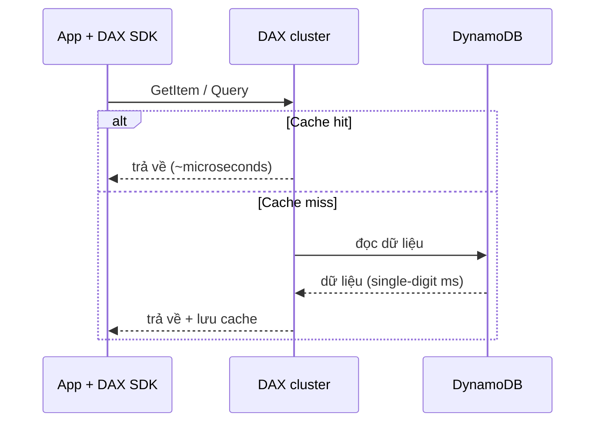
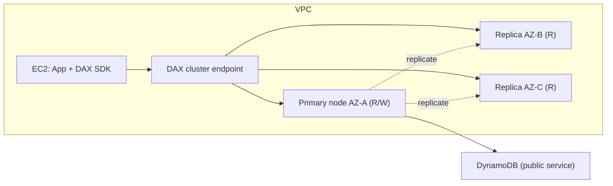

# DAX

> **TL;DR:** DynamoDB Accelerator (DAX) là **in-memory cache tích hợp sẵn với DynamoDB**. Ứng dụng dùng DAX SDK gọi một bộ API duy nhất, DAX tự lo cache hit/miss, đưa thời gian đọc từ single-digit millisecond xuống **microsecond**. DAX chạy **trong VPC**, dạng cluster nhiều AZ. Trong đề thi, "caching cho DynamoDB" mặc định là DAX.

## 🖼️ Sơ đồ
![[DAX.excalidraw]]
*Mở bằng plugin Excalidraw để chỉnh sửa · ảnh tĩnh: [[DAX.svg]]*

## Khái niệm cốt lõi

### Cache truyền thống vs DAX
**Cache generic** (ví dụ [[ElastiCache]]):
1. App kiểm tra cache → **cache miss**.
2. App tự đọc từ database (chậm hơn).
3. App tự ghi dữ liệu vào cache.
4. Lần sau đọc từ cache → **cache hit**.
- Vấn đề: cache và database **không tích hợp**, ứng dụng phải tự quản logic cache.

**DAX**:
- Cài **DAX SDK** trên instance ứng dụng. Từ góc nhìn app, DAX và DynamoDB là **một**.
- App gọi một lần; hit → DAX trả luôn; miss → DAX tự lấy từ DynamoDB, lưu vào cache, rồi trả cho app.
- Một bộ API, một SDK → **ít admin overhead** hơn nhiều, gần như không phải sửa logic ứng dụng.

## Cách hoạt động / Kiến trúc
- DAX chạy **bên trong VPC**, triển khai trên **nhiều AZ** để HA.
- Là **cluster**: **primary node** (đọc + ghi) và **replica node** (đọc) ở các AZ khác nhau. Primary hỏng → **bầu lại**, một replica lên làm primary.
- Mỗi cluster có **endpoint** cân bằng tải qua các node (giống cách truy cập RDS).
- Hai loại cache:
  - **Item cache**: item lấy bằng `GetItem` / `BatchGetItem` (chỉ định PK, và SK nếu có).
  - **Query cache**: tập item từ `Query` / `Scan` **kèm tham số** của lệnh → chạy lại đúng query/scan đó thì trả kết quả từ cache.
- Hiệu năng: **cache hit ~ microseconds** (ví dụ ~400 µs); **cache miss ~ single-digit ms** (như DynamoDB thường).
- **Write-through**: ghi qua DAX SDK thì dữ liệu được ghi vào DynamoDB **và** vào cache cùng lúc. Khi miss lúc đọc, dữ liệu được ghi vào primary node rồi replicate sang replica.
- **Scaling**: scale **up** (node lớn hơn) và scale **out** (thêm node).

## Khi nào dùng / không dùng

| Hợp với DAX | Không hợp với DAX |
|---|---|
| Workload **đọc nhiều** hoặc **bursty**, đọc lặp lại cùng dữ liệu | Ứng dụng cần **strongly consistent read** |
| Đang phải đặt **RCU rất cao** (đắt) — cache giúp giảm chi phí | Ứng dụng **không nhạy latency** |
| Hiệu năng kém vào **mùa sale**, có item/table "nóng" | Workload **write-heavy**, hiếm khi đọc |
| Dữ liệu dùng lệch (ví dụ time series gần đây được đọc nhiều) | |
| Cần **response time cực thấp** (microsecond) | |

## 🎯 Mẹo thi SAA-C03
- Câu hỏi về **caching cho DynamoDB** → mặc định **DAX**, chỉ đổi khi có bằng chứng rõ ràng khác.
- "Giảm latency đọc DynamoDB từ milliseconds xuống **microseconds**" → DAX.
- "Read-heavy, đọc lặp lại, RCU cao gây tốn kém, ít thay đổi code" → DAX.
- DynamoDB là **public service**, nhưng **DAX nằm trong VPC** → ứng dụng dùng DAX cũng phải ở trong VPC đó.
- Cần **strongly consistent** → DAX không giúp (strongly consistent read đi thẳng xuống DynamoDB, không được cache).
- DAX vs [[ElastiCache]]: DAX chỉ cho DynamoDB và tích hợp sẵn (ít admin); ElastiCache là cache generic cho mọi DB (RDS...), cần sửa ứng dụng để quản logic cache.

## Liên kết
- Tiên quyết: [[DynamoDB Architecture]], [[DynamoDB Operations and Performance]]
- Phân biệt với: [[ElastiCache]], [[RDS Read Replicas]], [[CloudFront Architecture]] (cache ở edge)
- Liên quan: [[DynamoDB Indexes LSI and GSI]], [[Horizontal vs Vertical Scaling]]
- Section: [[_MOC 20 NoSQL and Analytics]]
