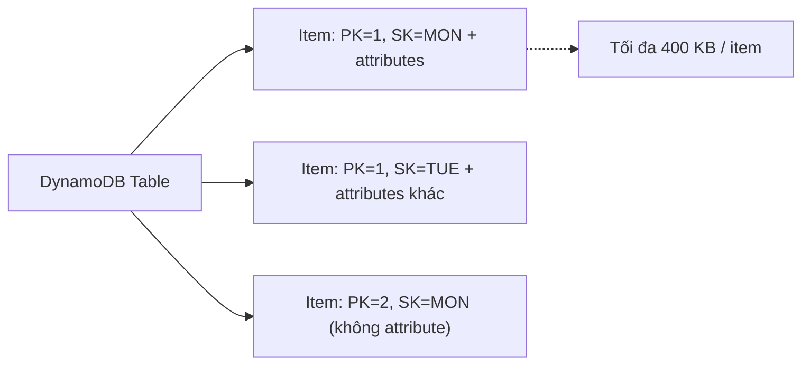
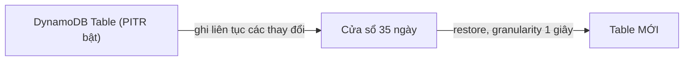

# DynamoDB Architecture

> **TL;DR:** DynamoDB là NoSQL **database-as-a-service** (chính xác hơn là "table-as-a-service") dạng wide-column key/value, public service, không có server nào để quản lý. Dữ liệu tự động được sao chép qua nhiều AZ, truy cập SSD với độ trễ single-digit millisecond, tính tiền theo capacity (tốc độ) và storage của từng table. Đây là lựa chọn mặc định cho ứng dụng serverless hoặc web-scale cần NoSQL/key-value.

## 🖼️ Sơ đồ
![[DynamoDB Architecture.excalidraw]]
*Mở bằng plugin Excalidraw để chỉnh sửa · ảnh tĩnh: [[DynamoDB Architecture.svg]]*

![[DynamoDB Architecture - backup.excalidraw]]
*Mở bằng plugin Excalidraw để chỉnh sửa · ảnh tĩnh: [[DynamoDB Architecture - backup.svg]]*

## Khái niệm cốt lõi

### DynamoDB là gì
- **NoSQL, public DBaaS**: endpoint public nên truy cập được từ Internet, hoặc từ VPC có Internet Gateway, hoặc qua **Gateway VPC Endpoint** (xem [[Gateway VPC Endpoints]]) — DynamoDB là một trong hai dịch vụ (cùng S3) dùng gateway endpoint. Xem [[AWS Public vs Private Services]].
- Lưu được dữ liệu **key/value** đơn giản lẫn dữ liệu có cấu trúc kiểu **document**. Nói chặt chẽ: *wide-column key/value database* (xem [[Database Models]]).
- **Không có self-managed server/infrastructure**: khác với [[RDS Architecture|RDS]], [[Aurora]], [[Aurora Serverless]] — những thứ đó là *database server*-as-a-service (bạn vẫn có instance/cluster). Với DynamoDB, thứ được giao dưới dạng dịch vụ là chính cái **table**.
- **Hiệu năng**: chọn *provisioned* (đặt thủ công hoặc để auto scaling tăng/giảm) hoặc *on-demand* (set-and-forget). Chi tiết ở [[DynamoDB Operations and Performance]].
- **Resilience**: mặc định dữ liệu được sao chép qua nhiều storage node ở **nhiều AZ** trong region — không phải tự cấu hình như [[RDS Multi-AZ]]. Có thể tùy chọn **global** bằng [[DynamoDB Global Tables]].
- **Nhanh**: chạy trên SSD, độ trễ **single-digit millisecond** (muốn microsecond thì thêm [[DAX]]).
- Có sẵn **backup, point-in-time recovery, encryption at rest**.
- **Event-driven integration**: làm việc gì đó khi dữ liệu thay đổi — xem [[DynamoDB Streams and Triggers]].

### Table, item, attribute
| Thành phần | Tương đương RDBMS | Ghi chú |
|---|---|---|
| **Table** | table | Đơn vị cơ bản của sản phẩm. Là tập các item dùng chung một primary key. |
| **Item** | row | Số item **không giới hạn**. Mỗi item tối đa **400 KB** (tính cả tên attribute, giá trị attribute và primary key). |
| **Attribute** | column | Mỗi item có thể có bộ attribute khác nhau: không có, có đủ, có một phần, hay attribute hoàn toàn khác. **Không có schema cứng** ngoài primary key. |

### Primary key
Chọn khi tạo table, có hai dạng:
- **Simple primary key** = chỉ **Partition Key (PK)**.
- **Composite primary key** = **PK + Sort Key (SK)**.
- Ràng buộc duy nhất với dữ liệu: mọi item phải có primary key và giá trị primary key phải **unique** (với composite thì tổ hợp PK+SK phải unique).

### Capacity = tốc độ, không phải dung lượng
- Trong DynamoDB, *capacity* nghĩa là **throughput** (speed). Thêm capacity = thêm hiệu năng.
- **On-demand**: không đặt giá trị capacity, trả tiền theo từng operation.
- **Provisioned**: đặt giá trị cho từng table:
  - **1 WCU** = ghi **1 KB/giây**.
  - **1 RCU** = đọc **4 KB/giây**.
  - Mỗi operation tiêu tối thiểu 1 đơn vị — đọc item 100 byte vẫn tốn 1 RCU.

## Backup

### On-demand backup
- Giống **manual snapshot** của RDS ([[RDS Backups and Restore]]): full backup của table, giữ tới khi bạn tự xóa.
- Restore được **cùng region hoặc cross-region** (một cách để chuyển dữ liệu sang region khác).
- Khi restore có thể chọn **giữ hay bỏ index**, và **đổi cấu hình encryption**.
- Bạn chịu trách nhiệm tạo backup và dọn backup cũ.

### Point-in-time Recovery (PITR)
- **Tắt mặc định**, phải bật **riêng cho từng table**.
- Khi bật: ghi lại liên tục mọi thay đổi trong cửa sổ **35 ngày**.
- Restore ra **table mới** tại bất kỳ thời điểm nào trong cửa sổ đó với độ mịn **1 giây**.

> Ghi chú hiện tại (2026): AWS đã cho phép cấu hình recovery period của PITR từ 1 đến 35 ngày; mặc định và tối đa vẫn là 35 ngày.

## Billing
- Tính theo **table**: RCU/WCU đã đặt (hoặc số operation nếu on-demand) + **storage** + **feature** bật thêm (PITR, streams, global tables...).
- **Không có chi phí base/infrastructure** — chỉ trả cho thứ dùng.
- Có thể mua **reserved capacity** cho provisioned throughput dài hạn để được giá rẻ hơn (giống tinh thần [[Reserved Instances and Savings Plans]]).

## 🎯 Mẹo thi SAA-C03
- Đề nói **NoSQL** → ưu tiên DynamoDB, trừ khi có lý do mạnh để chọn khác.
- Đề nói **key/value** → ưu tiên DynamoDB.
- Đề nói **relational data / relational database** → gần như chắc **không phải** DynamoDB (xem [[RDS Architecture]], [[Aurora]]). DynamoDB không có tính năng cho dữ liệu quan hệ (join...).
- Đề/đáp án nhắc tới **SQL** → thường loại DynamoDB. Truy cập bằng console, CLI, API. (DynamoDB có **PartiQL** — ngôn ngữ *giống* SQL — nhưng không hỗ trợ SQL thật.)
- "Serverless app cần database không quản lý server, tự scale" → DynamoDB (thường đi với [[Lambda]] và [[API Gateway]], xem [[Serverless Architecture]]).
- Dữ liệu **mặc định đã multi-AZ** — không có tùy chọn "bật Multi-AZ" như RDS.
- PITR: **tắt mặc định**, bật theo table, **35 ngày**, granularity **1 giây**, restore ra **table mới**.
- Item tối đa **400 KB** → dữ liệu lớn (ảnh, file) lưu trong [[S3 Basics|S3]] và chỉ giữ pointer trong DynamoDB.

## Liên kết
- Tiên quyết: [[Database Models]], [[ACID vs BASE]], [[AWS Public vs Private Services]]
- Tiếp theo: [[DynamoDB Operations and Performance]], [[DynamoDB Indexes LSI and GSI]], [[DynamoDB Streams and Triggers]], [[DynamoDB Global Tables]], [[DAX]], [[DynamoDB TTL]]
- Phân biệt với: [[RDS Architecture]], [[Aurora Serverless]], [[ElastiCache]]
- Truy cập riêng tư: [[Gateway VPC Endpoints]]
- Section: [[_MOC 20 NoSQL and Analytics]]
