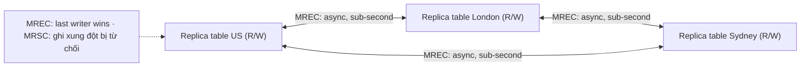

# DynamoDB Global Tables

> **TL;DR:** Global Tables cung cấp replication **multi-active (multi-master), cross-region** cho DynamoDB: tạo table ở nhiều region, gom vào một global table, rồi đọc **và ghi** ở region nào cũng được. Consistency mode chọn **lúc tạo, không đổi được**: **MREC** (mặc định) replication bất đồng bộ, thường dưới 1 giây, xung đột giải quyết bằng **last writer wins**; **MRSC** replication đồng bộ, strongly consistent read ở mọi region, ghi chậm hơn và ghi xung đột bị **từ chối**. Dùng cho global HA, hiệu năng toàn cầu và global DR/BC.

## 🖼️ Sơ đồ
![[DynamoDB Global Tables.excalidraw]]
*Mở bằng plugin Excalidraw để chỉnh sửa · ảnh tĩnh: [[DynamoDB Global Tables.svg]]*

## Khái niệm cốt lõi
- **Multi-active** (multi-master): không table nào là master, không table nào là "read replica" chỉ đọc — mọi table ngang hàng, đều nhận **read và write**.
- Global table là một thực thể riêng; bên dưới là các DynamoDB table ở các region khác nhau đóng vai **replica table**.
- **Consistency mode** chọn khi tạo global table và **bị khóa, không đổi được về sau**:
  - **MREC** (Multi-Region Eventual Consistency) — **mặc định**.
  - **MRSC** (Multi-Region Strong Consistency).

### MREC (mặc định)
- **Replication bất đồng bộ**: ghi thành công ở region local trước, replicate sau; thường **sub-second** (phụ thuộc chủ yếu vào khoảng cách giữa các region, một phần vào tải) → dùng được cho ứng dụng đòi hỏi cao.
- **Consistency**:
  - Trong **cùng region nơi ghi**: chọn được eventual hoặc **strongly consistent** read.
  - **Giữa các region**: luôn **eventually consistent**. Ghi ở US rồi đọc ở London → eventual.
  - Ứng dụng không chịu được eventual consistency giữa region thì MREC sẽ gây vấn đề.
- **Conflict resolution: last writer wins** — nếu cùng item bị ghi ở hai region gần như đồng thời (ví dụ của bài: hai người ở hai region cùng sửa giá Croc Cap trên web store Aus-E-Mart), bản ghi **mới nhất** thắng và được replicate đè lên mọi replica khác. Đơn giản, kết quả dễ dự đoán.

### MRSC
- **Replication đồng bộ**: một lệnh ghi chỉ được xác nhận khi đã commit ở **nhiều hơn một region** → ghi **chậm hơn** một chút.
- Đổi lại: **strongly consistent read ở mọi region** (cùng region ghi hay region khác).
- **Không giải quyết xung đột mà chặn xung đột**: ghi vào item đang bị sửa cùng lúc ở region khác bị **từ chối với lỗi**, ứng dụng phải **retry**. Không có gì bị ghi đè âm thầm.

| | **MREC** (mặc định) | **MRSC** |
|---|---|---|
| Replication | Bất đồng bộ, thường < 1 giây | Đồng bộ (commit ở > 1 region mới xác nhận) |
| Strongly consistent read | Chỉ trong region vừa ghi | **Mọi region** |
| Tốc độ ghi | Nhanh | Chậm hơn |
| Ghi xung đột | **Last writer wins** | **Bị từ chối**, app retry |

## Cách hoạt động / Kiến trúc

1. Chọn các region tham gia, ví dụ một region US, `ap-southeast-2` (Sydney) và London.
2. Tạo DynamoDB table ở mỗi region.
3. Trên **một** table bất kỳ, thêm các table còn lại vào cấu hình global table (chọn MREC hoặc MRSC) → DynamoDB thiết lập replication multi-active giữa tất cả.

- Replication dựa trên [[DynamoDB Streams and Triggers|DynamoDB Streams]] ở hậu trường (kiến thức bổ sung).
- Với kỳ thi, **kiến trúc** quan trọng hơn chi tiết triển khai.

## Use case
- **Global high availability**: một region sập, ứng dụng vẫn đọc/ghi ở region khác.
- **Global performance**: người dùng đọc/ghi ở region gần nhất (thường kết hợp [[R53 Latency Routing]]).
- **Global DR / business continuity** với [[RPO and RTO]] rất thấp.

## Bảng so sánh với giải pháp global khác

| | DynamoDB Global Tables | [[Aurora Global Database]] |
|---|---|---|
| Mô hình | NoSQL, **multi-active** (R/W mọi region) | Relational, 1 primary region ghi, region phụ chỉ đọc |
| Replication | MREC: async, thường < 1 giây; MRSC: đồng bộ | Storage-level, thường < 1 giây |
| Xung đột | MREC: last writer wins; MRSC: chặn, app retry | Không có (chỉ một nơi ghi) |

## 🎯 Mẹo thi SAA-C03
- "NoSQL, **đọc và ghi ở nhiều region**", "multi-region active-active", "người dùng toàn cầu cần latency ghi thấp" → **DynamoDB Global Tables**.
- Nhớ cụm từ khóa: **multi-active / multi-master**, **last writer wins**, **sub-second replication** (MREC).
- MREC (mặc định): **strongly consistent read chỉ trong cùng region với nơi ghi**; cross-region luôn eventual.
- Cần **strongly consistent read ở mọi region**, không cho phép ghi đè âm thầm → **MRSC** (ghi chậm hơn, ghi xung đột bị từ chối). Consistency mode chọn lúc tạo, **không đổi được**.
- Cần DR cho DynamoDB sang region khác: Global Tables (RPO/RTO gần 0) tốt hơn restore on-demand backup cross-region (xem [[DynamoDB Architecture]]).
- Đề yêu cầu relational/SQL toàn cầu → [[Aurora Global Database]], không phải Global Tables.

## Liên kết
- Tiên quyết: [[DynamoDB Architecture]], [[DynamoDB Operations and Performance]]
- Liên quan: [[DynamoDB Streams and Triggers]], [[Regional and Global Architecture]], [[HA vs FT vs DR]], [[RPO and RTO]]
- Phân biệt với: [[Aurora Global Database]], [[Aurora Multi-Master]], [[S3 Replication]]
- Section: [[_MOC 20 NoSQL and Analytics]]
