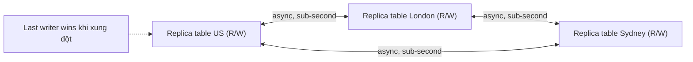

# DynamoDB Global Tables

> **TL;DR:** Global Tables cung cấp replication **multi-master, cross-region** cho DynamoDB: tạo table ở nhiều region, gom vào một global table, rồi đọc **và ghi** ở region nào cũng được. Replication bất đồng bộ, thường dưới 1 giây, xung đột giải quyết bằng **last writer wins**. Dùng cho global HA, hiệu năng toàn cầu và global DR/BC.

## 🖼️ Sơ đồ
![[DynamoDB Global Tables.excalidraw]]
*Mở bằng plugin Excalidraw để chỉnh sửa · ảnh tĩnh: [[DynamoDB Global Tables.svg]]*

## Khái niệm cốt lõi
- **Multi-master**: không table nào là master, không table nào là "read replica" chỉ đọc — mọi table ngang hàng, đều nhận **read và write**.
- Global table là một thực thể riêng; bên dưới là các DynamoDB table ở các region khác nhau đóng vai **replica table**.
- **Conflict resolution: last writer wins** — nếu cùng dữ liệu bị ghi ở hai region gần như đồng thời, bản ghi **mới nhất** thắng và được replicate đè lên mọi replica khác. Đơn giản, kết quả dễ dự đoán.
- **Replication thường sub-second** (phụ thuộc tải từng region) → dùng được cho ứng dụng đòi hỏi cao.
- **Consistency**:
  - Trong **cùng region nơi ghi**: chọn được eventual hoặc **strongly consistent** read.
  - **Giữa các region**: luôn **eventually consistent** (replication bất đồng bộ). Ghi ở US rồi đọc ở London → eventual.
  - Ứng dụng không chịu được eventual consistency thì global tables sẽ gây vấn đề.
- Ghi chú hiện nay (2025–2026): AWS đã bổ sung chế độ **multi-Region strong consistency (MRSC)** cho global tables (đổi lại latency ghi cao hơn, ràng buộc về region). Khóa học và phần lớn câu hỏi thi vẫn dựa trên chế độ mặc định **multi-Region eventual consistency** mô tả ở trên.

## Cách hoạt động / Kiến trúc

1. Chọn các region tham gia, ví dụ một region US, `ap-southeast-2` (Sydney) và London.
2. Tạo DynamoDB table ở mỗi region.
3. Trên **một** table bất kỳ, thêm các table còn lại vào cấu hình global table → DynamoDB thiết lập replication multi-master giữa tất cả.

- Replication dựa trên [[DynamoDB Streams and Triggers|DynamoDB Streams]] ở hậu trường (kiến thức bổ sung).
- Với kỳ thi, **kiến trúc** quan trọng hơn chi tiết triển khai.

## Use case
- **Global high availability**: một region sập, ứng dụng vẫn đọc/ghi ở region khác.
- **Global performance**: người dùng đọc/ghi ở region gần nhất (thường kết hợp [[R53 Latency Routing]]).
- **Global DR / business continuity** với [[RPO and RTO]] rất thấp.

## Bảng so sánh với giải pháp global khác

| | DynamoDB Global Tables | [[Aurora Global Database]] |
|---|---|---|
| Mô hình | NoSQL, **multi-master** (R/W mọi region) | Relational, 1 primary region ghi, region phụ chỉ đọc |
| Replication | Async, thường < 1 giây | Storage-level, thường < 1 giây |
| Xung đột | Last writer wins | Không có (chỉ một nơi ghi) |

## 🎯 Mẹo thi SAA-C03
- "NoSQL, **đọc và ghi ở nhiều region**", "multi-region active-active", "người dùng toàn cầu cần latency ghi thấp" → **DynamoDB Global Tables**.
- Nhớ cụm từ khóa: **multi-master**, **last writer wins**, **sub-second replication**.
- **Strongly consistent read chỉ trong cùng region với nơi ghi**; cross-region luôn eventual.
- Cần DR cho DynamoDB sang region khác: Global Tables (RPO/RTO gần 0) tốt hơn restore on-demand backup cross-region (xem [[DynamoDB Architecture]]).
- Đề yêu cầu relational/SQL toàn cầu → [[Aurora Global Database]], không phải Global Tables.

## Liên kết
- Tiên quyết: [[DynamoDB Architecture]], [[DynamoDB Operations and Performance]]
- Liên quan: [[DynamoDB Streams and Triggers]], [[Regional and Global Architecture]], [[HA vs FT vs DR]], [[RPO and RTO]]
- Phân biệt với: [[Aurora Global Database]], [[Aurora Multi-Master]], [[S3 Replication]]
- Section: [[_MOC 20 NoSQL and Analytics]]
