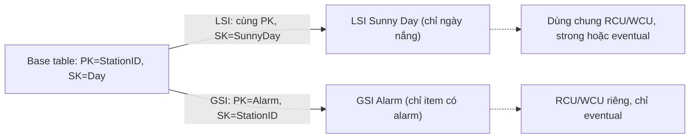

# DynamoDB Indexes LSI and GSI

> **TL;DR:** Query chỉ làm việc trên một giá trị partition key (và tùy chọn sort key). Index tạo ra một **góc nhìn thay thế** (alternative view) lên dữ liệu của base table để Query được theo attribute khác, tránh phải Scan. **LSI** = cùng PK, khác SK, phải tạo cùng lúc với table. **GSI** = PK và SK khác hẳn, tạo lúc nào cũng được, nhưng chỉ eventually consistent.

## 🖼️ Sơ đồ
![[DynamoDB Indexes LSI and GSI.excalidraw]]
*Mở bằng plugin Excalidraw để chỉnh sửa · ảnh tĩnh: [[DynamoDB Indexes LSI and GSI.svg]]*

## Khái niệm cốt lõi

### Vì sao cần index
- [[DynamoDB Operations and Performance|Query]] là operation hiệu quả nhất nhưng chỉ chạy trên **một giá trị PK** + một/khoảng giá trị SK.
- Muốn tìm theo attribute không phải key (ví dụ "ngày nắng", "có alarm") thì chỉ còn **Scan** → tốn capacity cho cả table.
- Index cho phép Query theo **access pattern thay thế** mà vẫn giữ dữ liệu ở một chỗ.

### Projection (attribute nào được chép vào index)
Áp dụng cho cả LSI và GSI:
- **ALL** — mọi attribute của base table.
- **KEYS_ONLY** — chỉ các key.
- **INCLUDE** — các key + những attribute bạn chỉ định.

### Sparse index
- Chỉ item nào **có giá trị cho attribute dùng làm key mới của index** mới xuất hiện trong index. Item không có attribute đó bị bỏ qua.
- Hệ quả: có thể **Scan một index sparse** mà chỉ tốn capacity cho dữ liệu liên quan (ví dụ index chỉ chứa các ngày nắng).

## Local Secondary Index (LSI)

- Alternative view với **cùng PK, SK khác**.
- **BẮT BUỘC tạo cùng lúc với base table** — không thể thêm sau.
- Tối đa **5 LSI** mỗi base table.
- **Dùng chung RCU/WCU** với base table (khi table dùng provisioned capacity).
- Hỗ trợ cả **strongly consistent read**.

Ví dụ trong bài: table thời tiết (PK = station ID, SK = ngày). Tạo LSI với SK = attribute *Sunny Day* → Query một station và lấy riêng các ngày nắng; vì index sparse, các ngày không nắng không có trong index.

## Global Secondary Index (GSI)

- Alternative view với **PK và SK hoàn toàn khác**.
- **Tạo bất kỳ lúc nào**, kể cả sau khi table đã có dữ liệu.
- Giới hạn mặc định **20 GSI** mỗi base table (soft limit, xin tăng được).
- Có **RCU/WCU riêng** (khi dùng provisioned capacity).
- **Luôn eventually consistent**: dữ liệu được sao chép từ base table sang index **bất đồng bộ** — ứng dụng phải chịu được điều này.

Ví dụ trong bài: attribute *Alarm* (lỗi thiết bị, động vật chui vào trạm...). Tạo GSI với **PK = Alarm**, **SK = station ID** → Query mọi item có alarm, lọc theo một hoặc một khoảng station. Item không có alarm không nằm trong GSI (sparse).

## Bảng so sánh

| | **LSI** | **GSI** |
|---|---|---|
| Partition key | **Giống** base table | **Khác** (tùy chọn) |
| Sort key | Khác | Khác (tùy chọn) |
| Thời điểm tạo | **Chỉ khi tạo table** | **Bất kỳ lúc nào** |
| Số lượng | 5 / table | 20 / table (mặc định) |
| Capacity | **Chia sẻ** với table | **Riêng** |
| Consistency | Strong hoặc eventual | **Chỉ eventual** |
| Projection | ALL / KEYS_ONLY / INCLUDE | ALL / KEYS_ONLY / INCLUDE |
| Sparse | Có | Có |

## Lưu ý thiết kế
- **Cẩn thận với projection**: đọc/ghi luôn tính trên toàn bộ item → project ALL thì index tốn capacity tương ứng với mọi attribute.
- Ngược lại, Query index mà cần attribute **không được project** thì vẫn chạy được nhưng DynamoDB phải fetch lại từ base table ở hậu trường → **rất tốn kém**. Phải lên kế hoạch index trước.
- AWS khuyến nghị: **dùng GSI làm mặc định**, chỉ dùng LSI khi **cần strong consistency**.
- Base table thiết kế PK/SK cho **access pattern chính**; index phục vụ **access pattern phụ** (ví dụ team security/data science chỉ quan tâm alarm) — cùng dữ liệu, nhiều góc nhìn.

## 🎯 Mẹo thi SAA-C03
- "Cần truy vấn theo attribute khác mà không Scan" → tạo **index** (thường là GSI).
- "Table đã tồn tại, cần thêm index" → chỉ có thể là **GSI** (LSI phải tạo lúc tạo table).
- "Cần alternative **sort key** nhưng giữ PK" → LSI. "Cần **partition key khác**" → GSI.
- "Index cần **strongly consistent read**" → LSI (GSI chỉ eventual).
- LSI dùng chung capacity với table; GSI có capacity riêng — một GSI bị thiếu WCU có thể gây throttle ghi lên base table (kiến thức bổ sung).
- Projection không đủ attribute → query tốn kém; project quá nhiều → index tốn capacity/storage.

## Liên kết
- Tiên quyết: [[DynamoDB Architecture]], [[DynamoDB Operations and Performance]]
- Liên quan: [[DAX]], [[DynamoDB Global Tables]]
- Phân biệt với: index trong [[RDS Architecture|RDS]] (B-tree trên cột, SQL), [[RDS Read Replicas]] (scale đọc cả DB)
- Section: [[_MOC 20 NoSQL and Analytics]]
