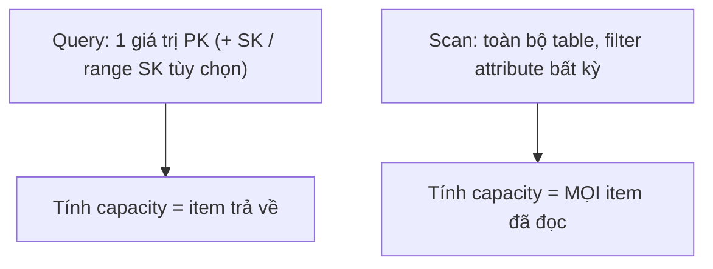
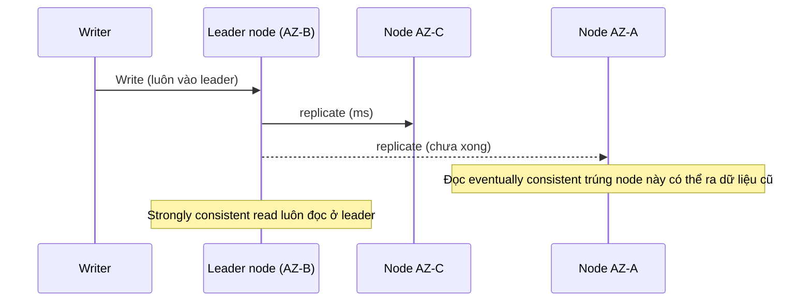

# DynamoDB Operations and Performance

> **TL;DR:** DynamoDB có hai capacity mode (on-demand và provisioned). Với provisioned, 1 RCU = 4 KB đọc/giây (strongly consistent), 1 WCU = 1 KB ghi/giây, mọi operation làm tròn lên tối thiểu 1 đơn vị. Query chỉ đọc theo một giá trị partition key nên rẻ; Scan đọc cả table nên linh hoạt nhưng tốn capacity. Eventually consistent read rẻ bằng một nửa strongly consistent read.

## 🖼️ Sơ đồ
![[DynamoDB Operations and Performance.excalidraw]]
*Mở bằng plugin Excalidraw để chỉnh sửa · ảnh tĩnh: [[DynamoDB Operations and Performance.svg]]*

![[DynamoDB Operations and Performance - consistency.excalidraw]]
*Mở bằng plugin Excalidraw để chỉnh sửa · ảnh tĩnh: [[DynamoDB Operations and Performance - consistency.svg]]*

## Capacity modes

| | **On-demand** | **Provisioned** |
|---|---|---|
| Khi nào dùng | Tải **không biết trước / khó đoán**, hoặc ưu tiên **admin overhead thấp nhất** | Tải biết trước, muốn tối ưu chi phí |
| Cấu hình | Không đặt gì, DynamoDB tự lo | Đặt **RCU** và **WCU** cho từng table (thủ công hoặc auto scaling) |
| Tính tiền | Giá theo **mỗi triệu read/write request unit** | Theo RCU/WCU đã đặt |
| Giá | Có thể đắt tới **~5 lần** provisioned (theo khóa học) | Rẻ hơn, có thể mua reserved capacity |

- Có thể chuyển đổi giữa hai mode sau khi table đã có dữ liệu, với một số hạn chế (giới hạn số lần chuyển trong mỗi 24 giờ).
- Ghi chú hiện nay: từ cuối 2024 AWS đã giảm giá on-demand khoảng 50%, nên khoảng chênh với provisioned nhỏ hơn con số trong khóa học; ý tưởng "on-demand = trả thêm để đổi lấy ít quản trị" vẫn đúng.

### Đơn vị capacity (provisioned)
- **1 RCU** = 1 lần đọc tới **4 KB mỗi giây** (strongly consistent).
- **1 WCU** = 1 lần ghi tới **1 KB mỗi giây**.
- **Mọi operation tiêu tối thiểu 1 đơn vị**, làm tròn lên: đọc item 1 KB vẫn tốn 1 RCU; đọc item 400 KB (tối đa) tốn **100 RCU**.
- Ghi đắt hơn đọc (1 KB vs 4 KB) vì mọi lệnh ghi phải vào **leader node** (xem phần consistency), nên ghi khó scale bằng đọc.

### Burst pool và throttling
- Mỗi table có **burst pool** cho RCU và WCU = **300 giây** capacity đã đặt.
- RCU/WCU đặt ra là cho **mức trung bình bền vững**; đừng dựa vào burst pool vì các tác vụ sửa đổi table khác cũng dùng chung pool này.
- Cạn pool + capacity thiếu → lỗi **`ProvisionedThroughputExceededException`**, request bị **throttle**. Cách xử lý: chờ rồi retry (exponential backoff) hoặc tăng capacity.

## Query vs Scan

Ví dụ của bài: table thời tiết, **PK = sensor ID**, **SK = ngày trong tuần**.

### Query
- **Bắt buộc** cung cấp **đúng một giá trị PK**; tùy chọn thêm một giá trị SK hoặc một **khoảng SK**.
- Trả về 0, 1 hoặc nhiều item. Capacity tiêu = **tổng kích thước các item trả về**.
- Ví dụ: Query(PK=1) trả 2 item 2.5 KB + 1.5 KB = 4 KB → **1 RCU**. Nếu tách thành 2 query riêng (PK=1,SK=MON và PK=1,SK=TUE) thì tốn **2 RCU** cho cùng dữ liệu → nên lấy càng nhiều dữ liệu cần thiết trong **một** operation càng tốt.
- Có thể chỉ yêu cầu một vài attribute (projection) hoặc filter thêm, nhưng phần bị lọc **vẫn bị tính capacity** — DynamoDB luôn đọc/ghi **nguyên cả item**. Vì thế nên giữ item nhỏ.
- Hạn chế: chỉ truy vấn được theo PK hoặc PK+SK. Muốn truy vấn theo attribute khác một cách hiệu quả → dùng [[DynamoDB Indexes LSI and GSI|index]].

### Scan
- Đi qua **toàn bộ table**, từng item một. Lọc được theo **bất kỳ attribute nào**, điều kiện gì cũng được.
- Tiêu capacity cho **mọi item đã quét qua**, kể cả item bị loại.
- Ví dụ: Scan tìm ngày nắng trên table có item 5K + 4K + 2K + 3K = 14 KB → **4 RCU**, dù chỉ trả về 5K + 4K; phần còn lại bị bỏ đi nhưng vẫn tính tiền.
- **Linh hoạt nhất nhưng kém hiệu quả nhất.**

## Consistency model

- Mỗi item được sao chép ra **nhiều storage node ở các AZ khác nhau** (trong bài: 3 node ở AZ-A/B/C).
- Một node được bầu làm **leader**; bầu lại tự động nếu leader hỏng.
- **Ghi luôn vào leader**. Leader có dữ liệu mới thì là "consistent", rồi bắt đầu sao chép sang các node khác (thường chỉ mất vài millisecond, tùy tải và giả định không lỗi).

| | **Eventually consistent read** | **Strongly consistent read** |
|---|---|---|
| Node phục vụ | Một node **ngẫu nhiên** | Luôn là **leader** |
| Dữ liệu | Có thể (hiếm) **cũ** nếu đọc ngay sau khi ghi | Luôn mới nhất |
| Scale | Tốt hơn | Kém hơn |
| Chi phí | **50%** — 1 RCU đọc được **8 KB/s** | Giá đầy đủ — 1 RCU = 4 KB/s |

- Phải chọn mô hình phù hợp: dữ liệu tồn kho, dữ liệu y tế quan trọng... cần strongly consistent; ứng dụng chịu được độ trễ nhỏ thì dùng eventually consistent để tiết kiệm.
- Xem thêm [[ACID vs BASE]].

## Tính RCU/WCU

**Ghi (WCU):**
1. WCU mỗi item = **ROUNDUP(item size / 1 KB)**.
2. Nhân với số lần ghi **mỗi giây**.
- Ví dụ: 10 item/giây, 2.5 KB → ROUNDUP(2.5) = 3 WCU/item × 10 = **30 WCU**.

**Đọc (RCU):**
1. RCU mỗi item = **ROUNDUP(item size / 4 KB)**.
2. Nhân với số lần đọc mỗi giây → RCU cho **strongly consistent**.
3. Chia 2 → RCU cho **eventually consistent**.
- Ví dụ: 10 item/giây, 2.5 KB → 1 RCU/item × 10 = **10 RCU** (strong) hoặc **5 RCU** (eventual).

> Lưu ý đề có thể cho "60 item mỗi phút" → đổi về **mỗi giây** (= 1/s) trước khi tính, vì RCU/WCU tính theo giây.

## 🎯 Mẹo thi SAA-C03
- Nhớ chắc: **RCU = 4 KB/s**, **WCU = 1 KB/s**, làm tròn lên theo **từng item**, tối thiểu 1 đơn vị/operation.
- **Eventually consistent = nửa giá** (gấp đôi lượng đọc cho cùng RCU). Đề cần "luôn đọc dữ liệu mới nhất ngay sau khi ghi" → **strongly consistent read**.
- Tải **không đoán trước / spiky / mới ra mắt / muốn ít quản trị** → **on-demand**. Tải ổn định, muốn rẻ → **provisioned** (+ auto scaling, reserved capacity).
- `ProvisionedThroughputExceededException` → capacity thiếu (hoặc hot partition); giải pháp: tăng capacity / auto scaling / on-demand, retry với backoff; đọc nhiều lặp lại thì cân nhắc [[DAX]].
- **Query** khi biết PK; **Scan** là tốn kém nhất — câu hỏi tối ưu chi phí/hiệu năng thường đáp án là "tránh Scan, dùng Query + index ([[DynamoDB Indexes LSI and GSI|GSI/LSI]])".
- Filter/projection **không giảm** capacity tiêu thụ.

## Liên kết
- Tiên quyết: [[DynamoDB Architecture]], [[ACID vs BASE]]
- Liên quan: [[DynamoDB Indexes LSI and GSI]], [[DAX]], [[DynamoDB Global Tables]]
- So sánh mô hình consistency: [[S3 Basics]], [[RDS Read Replicas]] (đọc từ replica cũng có thể trễ)
- Section: [[_MOC 20 NoSQL and Analytics]]
