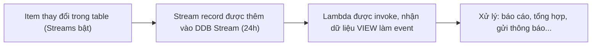

# DynamoDB Streams and Triggers

> **TL;DR:** DynamoDB Stream là danh sách **có thứ tự thời gian** các thay đổi (insert/update/delete) của item trong table, giữ trong cửa sổ trượt **24 giờ**. Kết hợp Stream với **Lambda** ta có kiến trúc **database trigger** serverless: dữ liệu đổi → Lambda chạy, không cần polling.

## 🖼️ Sơ đồ
![[DynamoDB Streams and Triggers.excalidraw]]
*Mở bằng plugin Excalidraw để chỉnh sửa · ảnh tĩnh: [[DynamoDB Streams and Triggers.svg]]*

## Khái niệm cốt lõi

### DynamoDB Streams
- Ghi lại **theo thứ tự** mọi thay đổi trên item: **insert, update, delete**.
- **Rolling window 24 giờ**.
- Bật **theo từng table** (mặc định tắt).
- Kiến trúc nền tương tự Kinesis (shard), như Adrian giới thiệu — xem [[Kinesis Data Streams]]. (Ngoài DynamoDB Streams, hiện DynamoDB còn tùy chọn đẩy change data thẳng vào Kinesis Data Streams với thời gian lưu dài hơn.)

### Stream view types
Mỗi stream chọn một view type, quyết định nội dung mỗi record. Ví dụ: một item bị **xóa attribute thứ 4**.

| View type | Nội dung record | Dùng khi |
|---|---|---|
| **KEYS_ONLY** | Chỉ PK (và SK nếu có) của item đổi | Chỉ cần biết item nào đổi; muốn biết đổi gì phải tự đọc lại DB |
| **NEW_IMAGE** | Toàn bộ item **sau** thay đổi | Xử lý nghiệp vụ dựa trên trạng thái mới |
| **OLD_IMAGE** | Toàn bộ item **trước** thay đổi | So với item hiện tại trong table để suy ra đã đổi gì |
| **NEW_AND_OLD_IMAGES** | Cả trước **và** sau | Cần thấy đầy đủ thay đổi mà **không phải đọc lại table** |

- Với **insert**: phần old trống. Với **delete**: phần new trống.

## Triggers = Streams + Lambda

1. Item thay đổi trong table đã bật stream.
2. Stream record được thêm vào stream (nội dung theo view type).
3. **Lambda function** được invoke, nhận dữ liệu view làm **event** — chính lần invoke này là "trigger".

- Event-driven, giống trigger của Oracle nhưng **serverless**: không phải poll database, chỉ tốn compute khi thực sự có thay đổi → rẻ và hiệu quả. Xem [[Event-Driven Architecture]].

### Use case
- **Reporting / analytics**: báo cáo khi mức tồn kho đổi, thống kê sản phẩm phổ biến.
- **Aggregation**: kiểm phiếu cho app bình chọn, tổng hợp tồn kho.
- **Messaging / notification**: app chat nhóm lưu tin nhắn trong DynamoDB → trigger gửi **push notification** cho thành viên (có thể qua [[SNS]]).

## 🎯 Mẹo thi SAA-C03
- "Thực hiện hành động **khi dữ liệu trong DynamoDB thay đổi**", "trigger", "event-driven, serverless, không polling" → **DynamoDB Streams + Lambda**.
- Nhớ **4 view type** và **24 giờ** retention.
- Cần cả trạng thái trước và sau mà không đọc lại table → **NEW_AND_OLD_IMAGES**.
- Streams phải **bật theo table**; streams cũng là nền tảng cho [[DynamoDB Global Tables]] (replication giữa region).
- Phân biệt: [[S3 Events]] cho thay đổi object S3; [[EventBridge]] cho event của dịch vụ AWS nói chung; DynamoDB Streams cho thay đổi **item** trong table.

## Liên kết
- Tiên quyết: [[DynamoDB Architecture]], [[Lambda]]
- Liên quan: [[Event-Driven Architecture]], [[Serverless Architecture]], [[Kinesis Data Streams]], [[DynamoDB Global Tables]], [[DynamoDB TTL]] (item hết hạn bị xóa cũng xuất hiện trong stream)
- Phân biệt với: [[S3 Events]], [[EventBridge]], [[SNS]]
- Section: [[_MOC 20 NoSQL and Analytics]]
