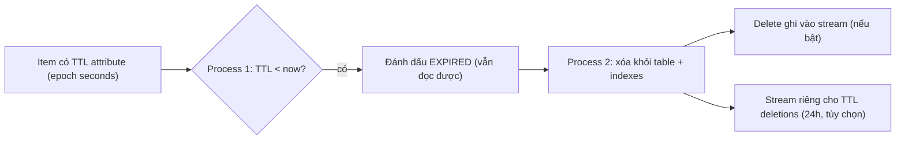

# DynamoDB TTL

> **TL;DR:** Time To Live (TTL) cho phép gắn **timestamp hết hạn cho từng item**; khi quá thời điểm đó, DynamoDB tự đánh dấu expired rồi xóa item trong nền — **miễn phí**, không ảnh hưởng hiệu năng table. Dùng để dọn dữ liệu hết giá trị hoặc tuân thủ thời hạn lưu trữ.

## 🖼️ Sơ đồ
![[DynamoDB TTL.excalidraw]]
*Mở bằng plugin Excalidraw để chỉnh sửa · ảnh tĩnh: [[DynamoDB TTL.svg]]*

## Khái niệm cốt lõi
- Bật TTL **trên table** và chọn **một attribute** làm TTL attribute.
- Giá trị attribute là **số giây kể từ epoch** (1/1/1970, Unix time). Muốn item hết hạn sau 1 tuần → ghi epoch time của thời điểm đó vào attribute.
- Chỉ item nào có TTL attribute hợp lệ mới bị ảnh hưởng.

## Cách hoạt động / Kiến trúc
TTL tạo các tiến trình tự động chạy trên **từng partition** của table:

1. **Process 1 (đánh dấu)**: định kỳ quét item trong partition, so giá trị TTL với thời gian hiện tại (epoch). Item có TTL **nhỏ hơn** hiện tại → đặt trạng thái **expired**. Lúc này item **chưa bị xóa**, vẫn query/xem được.
2. **Process 2 (xóa)**: chạy độc lập, định kỳ tìm item expired và **xóa** chúng khỏi **table và mọi index**; nếu table có stream thì một bản ghi **delete** được thêm vào stream.

- Các lệnh delete do TTL là **system process chạy nền**: **không ảnh hưởng hiệu năng** và **không tính phí** (không tốn WCU).
- **Stream**: delete do TTL xuất hiện trong [[DynamoDB Streams and Triggers|stream]] bình thường của table cùng các insert/update; ngoài ra có thể theo dõi riêng các TTL deletion (cửa sổ **24 giờ**) — hữu ích cho housekeeping như **undelete** hay **audit**. (Khóa học nói có thể bật "stream riêng cho TTL"; thực tế hiện nay chỉ có stream của table, record xóa do TTL mang `userIdentity` là service `dynamodb.amazonaws.com` nên lọc riêng được, ví dụ bằng event filter của Lambda.)
- Lưu ý thực tế: việc xóa không tức thì — item hết hạn thường bị xóa trong vòng vài ngày, nên ứng dụng nên tự lọc item đã quá TTL khi đọc.

## Use case
- Xóa dữ liệu mất giá trị sau một thời gian: dữ liệu user/sensor không hoạt động sau **1 năm**, session, token tạm.
- Tuân thủ **quy định/hợp đồng** về thời hạn lưu dữ liệu nhạy cảm (1, 3, 5 năm...) rồi tự động xóa.
- Giảm chi phí storage mà không tốn WCU cho việc xóa.

## 🎯 Mẹo thi SAA-C03
- "Tự động xóa item DynamoDB sau một khoảng thời gian", "dữ liệu session hết hạn", "giảm storage không tốn chi phí xóa" → **TTL**.
- TTL attribute = **epoch time tính bằng giây**.
- Xóa do TTL **miễn phí, không tốn WCU, không ảnh hưởng performance**.
- Muốn **lưu trữ (archive)** item trước khi bị xóa → TTL + **DynamoDB Streams + Lambda** ghi item hết hạn sang [[S3 Basics|S3]].
- Phân biệt với [[S3 Lifecycle Configuration]] (S3 object hết hạn/chuyển class) — cùng ý tưởng nhưng cho object S3.

## Liên kết
- Tiên quyết: [[DynamoDB Architecture]]
- Liên quan: [[DynamoDB Streams and Triggers]], [[DynamoDB Indexes LSI and GSI]], [[Lambda]]
- Phân biệt với: [[S3 Lifecycle Configuration]], [[CloudFront TTL and Invalidations]] (TTL của cache, khác hẳn)
- Section: [[_MOC 20 NoSQL and Analytics]]
