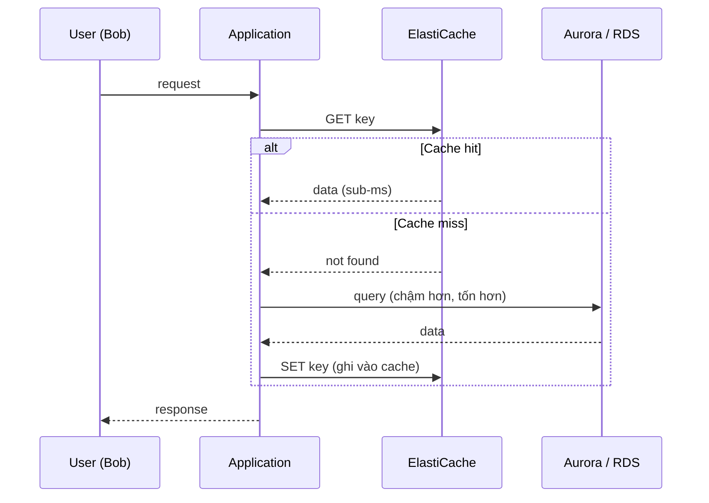
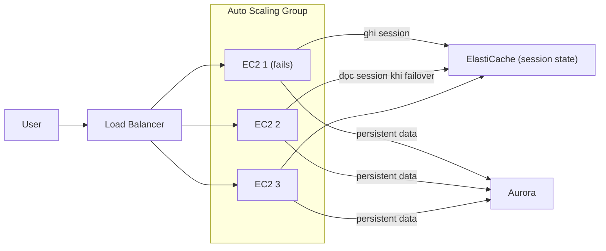

# ElastiCache

> **TL;DR:** ElastiCache là **in-memory cache/database dạng managed service**, có hai engine **Redis** và **Memcached**. Dùng để giảm tải đọc cho database (workload **read-heavy**), đạt độ trễ **sub-millisecond**, và lưu **session state** bên ngoài instance để ứng dụng thành **stateless**. Điều kiện tiên quyết: **phải sửa code ứng dụng**.

## 🖼️ Sơ đồ
![[ElastiCache.excalidraw]]
*Mở bằng plugin Excalidraw để chỉnh sửa · ảnh tĩnh: [[ElastiCache.svg]]*

![[ElastiCache - redis-vs-memcached.excalidraw]]
*Mở bằng plugin Excalidraw để chỉnh sửa · ảnh tĩnh: [[ElastiCache - redis-vs-memcached.svg]]*

## Khái niệm cốt lõi

### Vì sao cần in-memory cache
- Database như [[RDS Architecture|RDS]] hay [[Aurora]] lưu dữ liệu **bền vững trên disk**. Disk nhanh đến đâu cũng có giới hạn về throughput và latency.
- Cache giữ dữ liệu **trong RAM**: nhanh hơn disk nhiều bậc cả về throughput lẫn latency, nhưng **không bền vững**. Chỉ dùng cho dữ liệu tạm hoặc dữ liệu có thể nạp lại từ nguồn.
- ElastiCache cung cấp cache này **as a service**, giống cách RDS cung cấp database server as a service.

### Ba trường hợp sử dụng chính
1. **Workload read-heavy**: chuyển phần lớn lượt đọc sang cache, database chịu ít tải hơn. Database, nhất là relational, **khó scale** và **đắt** so với lượng dữ liệu và hiệu năng nó cho → offload đọc sang cache vừa nhanh hơn vừa **rẻ hơn (cost-effective)**.
2. **Yêu cầu latency thấp**: cả hai engine đều cho truy cập **sub-millisecond**.
3. **Lưu session state** của người dùng bên ngoài EC2 → app server **stateless** → hệ thống dùng [[Elastic Load Balancer|load balancer]] + [[Auto Scaling Groups|ASG]] có thể tiến tới **fault tolerant** chứ không chỉ highly available (xem [[HA vs FT vs DR]]).

### Phải sửa ứng dụng
- ElastiCache **không phải dịch vụ "bật là chạy"**. Ứng dụng phải hiểu kiến trúc caching: đọc cache trước, miss thì đọc database rồi ghi lại vào cache, và phải xử lý **cache invalidation** khi dữ liệu thay đổi.
- Đây là điểm khác lớn so với [[DAX]] (DAX SDK tự lo hit/miss cho DynamoDB) và [[RDS Read Replicas]] (chỉ đổi endpoint đọc).

## Cách hoạt động / Kiến trúc

### Mô hình cache-aside (cache hit / cache miss)
Ví dụ Catagram dùng [[Aurora]] làm database và đã được sửa để dùng ElastiCache:
- Lần đầu Bob truy vấn: app hỏi cache → **cache miss** → app đọc Aurora (chậm hơn, tốn hơn) → app **ghi kết quả vào cache**.
- Lần sau Bob (hoặc người khác) hỏi cùng dữ liệu → **cache hit** → trả thẳng từ ElastiCache, không đọc database.
- Khi số người dùng tăng mà kiểu truy cập dữ liệu tương tự nhau, phần lớn tải tăng thêm rơi vào cache. Số lượt đọc database **không tăng tương ứng**, nhờ vậy kiến trúc scale được với chi phí thấp hơn nhiều so với đọc thẳng database.

### Lưu session state (Catagram "extreme" edition, fault tolerant)
- App chạy trong ASG gồm 3 EC2 sau load balancer, dữ liệu bền vững trong Aurora.
- Khi Bob kết nối, instance phục vụ **ghi session state** (ví dụ giỏ hàng) vào ElastiCache và cập nhật liên tục.
- Instance hỏng → load balancer chuyển Bob sang instance khác → instance mới **đọc session từ ElastiCache** → phiên tiếp tục, Bob không thấy gián đoạn.

## Bảng so sánh / số liệu

### Redis vs Memcached

| Tiêu chí | Memcached | Redis |
|---|---|---|
| Latency | Sub-millisecond | Sub-millisecond |
| Ngôn ngữ lập trình | Hỗ trợ nhiều ngôn ngữ | Hỗ trợ nhiều ngôn ngữ |
| Cấu trúc dữ liệu | **Đơn giản** (string) | **Nâng cao**: list, set, **sorted set**, hash, bit array... |
| Replication / Multi-AZ | **Không** replication | **Có**: replicate qua nhiều AZ, **highly available**, replica dùng để **scale read** |
| Scale ngang | Nhiều node, **sharding thủ công** (ví dụ chia user theo node) | Replica cho read (và cluster mode cho sharding) |
| Backup & restore | **Không** (không persistence) | **Có**: khôi phục cache về trạng thái trước sự cố |
| Threading | **Multi-threaded** → tận dụng tốt CPU nhiều core | Lõi xử lý chủ yếu single-threaded |
| Transactions | Không | **Có**: nhiều thao tác thực thi như một (all or nothing) |

- Ví dụ Redis: **leaderboard game** dùng sorted set, Redis lưu cả dữ liệu lẫn thứ tự xếp hạng, giảm việc app phải tự sắp xếp.
- Cả hai engine chạy trên nhiều instance type/size. Instance có nhiều RAM hơn hoặc RAM nhanh hơn thì hiệu năng tốt hơn. Đề thi không hỏi chi tiết các loại node.
- (Khóa học chỉ nói hai engine. Hiện nay ElastiCache có thêm **Valkey**, bản fork mã nguồn mở tương thích Redis, và chế độ **ElastiCache Serverless**. Với đề thi, cứ phân biệt theo đặc tính Redis-like và Memcached như bảng trên.)

## 🎯 Mẹo thi SAA-C03
- Từ khóa → ElastiCache: "**read-heavy**", "giảm tải / **giảm chi phí** đọc database", "**sub-millisecond**", "**in-memory**", "lưu **session state** bên ngoài EC2", "ứng dụng **stateless**".
- Đề ghi "**không được sửa code / no application changes**" → ElastiCache **gần như chắc chắn sai**. Cân nhắc [[RDS Read Replicas]], [[Aurora]] replicas, hoặc [[DAX]] (với DynamoDB, ít thay đổi app).
- Cần **Multi-AZ, high availability, resilience, replication** → chọn **Redis**.
- Cần **backup/restore**, khôi phục cache mà không mất dữ liệu → **Redis** (Memcached không có persistence).
- Cần **transactions** / consistency chặt hơn → **Redis**. Cấu trúc dữ liệu phức tạp (sorted set, leaderboard) → **Redis**.
- Cần **multi-threaded**, cache đơn giản, tận dụng CPU nhiều core, chấp nhận mất dữ liệu → **Memcached**.
- Cache cho **DynamoDB** → mặc định **[[DAX]]**, không phải ElastiCache. Cache nội dung tĩnh ở edge cho người dùng toàn cầu → [[CloudFront Architecture|CloudFront]].
- Phân biệt với Session Stickiness ([[SSL Offload and Session Stickiness]]): stickiness gắn user vào một instance, instance chết thì mất session. Lưu session trong ElastiCache thì instance nào cũng phục vụ được → bền hơn.

## Liên kết
- Tiên quyết: [[Database Models]], [[RDS Architecture]], [[HA vs FT vs DR]]
- Dùng cùng: [[Aurora]], [[Auto Scaling Groups]], [[Elastic Load Balancer]], [[Lab - Architecture Evolution]]
- Phân biệt với: [[DAX]], [[RDS Read Replicas]], [[SSL Offload and Session Stickiness]], [[CloudFront Architecture]]
- Liên quan: [[Horizontal vs Vertical Scaling]], [[DynamoDB Operations and Performance]]
- Section: [[_MOC 20 NoSQL and Analytics]]
