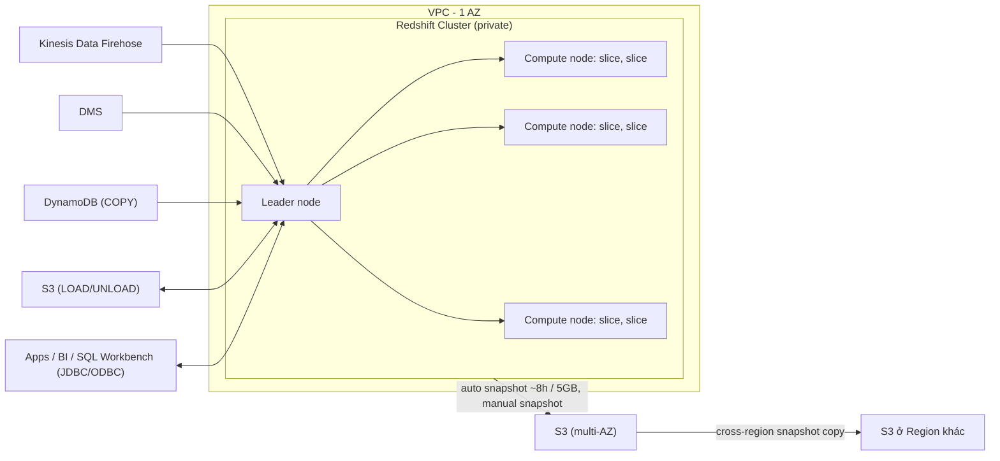

# Redshift

> **TL;DR:** Redshift là **data warehouse quy mô petabyte**, kiểu **OLAP, lưu theo cột (column-based)**, dạng provisioned cluster nằm **trong một AZ**. Các hệ thống OLTP (RDS...) đổ dữ liệu vào đây để phân tích dài hạn, báo cáo, BI. Bảo vệ dữ liệu bằng snapshot vào S3 (chịu được lỗi AZ) và copy snapshot sang Region khác (DR).

## 🖼️ Sơ đồ
![[Redshift.excalidraw]]
*Mở bằng plugin Excalidraw để chỉnh sửa · ảnh tĩnh: [[Redshift.svg]]*

![[Redshift - resilience.excalidraw]]
*Mở bằng plugin Excalidraw để chỉnh sửa · ảnh tĩnh: [[Redshift - resilience.svg]]*

## Khái niệm cốt lõi

### Data warehouse, OLAP vs OLTP
- **Data warehouse**: nơi nhiều database vận hành (operational) của doanh nghiệp đổ dữ liệu về để **phân tích dài hạn, tìm xu hướng**. Dùng cho **reporting & analytics**, không phải cho thao tác vận hành hằng ngày.
- **OLTP** (Online Transaction Processing): ghi và xử lý **giao dịch theo thời gian thực** (insert, update, delete), ví dụ thêm đơn hàng vào web bán hàng. Đây là kiểu của [[RDS Architecture|RDS]] / [[Aurora]].
- **OLAP** (Online Analytical Processing): **truy vấn phức tạp** trên **dữ liệu lịch sử đã tổng hợp** từ các hệ OLTP. Redshift là OLAP.

### Row-based vs column-based
- **Row-based (OLTP)**: mỗi hàng là một bản ghi (ví dụ một con mèo: microchip ID, tên, tuổi, màu...). Hợp khi thao tác trên từng bản ghi cụ thể. Nhưng muốn tính **tuổi trung bình** thì phải đọc qua mọi hàng chỉ để lấy một trường.
- **Column-based (Redshift)**: lưu theo cột (mọi tên, mọi tuổi...). Truy vấn kiểu báo cáo/tổng hợp trên vài cột nhanh và hiệu quả hơn nhiều. Xem thêm [[Database Models]].

### Đặc điểm sản phẩm
- **Managed như RDS**: dựng nhanh hơn nhiều so với tự xây data warehouse on-premises. Có thể dựng cluster, load dữ liệu, phân tích, rồi xóa đi.
- Là sản phẩm **provisioned**, có server, có **thời gian provisioning** → **không phải serverless** như [[Athena]] và không hợp cho query ad-hoc. (Khóa học nói vậy; hiện nay đã có **Redshift Serverless**, nhưng với đề thi, "ad-hoc query trên S3" vẫn nghĩ tới Athena trước.)
- Thường dữ liệu được **load vào** Redshift trước khi xử lý, nhưng có hai tính năng nâng cao:
  - **Redshift Spectrum**: query **dữ liệu trên S3 mà không cần load** vào Redshift. Hợp với dataset rất lớn. **Vẫn cần một Redshift cluster**.
  - **Federated Query**: query **trực tiếp dữ liệu ở database bên ngoài** (remote/foreign database, ví dụ RDS/Aurora PostgreSQL, MySQL) mà không cần chuyển dữ liệu vào.
- Giao tiếp: interface **SQL-like**, kết nối qua **JDBC/ODBC** (ví dụ SQL Workbench/J). Tích hợp **QuickSight** để trực quan hóa.

## Cách hoạt động / Kiến trúc

### Cluster
- Cluster là **một mạng riêng (private)**, bên ngoài không truy cập trực tiếp phần lớn cluster.
- Nhiều node nối bằng mạng tốc độ cao → về logic cluster chạy trong **một AZ** → **không highly available by design**.
- **Leader node**: điểm duy nhất bên ngoài nói chuyện cùng (công cụ quản trị, workbench, công cụ visualization qua JDBC/ODBC). Leader node nhận query, **lập execution plan**, phân phối dữ liệu và công việc xuống compute node.
- **Compute node**: chạy query được leader giao, **lưu dữ liệu** đã load. Mỗi compute node chia thành **slice**; mỗi slice có một phần RAM và disk của node, xử lý một phần workload, các slice chạy **song song**. Một node có **2, 4, 16 hoặc 32 slice** tùy năng lực.

### Bảo mật và mạng
- Là **VPC service**: dùng Security Group/[[NACL]] của VPC, [[IAM Basics|IAM]] để phân quyền, [[KMS]] mã hóa at rest, [[CloudWatch Basics|CloudWatch]] để giám sát.
- **Enhanced VPC Routing**:
  - Mặc định Redshift đi bằng **public route** khi gọi dịch vụ bên ngoài hoặc dịch vụ AWS (ví dụ S3 lúc load dữ liệu).
  - Bật Enhanced VPC Routing → lưu lượng đi **theo cấu hình mạng VPC**: chịu [[Security Groups]], NACL, custom DNS, và phải đi qua các gateway như mọi traffic khác ([[VPC Routing and Internet Gateway|Internet Gateway]], [[NAT Gateway]], [[Gateway VPC Endpoints|VPC endpoints]]).

### Nạp dữ liệu vào Redshift
- **LOAD/UNLOAD** với **S3** (lệnh COPY từ S3).
- **COPY từ DynamoDB**.
- **[[DMS]]** migrate dữ liệu từ nguồn khác vào.
- **[[Kinesis Data Firehose]]** stream dữ liệu vào Redshift (Firehose ghi tạm ra S3 rồi COPY).

## Resilience và Recovery

### Bên trong cluster
- Dữ liệu khi ghi được **replicate sang 1 node khác** → chịu được lỗi phần cứng cục bộ, nhưng không chịu được mất cả AZ.

### Snapshot vào S3

| | Automatic snapshot | Manual snapshot |
|---|---|---|
| Khi nào | Khoảng **mỗi 8 giờ** hoặc **mỗi 5 GB** dữ liệu thay đổi | Khi người/script/công cụ quản trị chủ động tạo |
| Retention | Mặc định **1 ngày**, cấu hình tới **35 ngày** | **Không hết hạn**, tồn tại tới khi admin xóa |
| Kiểu lưu | **Incremental**: chỉ lưu (và tính tiền) phần dữ liệu thay đổi | Incremental |
| Chi phí | Miễn phí dung lượng backup **bằng dung lượng cluster** | Tính phí lưu trữ |

- Snapshot nằm trên S3 → dữ liệu được nhân bản qua **≥3 AZ** trong Region. Cluster chỉ ở một AZ, nhưng **dữ liệu** thì chịu được lỗi AZ.
- **Restore từ snapshot tạo cluster mới**, có thể chọn AZ còn hoạt động.

### Cross-region snapshot copy (DR)
- Cấu hình để snapshot **tự động copy sang Region khác** (ví dụ us-east-1 → ap-southeast-2).
- Bản copy có **retention riêng, cấu hình độc lập** → tiết kiệm chi phí.
- Mất cả Region thì vẫn dựng nhanh cluster mới ở Region đích. Xem [[RPO and RTO]].

(Khóa học mô tả Redshift chỉ ở một AZ. Hiện nay cluster RA3 có tùy chọn **Multi-AZ deployment** và **cluster relocation**, nhưng đề thi theo khóa chủ yếu hỏi về snapshot và cross-region copy.)

## 🎯 Mẹo thi SAA-C03
- Từ khóa → Redshift: "**data warehouse**", "**petabyte**", "**OLAP**", "**columnar**", "phân tích/BI/reporting **dài hạn**, dữ liệu lịch sử tổng hợp từ nhiều nguồn".
- OLTP (giao dịch thời gian thực) → [[RDS Architecture|RDS]]/[[Aurora]]; OLAP (phân tích) → Redshift.
- **Ad-hoc query** trên S3, serverless, trả theo query → **[[Athena]]**, không phải Redshift.
- Đã có Redshift và muốn query dữ liệu S3 **không load** → **Redshift Spectrum**. Query database bên ngoài trực tiếp → **Federated Query**.
- Có yêu cầu mạng tùy chỉnh (Security Group, NACL, VPC endpoint, custom DNS, ép traffic đi trong VPC) → **bật Enhanced VPC Routing**. Adrian nhấn mạnh điểm này hai lần.
- Redshift **chạy trong một AZ**, không HA by design. Đề hỏi resilience trước lỗi AZ → **snapshot vào S3** rồi restore sang AZ khác. Hỏi DR Region → **cross-region snapshot copy**.
- Nhớ số: automatic snapshot **~8 giờ hoặc 5 GB**, retention **1 ngày mặc định, tối đa 35 ngày**; manual snapshot **không tự xóa**.
- Đường đưa dữ liệu vào: S3 (COPY), DynamoDB (COPY), DMS, Kinesis Data Firehose. Trực quan hóa: QuickSight. Kết nối: JDBC/ODBC.

## Liên kết
- Tiên quyết: [[Database Models]], [[ACID vs BASE]], [[S3 Basics]]
- Nguồn dữ liệu: [[Kinesis Data Firehose]], [[DMS]], [[DynamoDB Architecture]], [[Glue]]
- Phân biệt với: [[Athena]], [[RDS Architecture]], [[Aurora]], [[S3 Select and Glacier Select]]
- Mạng & bảo mật: [[Security Groups]], [[NACL]], [[Gateway VPC Endpoints]], [[KMS]]
- Resilience: [[HA vs FT vs DR]], [[RPO and RTO]], [[RDS Backups and Restore]]
- Section: [[_MOC 20 NoSQL and Analytics]]
