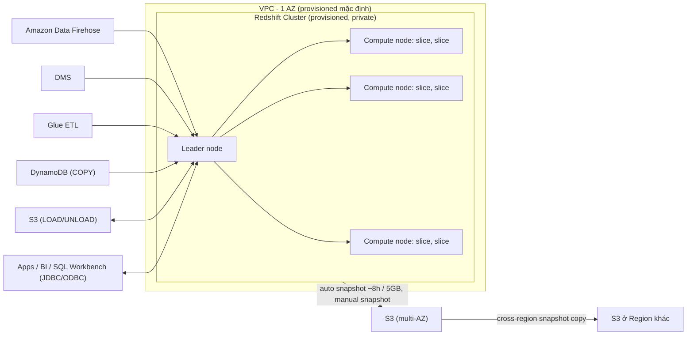

# Redshift

> **TL;DR:** Redshift là **data warehouse quy mô petabyte, MPP (massively parallel processing)**, kiểu **OLAP, lưu theo cột (column-based)**. Có hai mode cùng engine và cùng SQL: **provisioned** (chọn node type + số node, leader node + compute node, mặc định **trong một AZ**, Multi-AZ tùy chọn với RG/RA3) và **Serverless** (capacity theo **RPU**, tự scale, trả theo RPU-giây, không tốn tiền khi rảnh). Các hệ thống OLTP (RDS...) đổ dữ liệu vào đây để phân tích dài hạn, báo cáo, BI. Bảo vệ dữ liệu bằng snapshot vào S3 (chịu được lỗi AZ) và copy snapshot sang Region khác (DR).

## 🖼️ Sơ đồ
![[Redshift.excalidraw]]
*Mở bằng plugin Excalidraw để chỉnh sửa · ảnh tĩnh: [[Redshift.svg]]*

![[Redshift - resilience.excalidraw]]
*Mở bằng plugin Excalidraw để chỉnh sửa · ảnh tĩnh: [[Redshift - resilience.svg]]*

## Khái niệm cốt lõi

### Data warehouse, OLAP vs OLTP
- **Data warehouse**: nơi nhiều database vận hành (operational) của doanh nghiệp đổ dữ liệu về để **phân tích dài hạn, tìm xu hướng**. Dùng cho **reporting & analytics**, không phải cho thao tác vận hành hằng ngày.
- **MPP (massively parallel processing)**: Redshift chia **cả dữ liệu lẫn công việc query/phân tích** ra rất nhiều compute chạy song song, nhờ vậy xử lý được dữ liệu cỡ **petabyte**.
- **OLTP** (Online Transaction Processing): ghi và xử lý **giao dịch theo thời gian thực** (insert, update, delete), ví dụ thêm đơn hàng vào web bán hàng. Đây là kiểu của [[RDS Architecture|RDS]] / [[Aurora]].
- **OLAP** (Online Analytical Processing): **truy vấn phức tạp** trên **dữ liệu lịch sử đã tổng hợp** từ các hệ OLTP. Redshift là OLAP. Ví dụ của bài: Aus-E-Mart có nhiều OLTP database (sản xuất, bán hàng, marketing), nạp hết vào Redshift để xem sản phẩm nào thành công và hiệu quả chi phí nhất trong năm.

### Row-based vs column-based
- **Row-based (OLTP)**: mỗi hàng là một bản ghi (ví dụ một đơn hàng Aus-E-Mart: order ID, khách hàng, sản phẩm, giá...). Hợp khi tạo/sửa từng bản ghi cụ thể. Nhưng marketing hỏi "năm ngoái bán Croc Cap được bao nhiêu tiền" thì phải đọc qua mọi hàng dù chỉ cần sản phẩm, giá và ngày.
- **Column-based (Redshift)**: lưu theo cột (mọi sản phẩm, mọi giá, mọi ngày...). Query chỉ đọc đúng các cột cần → truy vấn kiểu báo cáo/tổng hợp nhanh và hiệu quả hơn nhiều. Xem thêm [[Database Models]].

### Đặc điểm sản phẩm
- **Managed như RDS**: dựng nhanh hơn nhiều so với tự xây data warehouse on-premises. Có thể dựng cluster, load dữ liệu, phân tích, rồi xóa đi.
- Hai mode **provisioned** và **serverless**, dùng **cùng engine Redshift và cùng ngôn ngữ SQL** (chi tiết ở mục dưới). Bản khóa cũ chỉ dạy provisioned và nói Redshift "không phải serverless như Athena"; bài mới dạy cả Redshift Serverless. Dù vậy, "ad-hoc query trên S3, không cần warehouse" vẫn là [[Athena]].
- Thường dữ liệu được **load vào** Redshift trước khi xử lý, nhưng có hai tính năng nâng cao:
  - **Redshift Spectrum**: query **dữ liệu trên S3 mà không cần load** vào Redshift. Hợp với dataset rất lớn. **Vẫn cần một Redshift data warehouse** (provisioned cluster hoặc serverless workgroup).
  - **Federated Query**: query **trực tiếp dữ liệu ở database bên ngoài** (remote/foreign database, ví dụ RDS/Aurora PostgreSQL, MySQL) mà không cần chuyển dữ liệu vào.
- Giao tiếp: interface **SQL**, kết nối qua chuẩn **JDBC/ODBC** (ví dụ SQL Workbench/J). Dịch vụ AWS tích hợp native, ví dụ [[Amazon QuickSight]] (thuộc bộ Amazon Quick) để dashboard và trực quan hóa.
- Mặc định **private**, chạy trong VPC; **IAM** phân quyền; data warehouse mới **mặc định mã hóa at rest bằng KMS**; giám sát bằng **CloudWatch**.

## Provisioned vs Serverless

| | **Provisioned** | **Serverless** |
|---|---|---|
| Capacity | Chọn **node type** và **số node** | Không có node: đặt **base capacity** bằng **RPU** (Redshift Processing Unit), Redshift tự scale; đặt **maximum** để tránh hóa đơn bất ngờ |
| Thành phần | **Leader node** + **compute node** (chia slice) | **Namespace** (database, schema, table, user, snapshot) + **Workgroup** (compute: RPU, cài đặt mạng, **endpoint** cho app kết nối) |
| Mạng / AZ | Mặc định **1 AZ**; **Multi-AZ** tùy chọn với node **RG / RA3**: compute chạy ở **2 AZ sau một endpoint** | Trong VPC, cần **≥ 2 subnet ở ≥ 2 AZ** (yêu cầu đặt chỗ, không phải tùy chọn Multi-AZ) |
| Tính tiền | Theo **node-giờ** khi cluster chạy, dù có query hay không. **Pause** cluster → chỉ trả backup storage. Leader node **không tính tiền** | Theo **RPU-giây** dùng thực tế, **không tốn tiền khi rảnh**, không cần pause |
| Backup tự động | Automatic snapshot | Gọi là **recovery point** |
| Hợp với | Tải **ổn định, nặng, dự đoán được** (reserved node làm rẻ nhất) | Tải **biến động, thỉnh thoảng**, hoặc không muốn quản capacity |

## Cách hoạt động / Kiến trúc

### Cluster
- Cluster là **một mạng riêng (private)**, bên ngoài không truy cập trực tiếp phần lớn cluster.
- Nhiều node nối bằng mạng tốc độ cao → mặc định cluster chạy trong **một AZ** → **không highly available across AZ by design**. Cần HA qua AZ thì dùng **Multi-AZ** (chỉ node **RG / RA3**).
- **Leader node**: điểm duy nhất bên ngoài nói chuyện cùng (công cụ quản trị, workbench, công cụ visualization qua JDBC/ODBC). Leader node nhận query, **lập execution plan**, phân phối dữ liệu và công việc xuống compute node, rồi **tổng hợp kết quả**. Leader node **không bị tính tiền**, chỉ trả cho compute node. (Serverless: client kết nối tới **endpoint của workgroup**.)
- **Compute node**: chạy query được leader giao, **lưu dữ liệu** đã load. Mỗi compute node chia thành **slice**; mỗi slice có một phần RAM và disk của node, xử lý một phần workload, các slice chạy **song song**. Một node có **2, 4, 8 hoặc 16 slice** tùy kích thước (bản khóa cũ nêu 2, 4, 16 hoặc 32). Đây chính là phần **MPP** của Redshift.

### Bảo mật và mạng
- Là **VPC service**, **private mặc định**: dùng Security Group/[[NACL]] của VPC, [[IAM Basics|IAM]] để phân quyền, [[KMS]] mã hóa at rest (mặc định với data warehouse mới), [[CloudWatch Basics|CloudWatch]] để giám sát.
- **Enhanced VPC Routing**:
  - Mặc định Redshift đi bằng **public route** khi gọi dịch vụ bên ngoài hoặc dịch vụ AWS (ví dụ S3 lúc load dữ liệu).
  - Bật Enhanced VPC Routing → traffic **COPY / UNLOAD** đi **theo cấu hình mạng VPC**: chịu [[Security Groups]], NACL, custom DNS, theo dõi được bằng [[VPC Flow Logs]], và phải đi qua các gateway như mọi traffic khác ([[VPC Routing and Internet Gateway|Internet Gateway]], [[NAT Gateway]], [[Gateway VPC Endpoints|VPC endpoints]]).
  - Với **Serverless**, bật Enhanced VPC Routing cần **3 subnet ở 3 AZ**.

### Nạp dữ liệu vào Redshift
- **LOAD/UNLOAD** với **S3** (lệnh COPY từ S3).
- **COPY từ DynamoDB**.
- **[[DMS]]** migrate dữ liệu từ nguồn khác vào.
- **[[Kinesis Data Firehose|Amazon Data Firehose]]** stream dữ liệu vào Redshift (Firehose ghi tạm ra S3 rồi COPY).
- **[[Glue|AWS Glue]]**: job ETL serverless biến đổi dữ liệu từ dịch vụ khác rồi load kết quả vào Redshift.

## Resilience và Recovery

### Bên trong cluster
- Cluster có **từ 2 compute node trở lên** thì dữ liệu trên mỗi node được **mirror sang một node khác** → giảm rủi ro mất dữ liệu khi node hỏng, nhưng không chịu được mất cả AZ.

### Snapshot vào S3

| | Automatic snapshot | Manual snapshot |
|---|---|---|
| Khi nào | Khoảng **mỗi 8 giờ** hoặc **mỗi 5 GB** dữ liệu thay đổi | Khi người/script/công cụ quản trị chủ động tạo |
| Retention | Mặc định **1 ngày**, cấu hình được (bản khóa cũ nêu tối đa **35 ngày**) | **Không hết hạn**, tồn tại tới khi admin xóa |
| Kiểu lưu | **Incremental**: chỉ lưu (và tính tiền) phần dữ liệu thay đổi | Incremental |
| Chi phí | Miễn phí dung lượng backup **bằng dung lượng cluster** | Tính phí lưu trữ |

- Snapshot nằm trên S3 → dữ liệu được nhân bản qua **≥3 AZ** trong Region. Cluster chỉ ở một AZ, nhưng **dữ liệu** thì chịu được lỗi AZ.
- **Restore từ snapshot tạo cluster mới**, có thể chọn AZ còn hoạt động.
- **Serverless** hoạt động tương tự, nhưng backup tự động gọi là **recovery point**.

### Cross-region snapshot copy (DR)
- Cấu hình để snapshot **tự động copy sang Region khác** (ví dụ us-east-1 → ap-southeast-2).
- Bản copy có **retention riêng, cấu hình độc lập** → tiết kiệm chi phí.
- Mất cả Region thì vẫn dựng nhanh cluster mới ở Region đích. Xem [[RPO and RTO]].

(Bài mới nêu thêm: provisioned cluster mặc định một AZ, nhưng node RG / RA3 có tùy chọn **Multi-AZ** chạy compute ở hai AZ sau một endpoint. Bản khóa cũ chỉ nói một AZ.)

## 🎯 Mẹo thi SAA-C03
- Từ khóa → Redshift: "**data warehouse**", "**petabyte**", "**OLAP**", "**columnar**", "phân tích/BI/reporting **dài hạn**, dữ liệu lịch sử tổng hợp từ nhiều nguồn".
- OLTP (giao dịch thời gian thực) → [[RDS Architecture|RDS]]/[[Aurora]]; OLAP (phân tích) → Redshift.
- **Ad-hoc query** trên S3, không cần warehouse, trả theo query → **[[Athena]]**. Cần **load vào warehouse và phân tích nặng** → Redshift; warehouse đó phải **serverless** → **Redshift Serverless**.
- Tải ổn định, nặng, dự đoán được → **provisioned** (+ reserved node); tải biến động/thỉnh thoảng, không muốn quản capacity → **Serverless** (RPU, không tốn tiền khi rảnh).
- Đã có Redshift và muốn query dữ liệu S3 **không load** → **Redshift Spectrum**. Query database bên ngoài trực tiếp → **Federated Query**.
- Có yêu cầu kiểm soát cách traffic Redshift đi trong mạng (Security Group, NACL, VPC endpoint, custom DNS, VPC Flow Logs) → **bật Enhanced VPC Routing** (mặc định traffic đi qua Internet, kể cả tới S3).
- Provisioned Redshift **mặc định chạy trong một AZ**, không HA qua AZ (Multi-AZ chỉ với RG / RA3). Đề hỏi resilience trước lỗi AZ → **snapshot vào S3** rồi restore sang AZ khác. Hỏi DR Region → **cross-region snapshot copy**.
- Nhớ số: automatic snapshot **~8 giờ hoặc 5 GB** mỗi node, retention **1 ngày mặc định** (cấu hình được; bản khóa cũ nêu tối đa 35 ngày); manual snapshot **không tự xóa**.
- Đường đưa dữ liệu vào: S3 (COPY), DynamoDB (COPY), DMS, Amazon Data Firehose, Glue ETL. Trực quan hóa: QuickSight. Kết nối: JDBC/ODBC.

## Liên kết
- Tiên quyết: [[Database Models]], [[ACID vs BASE]], [[S3 Basics]]
- Nguồn dữ liệu: [[Kinesis Data Firehose]], [[DMS]], [[DynamoDB Architecture]], [[Glue]]
- Trực quan hóa: [[Amazon QuickSight]]
- Chia sẻ dữ liệu: [[AWS Data Exchange]] (Redshift datashare), [[AWS Lake Formation]] (Redshift Spectrum chịu quyền Lake Formation)
- Phân biệt với: [[Athena]], [[RDS Architecture]], [[Aurora]], [[S3 Select and Glacier Select]]
- Mạng & bảo mật: [[Security Groups]], [[NACL]], [[Gateway VPC Endpoints]], [[KMS]]
- Resilience: [[HA vs FT vs DR]], [[RPO and RTO]], [[RDS Backups and Restore]]
- Section: [[_MOC 20 NoSQL and Analytics]]
