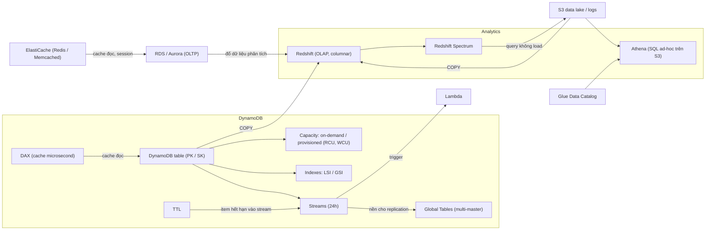

# 20 NoSQL and Analytics

Section này bổ sung mảng dữ liệu phi quan hệ và phân tích sau phần RDS/Aurora ở [[_MOC 11 Databases]]: DynamoDB từ kiến trúc, capacity, index, streams, global tables, DAX, TTL; tiếp theo là truy vấn serverless trên S3 bằng Athena, cache in-memory với ElastiCache và data warehouse Redshift. Đề SAA-C03 hỏi rất nhiều câu chọn đúng database/cache/công cụ phân tích theo từ khóa trong phần này.

← [[00 Home]] · Trước: [[_MOC 19 CloudFormation]] · Sau: [[_MOC 21 Machine Learning]]

## Lộ trình học
1. [[DynamoDB Architecture]] — NoSQL table-as-a-service, wide-column key/value, public service, mặc định multi-AZ, item tối đa 400 KB.
2. [[DynamoDB Operations and Performance]] — on-demand vs provisioned; RCU 4 KB/s, WCU 1 KB/s; Query rẻ, Scan tốn; eventually consistent nửa giá.
3. [[DynamoDB Indexes LSI and GSI]] — LSI cùng PK khác SK, tạo cùng table; GSI PK/SK mới, tạo bất cứ lúc nào, chỉ eventual.
4. [[DynamoDB Streams and Triggers]] — luồng thay đổi item có thứ tự, giữ 24 giờ; kết hợp Lambda thành database trigger.
5. [[DynamoDB Global Tables]] — replication multi-master cross-region, last writer wins, thường dưới 1 giây.
6. [[DAX]] — in-memory cache tích hợp DynamoDB, đọc xuống microsecond, chạy trong VPC.
7. [[DynamoDB TTL]] — timestamp hết hạn theo item, xóa nền miễn phí, không tốn WCU.
8. [[Athena]] — SQL ad-hoc serverless trên S3, schema-on-read, trả tiền theo dữ liệu quét.
9. [[ElastiCache]] — cache in-memory managed (Redis, Memcached) cho workload read-heavy và session state; phải sửa code.
10. [[Redshift]] — data warehouse OLAP lưu theo cột, quy mô petabyte, cluster trong một AZ, snapshot sang S3/region khác.

## Bản đồ khái niệm

## Liên kết sang section khác
- [[Database Models]] — nền về key/value, wide-column, columnar.
- [[ACID vs BASE]] — vì sao DynamoDB mặc định eventually consistent.
- [[RDS Read Replicas]] — lựa chọn tăng hiệu năng đọc khi không được sửa code (thay ElastiCache).
- [[Aurora Global Database]] — bản relational của bài toán multi-region, đối chiếu Global Tables.
- [[Lambda]] — xử lý DynamoDB Streams.
- [[Serverless Architecture]] — DynamoDB là database mặc định của kiến trúc serverless.
- [[Glue]] — Data Catalog cho Athena.
- [[Kinesis Data Firehose]] — đường nạp dữ liệu streaming vào Redshift.
- [[S3 Select and Glacier Select]] — lọc trong một object, phân biệt với Athena.
- [[SSL Offload and Session Stickiness]] — stickiness so với lưu session trong ElastiCache.

## 🎯 Top mẹo thi của section
- **NoSQL / key-value / serverless không quản lý server** → DynamoDB; thấy **relational, SQL, join** → không phải DynamoDB ([[DynamoDB Architecture]]).
- DynamoDB **mặc định multi-AZ**; PITR tắt mặc định, 35 ngày, restore ra table mới; item > 400 KB → lưu S3 và giữ pointer ([[DynamoDB Architecture]]).
- **RCU = 4 KB/s, WCU = 1 KB/s**, làm tròn lên theo item; eventually consistent = nửa giá ([[DynamoDB Operations and Performance]]).
- Tải spiky, không đoán trước, ít quản trị → **on-demand**; tải ổn định, tối ưu chi phí → **provisioned** + auto scaling ([[DynamoDB Operations and Performance]]).
- Tối ưu chi phí/hiệu năng → **tránh Scan**, dùng Query + index; table đã tồn tại chỉ thêm được **GSI**; cần strongly consistent trên index → **LSI** ([[DynamoDB Indexes LSI and GSI]]).
- Hành động khi item thay đổi, không polling → **DynamoDB Streams + Lambda**; cần cả trước và sau → NEW_AND_OLD_IMAGES ([[DynamoDB Streams and Triggers]]).
- Đọc **và ghi** ở nhiều region, active-active NoSQL → **Global Tables** (last writer wins, strongly consistent chỉ trong region ghi) ([[DynamoDB Global Tables]]).
- Caching cho DynamoDB → mặc định **DAX** (microsecond, nằm trong VPC, không giúp strongly consistent read) ([[DAX]]).
- Tự xóa item sau một khoảng thời gian, miễn phí → **TTL** (epoch giây); muốn archive trước khi xóa → TTL + Streams + Lambda → S3 ([[DynamoDB TTL]]).
- Query **ad-hoc** trên S3, không load, serverless, log dịch vụ AWS (VPC Flow Logs, CloudTrail, ELB) → **Athena** ([[Athena]]).
- Read-heavy, sub-millisecond, session state cho app stateless → **ElastiCache**; đề nói "không sửa code" → ElastiCache gần như sai ([[ElastiCache]]).
- Cần HA, replication, backup/restore, cấu trúc dữ liệu phức tạp → **Redis**; multi-threaded, cache đơn giản → **Memcached** ([[ElastiCache]]).
- Data warehouse, petabyte, OLAP, columnar, BI dài hạn → **Redshift**; query S3 không load khi đã có Redshift → **Spectrum** ([[Redshift]]).
- Redshift chạy **một AZ**: chống lỗi AZ bằng snapshot S3, DR bằng **cross-region snapshot copy**; yêu cầu mạng tùy chỉnh → **Enhanced VPC Routing** ([[Redshift]]).
