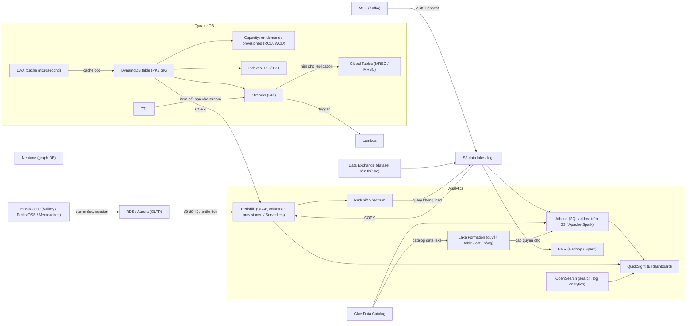

# 20 NoSQL and Analytics

Section này bổ sung mảng dữ liệu phi quan hệ và phân tích sau phần RDS/Aurora ở [[_MOC 11 Databases]]: DynamoDB từ kiến trúc, capacity, index, streams, global tables, DAX, TTL; tiếp theo là truy vấn serverless trên S3 bằng Athena (SQL và Apache Spark), cache in-memory với ElastiCache và data warehouse Redshift; cuối cùng là các dịch vụ dữ liệu khác của bản khóa mới: graph database Neptune, search và log analytics OpenSearch, phân quyền data lake Lake Formation, big data EMR, BI QuickSight, dataset bên thứ ba Data Exchange và Kafka managed MSK. Đề SAA-C03 hỏi rất nhiều câu chọn đúng database/cache/công cụ phân tích theo từ khóa trong phần này.

← [[00 Home]] · Trước: [[_MOC 19 CloudFormation]] · Sau: [[_MOC 21 Machine Learning]]

## Lộ trình học
1. [[DynamoDB Architecture]] — NoSQL table-as-a-service, wide-column key/value, public service, mặc định multi-AZ, item tối đa 400 KB, on-demand là mode mặc định.
2. [[DynamoDB Operations and Performance]] — on-demand (mặc định) vs provisioned, partition; RCU 4 KB/s, WCU 1 KB/s; Query rẻ, Scan tốn; eventually consistent (mặc định) nửa giá.
3. [[DynamoDB Indexes LSI and GSI]] — LSI cùng PK khác SK, tạo cùng table; GSI PK/SK mới, tạo bất cứ lúc nào, chỉ eventual.
4. [[DynamoDB Streams and Triggers]] — luồng thay đổi item có thứ tự, giữ 24 giờ; kết hợp Lambda thành database trigger.
5. [[DynamoDB Global Tables]] — replication multi-active cross-region; MREC (mặc định, last writer wins, thường dưới 1 giây) hoặc MRSC (strong ở mọi region).
6. [[DAX]] — in-memory cache tích hợp DynamoDB, đọc xuống microsecond, chạy trong VPC.
7. [[DynamoDB TTL]] — timestamp hết hạn theo item, xóa nền miễn phí, không tốn WCU.
8. [[Athena]] — SQL ad-hoc serverless trên S3, schema-on-read, trả theo dữ liệu quét; engine Apache Spark cho pipeline bằng PySpark.
9. [[ElastiCache]] — cache in-memory managed (Valkey, Redis OSS, Memcached) cho workload read-heavy và session state; phải sửa code.
10. [[Redshift]] — data warehouse MPP, OLAP lưu theo cột, quy mô petabyte; provisioned (mặc định một AZ) hoặc Serverless; snapshot sang S3/region khác.
11. [[Amazon Neptune]] — graph database managed, giống RDS/Aurora nhưng cho dữ liệu quan hệ linh hoạt (mạng xã hội, gian lận, recommendation).
12. [[Amazon OpenSearch Service]] — search và log analytics near real-time (fork Elasticsearch/Kibana), domain hoặc Serverless.
13. [[AWS Lake Formation]] — phân quyền theo table, cột, hàng cho S3 data lake (S3 + Glue Data Catalog).
14. [[Amazon EMR]] — Hadoop/Spark managed: EC2 (HDFS, primary/core/task), Serverless, EKS, Outposts; cluster transient.
15. [[Amazon QuickSight]] — BI dashboard và visualization, tính tiền theo user, SPICE.
16. [[AWS Data Exchange]] — tìm, subscribe, cung cấp dataset bên thứ ba qua file, API, S3, Redshift, Lake Formation.
17. [[Amazon MSK]] — Apache Kafka managed: topic giữ record, nhiều consumer group độc lập với offset.

## Bản đồ khái niệm

## Liên kết sang section khác
- [[Database Models]] — nền về key/value, wide-column, columnar.
- [[ACID vs BASE]] — vì sao DynamoDB mặc định eventually consistent.
- [[RDS Read Replicas]] — lựa chọn tăng hiệu năng đọc khi không được sửa code (thay ElastiCache).
- [[Aurora Global Database]] — bản relational của bài toán multi-region, đối chiếu Global Tables.
- [[Lambda]] — xử lý DynamoDB Streams.
- [[Serverless Architecture]] — DynamoDB là database mặc định của kiến trúc serverless.
- [[Glue]] — Data Catalog cho Athena.
- [[Kinesis Data Firehose]] — đường nạp dữ liệu streaming vào Redshift.
- [[S3 Select and Glacier Select]] — lọc trong một object, phân biệt với Athena.
- [[SSL Offload and Session Stickiness]] — stickiness so với lưu session trong ElastiCache.
- [[Kinesis Data Streams]] — streaming native của AWS, đối chiếu MSK.
- [[AWS Resource Access Manager]] — nền share cross-account của Lake Formation.

## 🎯 Top mẹo thi của section
- **NoSQL / key-value / serverless không quản lý server** → DynamoDB; thấy **relational, SQL, join** → không phải DynamoDB ([[DynamoDB Architecture]]).
- DynamoDB **mặc định multi-AZ**, **on-demand là mode mặc định**; PITR tắt mặc định, recovery window 1–35 ngày, restore ra table mới; item > 400 KB → lưu S3 và giữ pointer ([[DynamoDB Architecture]]).
- **RCU = 4 KB/s, WCU = 1 KB/s**, làm tròn lên theo item; eventually consistent (mặc định) = nửa giá, cùng phép tính cho request unit on-demand ([[DynamoDB Operations and Performance]]).
- Tải spiky, không đoán trước, ít quản trị → **on-demand**; tải ổn định, tối ưu chi phí → **provisioned** + auto scaling ([[DynamoDB Operations and Performance]]).
- Tối ưu chi phí/hiệu năng → **tránh Scan**, dùng Query + index; table đã tồn tại chỉ thêm được **GSI**; cần strongly consistent trên index → **LSI** ([[DynamoDB Indexes LSI and GSI]]).
- Hành động khi item thay đổi, không polling → **DynamoDB Streams + Lambda**; cần cả trước và sau → NEW_AND_OLD_IMAGES ([[DynamoDB Streams and Triggers]]).
- Đọc **và ghi** ở nhiều region, active-active NoSQL → **Global Tables**: MREC mặc định (last writer wins, strongly consistent chỉ trong region ghi); cần strong ở mọi region → **MRSC** (chọn lúc tạo, ghi xung đột bị từ chối) ([[DynamoDB Global Tables]]).
- Caching cho DynamoDB → mặc định **DAX** (microsecond, nằm trong VPC, không giúp strongly consistent read) ([[DAX]]).
- Tự xóa item sau một khoảng thời gian, miễn phí → **TTL** (epoch giây); muốn archive trước khi xóa → TTL + Streams + Lambda → S3 ([[DynamoDB TTL]]).
- Query **ad-hoc** trên S3, không load, serverless, log dịch vụ AWS (VPC Flow Logs, CloudTrail, ELB) → **Athena**; pipeline / ETL bằng PySpark serverless → **Athena for Apache Spark** (engine chọn ở workgroup, không đổi được) ([[Athena]]).
- Read-heavy, sub-millisecond, session state cho app stateless → **ElastiCache**; đề nói "không sửa code" → ElastiCache gần như sai ([[ElastiCache]]).
- Cần HA, replication, backup/restore, cấu trúc dữ liệu phức tạp → **Valkey / Redis OSS** (Valkey: AWS khuyên cho triển khai mới); multi-threaded, cache đơn giản → **Memcached** ([[ElastiCache]]).
- Data warehouse, petabyte, OLAP, columnar, BI dài hạn → **Redshift**; tải biến động, không quản capacity → **Redshift Serverless**; query S3 không load khi đã có Redshift → **Spectrum** ([[Redshift]]).
- Provisioned Redshift mặc định **một AZ** (Multi-AZ với RG/RA3): chống lỗi AZ bằng snapshot S3, DR bằng **cross-region snapshot copy**; kiểm soát traffic trong VPC → **Enhanced VPC Routing** ([[Redshift]]).
- **Graph**, quan hệ thay đổi liên tục (social, fraud, recommendation, knowledge graph) → **Neptune** ([[Amazon Neptune]]).
- **Search, log analytics near real-time**, Elasticsearch/Kibana, vector search → **OpenSearch** ([[Amazon OpenSearch Service]]).
- S3 data lake cần quyền **theo cột / hàng / table** → **Lake Formation** ([[AWS Lake Formation]]).
- **Hadoop, Hive, HBase, Presto**, Spark quy mô lớn, cluster transient → **EMR**; Spot cho task node ([[Amazon EMR]]).
- **Dashboard, visualization, BI** → **QuickSight** ([[Amazon QuickSight]]).
- Lấy / bán **dataset bên thứ ba** → **Data Exchange** ([[AWS Data Exchange]]).
- **Đã dùng Kafka**, không muốn quản cluster → **MSK**; xây mới native → Kinesis Data Streams ([[Amazon MSK]]).
