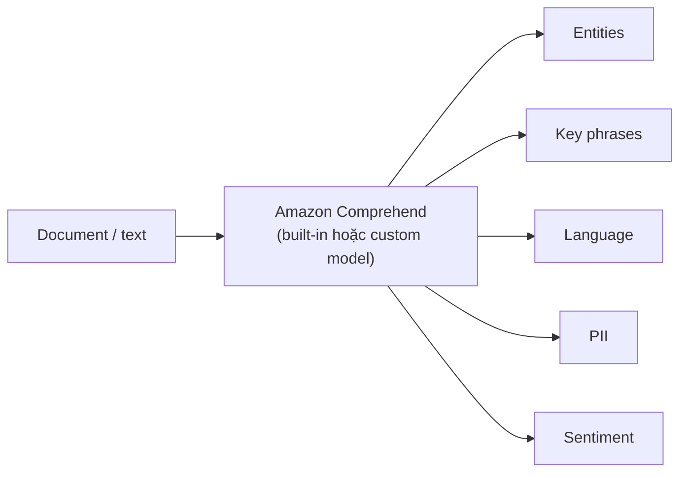

# Comprehend

> **TL;DR:** Amazon Comprehend là dịch vụ **Natural Language Processing (NLP)** được quản lý hoàn toàn. Đầu vào là **văn bản (document/text)**, đầu ra là các "insight": **entities, key phrases, language, PII, sentiment, syntax**. Không cần tự huấn luyện model, gọi qua console, CLI hoặc API.

## 🖼️ Sơ đồ
![[Comprehend.excalidraw]]
*Mở bằng plugin Excalidraw để chỉnh sửa · ảnh tĩnh: [[Comprehend.svg]]*

## Khái niệm cốt lõi
- **Input = text**, **output = các phần tử quan trọng** được trích ra từ text đó:
  - **Entities**: người (Person), tổ chức (Organization), địa điểm (Location), ngày (Date), số lượng (Quantity), loại khác (Other: số thẻ, email...).
  - **Key phrases**: cụm từ chính trong văn bản.
  - **Language**: nhận diện ngôn ngữ chủ đạo (dominant language).
  - **PII** (Personally Identifiable Information): tên, số thẻ tín dụng, số tài khoản ngân hàng, routing number, địa chỉ, số điện thoại, email, ngày giờ...
  - **Sentiment**: Positive / Negative / Neutral / **Mixed**.
  - **Syntax**: phân tích từ loại.
- Mỗi kết quả kèm **confidence score** từ 0 (0%) đến 1 (100%), ví dụ "0.99+" nghĩa là chắc chắn trên 99%.
- **Hai loại model**:
  - **Pre-trained (Built-in)**: model có sẵn của AWS, dùng ngay.
  - **Custom**: tự huấn luyện để **custom classification** (phân loại tài liệu theo nhãn của bạn) hoặc **custom entity recognition** (nhận diện entity riêng của doanh nghiệp). Model custom được phục vụ real-time qua **endpoint**.
- **Hai chế độ xử lý**:
  - **Real-time (synchronous)** cho workload nhỏ. Console giới hạn ô nhập 5.000 ký tự.
  - **Asynchronous analysis jobs** cho workload lớn (thường đọc dữ liệu từ [[S3 Basics|S3]]).
- Dùng được từ **console / CLI** (tương tác) hoặc **API** (tích hợp vào ứng dụng). Có biến thể **Comprehend Medical** cho văn bản y tế.

## Cách hoạt động / Kiến trúc

Comprehend thường đứng **sau** một dịch vụ khác tạo ra text: ví dụ [[Transcribe]] chuyển cuộc gọi thành text rồi Comprehend phân tích sentiment; hoặc [[Textract]] trích text từ tài liệu scan rồi Comprehend tìm PII. Nếu text ở ngôn ngữ khác, có thể đưa qua [[Translate]] trước.

## Demo / Lab
- Console → **Real-time analysis** → Analysis type **Built-in** → dán text mẫu (email của một công ty tài chính) → **Analyze**.
- Tab **Entities**: nhận ra 2 Person (người gửi, người nhận), 1 Organization, số thẻ tín dụng (Other), số tiền (Quantity), ngày (Date), địa chỉ (Location), email, đều ~0.99+.
- Tab **PII**: liệt kê tên, số thẻ, ngày giờ, số tài khoản, routing, địa chỉ, điện thoại, email.
- Thử sentiment: câu "thích mèo... ghét nhện" → **Mixed**; bỏ vế "ghét nhện" → chủ yếu **Positive** (0.65) + Neutral (0.34).
- Rút ra: cùng một API trả nhiều loại insight; sentiment thay đổi rõ theo nội dung.

## 🎯 Mẹo thi SAA-C03
- Từ khóa **"sentiment analysis", "extract key phrases/entities from text", "detect language of text", "NLP", "phân tích review/feedback/social media"** → **Comprehend**.
- Comprehend làm việc trên **text**. Nếu đầu vào là audio, cần [[Transcribe]] trước; nếu là ảnh/scan, cần [[Textract]] trước.
- Phát hiện PII **trong văn bản do ứng dụng gửi tới** → Comprehend. Còn quét **S3 bucket** để tìm dữ liệu nhạy cảm/PII ở quy mô tài khoản → [[Macie]].
- Cần model riêng cho domain của mình → **custom classification / custom entity recognition**.

## Liên kết
- Dùng cùng: [[Transcribe]], [[Textract]], [[Translate]], [[Lambda]], [[S3 Basics]]
- Liên quan: [[Kendra]], [[Lex]], [[SageMaker]]
- Phân biệt với: [[Macie]] (tìm PII trong S3), [[Rekognition]] (phân tích ảnh/video, không phải text)
- MOC: [[_MOC 21 Machine Learning]]
