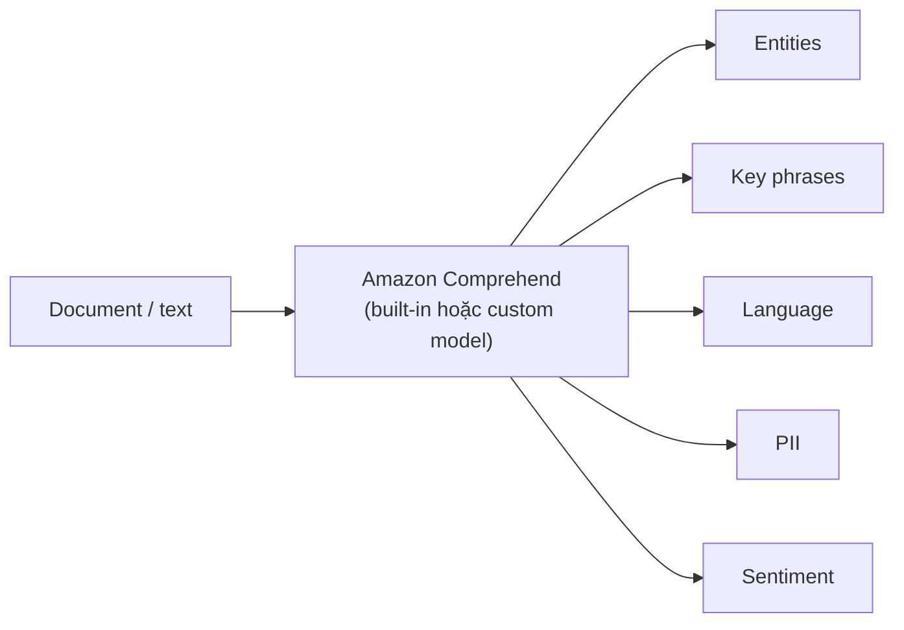

# Comprehend

> **TL;DR:** Amazon Comprehend là dịch vụ **Natural Language Processing (NLP)** được quản lý hoàn toàn. Đầu vào là **văn bản (document/text)**, đầu ra là các "insight": **entities, key phrases, language, PII, sentiment, syntax**. Không cần tự huấn luyện model, gọi qua console, CLI hoặc API.

## 🖼️ Sơ đồ
![[Comprehend.excalidraw]]
*Mở bằng plugin Excalidraw để chỉnh sửa · ảnh tĩnh: [[Comprehend.svg]]*

## Khái niệm cốt lõi
- **Input = text**, **output = các phần tử quan trọng** được trích ra từ text đó:
  - **Entities**: người (Person), tổ chức (Organization), địa điểm (Location), ngày (Date), số lượng (Quantity), loại khác (Other: số thẻ, email...).
  - **Key phrases**: cụm từ chính trong văn bản.
  - **Language**: nhận diện ngôn ngữ chủ đạo (dominant language).
  - **PII** (Personally Identifiable Information): tên, số thẻ tín dụng, số tài khoản ngân hàng, routing number, địa chỉ, số điện thoại, email, ngày giờ...
  - **Sentiment**: Positive / Negative / Neutral / **Mixed** cho cả văn bản.
  - **Targeted sentiment**: sentiment cho **từng cụm/entity** trong văn bản, ví dụ trong cùng một email "torn sleeve" và "sizing chart" là Negative, còn phần khen trải nghiệm là Positive.
  - **Syntax**: phân tích từ loại.
- Mỗi kết quả kèm **confidence score** từ 0 (0%) đến 1 (100%), ví dụ "0.99+" nghĩa là chắc chắn trên 99%.
- **Hai loại model**:
  - **Pre-trained (Built-in)**: model có sẵn của AWS, dùng ngay.
  - **Custom**: tự huấn luyện để **custom classification** (phân loại tài liệu theo nhãn của bạn) hoặc **custom entity recognition** (nhận diện entity riêng của doanh nghiệp). Model custom được phục vụ real-time qua **endpoint**.
- **Hai chế độ xử lý**:
  - **Real-time (synchronous)** cho workload nhỏ. Console giới hạn ô nhập 5.000 ký tự (bản khóa cũ nêu, bài mới không nói).
  - **Asynchronous analysis jobs** cho workload lớn: tài liệu nằm trong [[S3 Basics|S3]], xử lý không tương tác.
- Dùng được từ **console / CLI** (tương tác) hoặc **API** (tích hợp vào ứng dụng).
- **Amazon Comprehend Medical** là một **dịch vụ riêng** (mở riêng trong console), cách dùng giống Comprehend nhưng dành cho văn bản y tế: cần tìm **thông tin sức khỏe** chứ không chỉ PII thì dùng Comprehend Medical.

## Cách hoạt động / Kiến trúc

Comprehend thường đứng **sau** một dịch vụ khác tạo ra text: ví dụ [[Transcribe]] chuyển cuộc gọi thành text rồi Comprehend phân tích sentiment; hoặc [[Textract]] trích text từ tài liệu scan rồi Comprehend tìm PII. Nếu text ở ngôn ngữ khác, có thể đưa qua [[Translate]] trước.

## Demo / Lab
- Console → **Launch Amazon Comprehend** → **Real-time analysis** → Analysis type **Built-in** (hoặc **Custom** nếu đã có endpoint của model riêng) → dán email khách gửi bộ phận hỗ trợ **Aus-E-Mart**: xin đổi một áo Koalification bị rách tay áo, kèm số đơn, ngày, email, địa chỉ, số thẻ và nhận xét về giao hàng, bảng size → **Analyze**.
- Tab **Entities**: Aus-E-Mart là Organization (0.99), "one" là Quantity, người gửi là Person, địa chỉ là Location. Tên sản phẩm "Koalification" bị nhận nhầm là Organization, và confidence thấp hơn hẳn: model không hoàn hảo, hãy nhìn confidence.
- Tab **Key phrases**: "replacement shirt", "torn sleeve", "sizing chart"... Tab **Language**: English, 98%.
- Tab **PII**: tên, **số thẻ tín dụng** (khách lỡ dán vào), email, địa chỉ.
- Tab **Sentiment**: **Mixed** (0.91), đúng vì khách không giận nhưng chê bảng size. Tab **Targeted sentiment**: "torn sleeve", "sizing chart" Negative; các phần khen trải nghiệm là Positive hoặc Neutral. Tab **Syntax**: phân tích từ loại.
- Dán email thứ hai (giao hàng tệ, bực vì bảng size) → sentiment **Negative**.
- Rút ra: một lần phân tích trả nhiều loại insight; muốn xử lý hàng loạt tài liệu trong S3 không tương tác thì dùng **Analysis jobs**.
- Demo bản khóa cũ (bài mới không còn): email của một công ty tài chính (2 Person, Organization, số thẻ, số tài khoản, routing number); câu "thích mèo... ghét nhện" → Mixed, bỏ vế "ghét nhện" → chủ yếu Positive (0.65) + Neutral (0.34).

## 🎯 Mẹo thi SAA-C03
- Từ khóa **"sentiment analysis", "extract key phrases/entities from text", "detect language of text", "NLP", "phân tích review/feedback/social media"** → **Comprehend**.
- Comprehend làm việc trên **text**. Nếu đầu vào là audio, cần [[Transcribe]] trước; nếu là ảnh/scan, cần [[Textract]] trước.
- Phát hiện PII **trong văn bản do ứng dụng gửi tới** → Comprehend. Còn quét **S3 bucket** để tìm dữ liệu nhạy cảm/PII ở quy mô tài khoản → [[Macie]].
- Cần model riêng cho domain của mình → **custom classification / custom entity recognition**.
- Cần sentiment cho **từng khía cạnh/cụm** trong một review (giao hàng tốt, sản phẩm lỗi) → **targeted sentiment**; văn bản y tế, thông tin sức khỏe → **Comprehend Medical**.

## Liên kết
- Dùng cùng: [[Transcribe]], [[Textract]], [[Translate]], [[Lambda]], [[S3 Basics]]
- Liên quan: [[Kendra]], [[Lex]], [[SageMaker]]
- Phân biệt với: [[Macie]] (tìm PII trong S3), [[Rekognition]] (phân tích ảnh/video, không phải text)
- MOC: [[_MOC 21 Machine Learning]]
