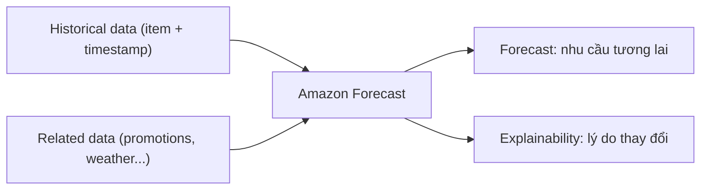

# Forecast

> **TL;DR:** Amazon Forecast là dịch vụ managed để **dự báo dữ liệu chuỗi thời gian (time-series)**, không phải dự báo thời tiết. Bạn đưa vào **dữ liệu lịch sử + dữ liệu liên quan**, nhận về **forecast** và **forecast explainability**.

## 🖼️ Sơ đồ
![[Forecast.excalidraw]]
*Mở bằng plugin Excalidraw để chỉnh sửa · ảnh tĩnh: [[Forecast.svg]]*

## Khái niệm cốt lõi
- **Use case**: dự báo **nhu cầu bán lẻ (retail demand)**, **supply chain**, **staffing** (nhân sự), **energy**, **server capacity**, **web traffic**... Mọi dữ liệu time-series có nhiều lịch sử.
- **Input**:
  - **Historical data**: ví dụ dữ liệu bán hàng đơn giản gồm món hàng + ngày giờ bán. Đủ để thấy xu hướng phổ biến theo thời gian.
  - **Related data**: thông tin ngữ cảnh bổ sung như **chương trình khuyến mãi**, **thời tiết** trong giai đoạn đó.
- Forecast học được **thế nào là "bình thường"** trong một khoảng thời gian.
- **Output**:
  - **Forecast**: dự báo nhu cầu/yêu cầu tương lai.
  - **Forecast explainability**: giải thích **tại sao** nhu cầu thay đổi. Ví dụ thời tiết: trời xấu khiến người ta ở nhà (giảm mua ở cửa hàng vật lý), mưa lớn làm tăng nhu cầu một số loại quần áo.
- **Truy cập**: **Web console** (trực quan hóa dữ liệu quá khứ, dự báo, explainability), **CLI**, **API**, **Python SDK**.
- Là **backend service**: dùng như một phần của quy trình nghiệp vụ hoặc tích hợp vào ứng dụng.

> (khóa học giới thiệu Forecast như dịch vụ đang hoạt động; từ 07/2024 AWS đã ngừng nhận khách hàng mới cho Amazon Forecast và khuyến nghị dùng SageMaker Canvas. Khách hàng hiện tại vẫn dùng được, và tên dịch vụ vẫn có thể xuất hiện trong đề.)

## Cách hoạt động / Kiến trúc

## 🎯 Mẹo thi SAA-C03
- Từ khóa **"forecast", "predict future demand", "time-series", "dự báo nhu cầu tồn kho/nhân sự/traffic dựa trên dữ liệu lịch sử"** → **Forecast**.
- **Bẫy**: "Forecast" không liên quan thời tiết. Thời tiết chỉ có thể là một **related data** đầu vào.
- Nếu đề yêu cầu tự xây/huấn luyện model tùy ý (không chỉ time-series) → [[SageMaker]].
- Dự báo server capacity để scale: đây là dịch vụ ML; với EC2 Auto Scaling, cơ chế "predictive scaling" có sẵn trong [[ASG Scaling Policies]] thường là đáp án đơn giản hơn.

## Liên kết
- Liên quan: [[SageMaker]], [[Fraud Detector]]
- Nguồn dữ liệu thường gặp: [[S3 Basics]], [[Redshift]], [[Athena]]
- Phân biệt với: [[ASG Scaling Policies]], [[CloudWatch Basics]]
- MOC: [[_MOC 21 Machine Learning]]
