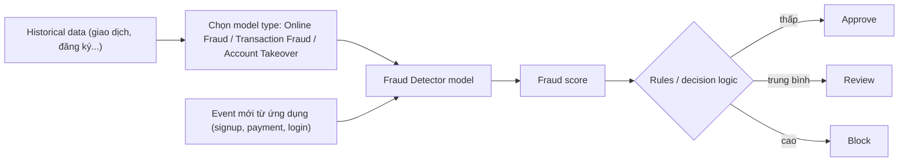

# Fraud Detector

> **TL;DR:** Amazon Fraud Detector là dịch vụ **phát hiện gian lận (fraud detection)** được quản lý hoàn toàn cho các hoạt động online: **tạo tài khoản mới, thanh toán, guest checkout**. Bạn upload dữ liệu lịch sử, chọn **model type**, sự kiện được **chấm điểm**, rồi **rules/decision logic** quyết định phản ứng.

## 🖼️ Sơ đồ
![[Fraud Detector.excalidraw]]
*Mở bằng plugin Excalidraw để chỉnh sửa · ảnh tĩnh: [[Fraud Detector.svg]]*

## Khái niệm cốt lõi
- **Phạm vi**: các hoạt động online có rủi ro gian lận: **new account creation**, **payments**, **guest checkout**.
- **Quy trình**: upload **historical data** → chọn **model type** → model chấm điểm các event → viết **rules** để phản ứng.
- **Ba model type**:
  | Model type | Khi nào dùng | Ví dụ |
  |---|---|---|
  | **Online Fraud** | **Ít dữ liệu lịch sử** về đối tượng | Đăng ký **tài khoản mới**: chưa có lịch sử khách hàng, nên xét các tín hiệu xung quanh lượt đăng ký |
  | **Transaction Fraud** | **Có lịch sử giao dịch** của khách hàng | Kiểm tra **giao dịch thẻ tín dụng**: dựa trên cửa hàng hay dùng, loại hàng, giá trị, quốc gia, thời điểm trong ngày để dựng "profile bình thường" và phát hiện thanh toán đáng ngờ |
  | **Account Takeover** | Phát hiện tài khoản bị chiếm | **Phishing** hoặc tấn công kiểu social engineering: đăng nhập từ vị trí hoàn toàn khác, được refer từ site lạ... |
- **Scoring + Rules**: mọi event được **score**; **rules (decision logic)** cho phép phản ứng theo score, tùy hoạt động kinh doanh và **mức chấp nhận rủi ro** (ví dụ: duyệt, gửi review thủ công, chặn).
- Là **backend service**: tích hợp vào ứng dụng/môi trường qua API, không dùng tương tác từ console.

> (có thông tin từ 2025 AWS đã đưa Amazon Fraud Detector vào trạng thái ngừng nhận khách hàng mới; về mặt kiến thức thi vẫn nên nắm như trên.)

## Cách hoạt động / Kiến trúc

## 🎯 Mẹo thi SAA-C03
- Từ khóa **"detect fraudulent online activity", "payment fraud", "fake account sign-ups", "account takeover"** → **Fraud Detector**.
- Chọn model theo dữ liệu: **ít lịch sử / tài khoản mới → Online Fraud**; **có lịch sử giao dịch → Transaction Fraud**; **đăng nhập bất thường / phishing → Account Takeover**.
- **Phân biệt** với các dịch vụ bảo mật hạ tầng:
  - [[GuardDuty]]: phát hiện mối đe dọa trên **tài khoản/hạ tầng AWS** (CloudTrail, VPC Flow Logs, DNS logs), không phải gian lận nghiệp vụ.
  - [[WAF]]: lọc request HTTP ở layer 7.
  - [[Cognito]]: quản lý danh tính người dùng ứng dụng.
- Fraud Detector nhắm **gian lận ở tầng nghiệp vụ** (thanh toán, đăng ký, đăng nhập của khách hàng).

## Liên kết
- Liên quan: [[Forecast]], [[SageMaker]]
- Phân biệt với: [[GuardDuty]], [[WAF]], [[Cognito]], [[Macie]]
- Dùng cùng: [[Lambda]], [[API Gateway]]
- MOC: [[_MOC 21 Machine Learning]]
