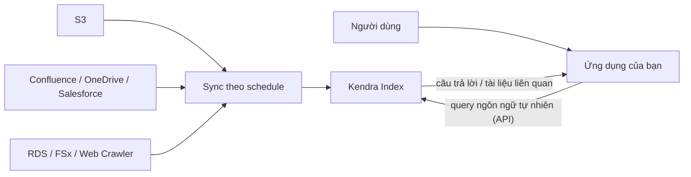

# Kendra

> **TL;DR:** Amazon Kendra là dịch vụ **intelligent search** dựa trên ML. Mục tiêu: người dùng hỏi bằng ngôn ngữ tự nhiên và nhận câu trả lời như đang hỏi **một chuyên gia** về kho dữ liệu đó. Kendra là **backend service**: ứng dụng của bạn gọi API Kendra để cung cấp chức năng tìm kiếm.

## 🖼️ Sơ đồ
![[Kendra.excalidraw]]
*Mở bằng plugin Excalidraw để chỉnh sửa · ảnh tĩnh: [[Kendra.svg]]*

## Khái niệm cốt lõi
- **Các loại câu hỏi Kendra xử lý được**:
  - **Factoid**: who / what / where ("Ai viết cuốn sách này?", "Nơi này ở đâu?").
  - **Descriptive**: câu hỏi "how do I...", cần hiểu cả nội dung lẫn **ý định (intent)** của câu hỏi.
  - **Keyword**: khó hơn vẻ ngoài vì từ khóa có thể nhiều nghĩa. Ví dụ "What time is the **keynote address**?": "address" ở đây là bài phát biểu, không phải địa chỉ bưu điện. Kendra phải suy ra intent.
- **Index**: khối dữ liệu đã được tổ chức để tìm kiếm hiệu quả. Đây là thứ Kendra thực sự search khi nhận query.
- **Data source**: nơi dữ liệu gốc nằm. Kendra kết nối tới và đánh index từ đó. Ví dụ: **S3, Confluence, Google Workspace, RDS, OneDrive, Salesforce, Kendra Web Crawler, WorkDocs, FSx**... (còn rất nhiều connector khác).
- **Sync theo schedule**: cấu hình đồng bộ định kỳ data source → index để index luôn cập nhật.
- **Documents**:
  - **Structured**: ví dụ FAQ (cặp câu hỏi/trả lời).
  - **Unstructured**: HTML, PDF, text...
- **Tích hợp**: [[IAM Basics|IAM]] cho bảo mật, **IAM Identity Center** (trước đây là AWS SSO) cho single sign-on và lọc kết quả theo người dùng.
- Ngoài bước setup ban đầu, người dùng cuối **không** dùng Kendra qua console; tương tác qua **API** từ ứng dụng.

> (khóa học liệt kê WorkDocs là data source; hiện nay Amazon WorkDocs đã ngừng hoạt động từ 04/2025.)

## Cách hoạt động / Kiến trúc

## 🎯 Mẹo thi SAA-C03
- Đề nói **"intelligent search", "enterprise search", "natural language search across documents/FAQs/intranet"**, "tìm câu trả lời trong kho tài liệu nội bộ" → **Kendra**.
- Kendra **tìm kiếm** trong tài liệu; [[Comprehend]] **phân tích** nội dung text (sentiment, entity). Đừng nhầm.
- Kendra trả lời câu hỏi dựa trên dữ liệu của bạn; [[Lex]] xây **chatbot hội thoại**. Hai dịch vụ có thể kết hợp: Lex nhận câu hỏi, Kendra tìm câu trả lời.
- Dữ liệu nằm ở nhiều nguồn khác nhau (S3, SharePoint, Confluence, DB...) và cần một chỗ search chung → Kendra với nhiều data source connector.

## Liên kết
- Data source thường gặp: [[S3 Basics]], [[RDS Architecture]], [[FSx for Windows]]
- Bảo mật: [[IAM Basics]], [[IAM Roles]]
- Liên quan: [[Comprehend]], [[Lex]], [[Textract]]
- Phân biệt với: [[Athena]] (query SQL trên S3, không phải search ngôn ngữ tự nhiên)
- MOC: [[_MOC 21 Machine Learning]]
