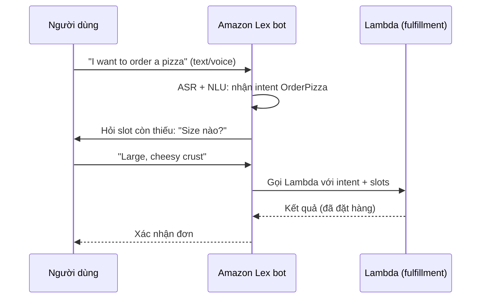

# Lex

> **TL;DR:** Amazon Lex là dịch vụ backend để xây **chatbot / voice bot** với giao diện hội thoại bằng **text hoặc giọng nói**. Lex cung cấp hai năng lực khó: **ASR** (speech-to-text) và **NLU** (hiểu ý định người dùng). Câu ghi nhớ của Adrian: **"Lex for voice, Lex for Alexa"**.

## 🖼️ Sơ đồ
![[Lex.excalidraw]]
*Mở bằng plugin Excalidraw để chỉnh sửa · ảnh tĩnh: [[Lex.svg]]*

## Khái niệm cốt lõi
- Lex là **backend service**: bạn tích hợp vào ứng dụng, không phải công cụ người dùng cuối mở console ra dùng.
- Lex dùng cùng công nghệ hội thoại với các sản phẩm giọng nói của Amazon (**Alexa**).
- **Hai năng lực chính**:
  - **ASR (Automatic Speech Recognition)**: chuyển giọng nói → text. Nghe đơn giản nhưng làm tốt rất khó.
  - **NLU (Natural Language Understanding)**: nhận ra **intent** và hỗ trợ **intent chaining**. Ví dụ: "Cho tôi đặt một pizza" → intent = OrderPizza; câu tiếp "Cho cỡ extra large nhé" → Lex phải hiểu câu này bổ sung cho câu trước.
- **Đặc tính vận hành**: tự scale, triển khai nhanh, **pay-as-you-go** (chỉ trả khi dùng), rất hợp với kiến trúc **event-driven / serverless**. Tích hợp với các dịch vụ AWS như **Amazon Connect** (contact center).
- **Use case**: chatbot hỗ trợ trên website, bot hỗ trợ khi mở ticket, **voice assistant**, Q&A bot, info bot, enterprise productivity bot. Nói chung là mọi bot tương tác nhận text/voice và thực hiện một dịch vụ.

### Các khái niệm của Lex
| Khái niệm | Ý nghĩa | Ví dụ |
|---|---|---|
| **Bot** | Thực thể hội thoại, nói được **1+ ngôn ngữ** | PizzaBot |
| **Intent** | **Hành động** người dùng muốn làm | đặt pizza, milkshake, khoai tây chiên |
| **Sample utterances** | Các cách khác nhau để nói ra một intent | "Can I order...", "I want to order...", "Give me a..." |
| **Fulfillment** | Cách thực hiện intent sau khi đã hiểu | thường gọi **[[Lambda]]** |
| **Slot** | **Tham số** của intent, có thể bắt buộc | Size: small/medium/large; Crust: normal/cheesy |

## Cách hoạt động / Kiến trúc

## 🎯 Mẹo thi SAA-C03
- **Chatbot, conversational interface, voice assistant, interactive bot (text hoặc voice)** → **Lex**. Ghi nhớ "Lex for Alexa".
- Fulfillment của intent thường dùng **[[Lambda]]**, đây là cặp đôi điển hình trong kiến trúc serverless.
- Phân biệt các dịch vụ âm thanh/ngôn ngữ:
  - [[Transcribe]]: chỉ speech → text (ASR), không hiểu intent, không hội thoại.
  - [[Polly]]: text → speech.
  - **Lex**: hội thoại hai chiều (ASR + NLU + quản lý slot/intent).
- Contact center/IVR thông minh: **Amazon Connect + Lex**.

## Liên kết
- Tiên quyết: [[Lambda]], [[Serverless Architecture]], [[Event-Driven Architecture]]
- Dùng cùng: [[Polly]], [[Kendra]], [[Comprehend]]
- Phân biệt với: [[Transcribe]], [[Polly]]
- MOC: [[_MOC 21 Machine Learning]]
