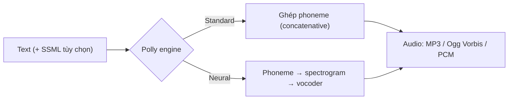

# Polly

> **TL;DR:** Amazon Polly chuyển **text → speech** nghe tự nhiên ("lifelike"). Text ở ngôn ngữ nào thì giọng nói ra ở **đúng ngôn ngữ đó**. **Polly không dịch.**

## 🖼️ Sơ đồ
![[Polly.excalidraw]]
*Mở bằng plugin Excalidraw để chỉnh sửa · ảnh tĩnh: [[Polly.svg]]*

## Khái niệm cốt lõi
- **Input**: text (một ngôn ngữ cụ thể). **Output**: audio, cùng ngôn ngữ đó.
- **Hai engine trong khóa học**:
  - **Standard TTS**: kiến trúc **concatenative**. Ghép các **phoneme** (đơn vị âm nhỏ nhất của ngôn ngữ) thành câu nói.
  - **Neural TTS (NTTS)**: phoneme → **spectrogram** → **vocoder** → audio. Tính toán nặng hơn nhiều nhưng giọng **tự nhiên, giống người hơn rõ rệt**.
  - (khóa học chỉ nói 2 engine; hiện nay Polly có thêm engine **Long-Form** và **Generative**.)
- **Output format**: **MP3**, **Ogg Vorbis**, **PCM**. Chọn theo cách tích hợp (ví dụ PCM khi đưa audio thô sang dịch vụ khác).
- **SSML (Speech Synthesis Markup Language)**: chèn thẻ vào text để điều khiển *cách* Polly nói:
  - nhấn mạnh (**emphasis**) một phần câu,
  - **pronunciation**: phát âm theo cách chỉ định,
  - **whispering**: nói thì thầm,
  - kiểu nói **"Newscaster"** (giọng phát thanh viên).
- **Tích hợp**: plugin WordPress để đọc bài blog thành audio, dịch vụ AWS khác cần sinh giọng nói, ứng dụng riêng qua API. Đây là sản phẩm "niche", chủ yếu dùng như một thành phần trong hệ thống lớn hơn.

## Cách hoạt động / Kiến trúc

Pipeline đa ngôn ngữ điển hình: text tiếng Anh → [[Translate]] sang tiếng Việt → **Polly** đọc thành audio tiếng Việt.

## 🎯 Mẹo thi SAA-C03
- **Text-to-speech, "lifelike speech", đọc bài viết thành audio, sinh giọng nói cho ứng dụng** → **Polly**.
- **Bẫy**: Polly **không dịch**. Đề yêu cầu "đọc nội dung tiếng Anh bằng tiếng Tây Ban Nha" → cần **[[Translate]] rồi mới Polly**.
- Cần kiểm soát nhấn giọng, phát âm, thì thầm, phong cách đọc → **SSML**.
- Đảo chiều (speech → text) là [[Transcribe]], không phải Polly.

## Liên kết
- Dùng cùng: [[Translate]], [[Lex]], [[Lambda]], [[S3 Basics]]
- Phân biệt với: [[Transcribe]] (speech → text), [[Lex]] (hội thoại hai chiều)
- Liên quan: [[Comprehend]]
- MOC: [[_MOC 21 Machine Learning]]
